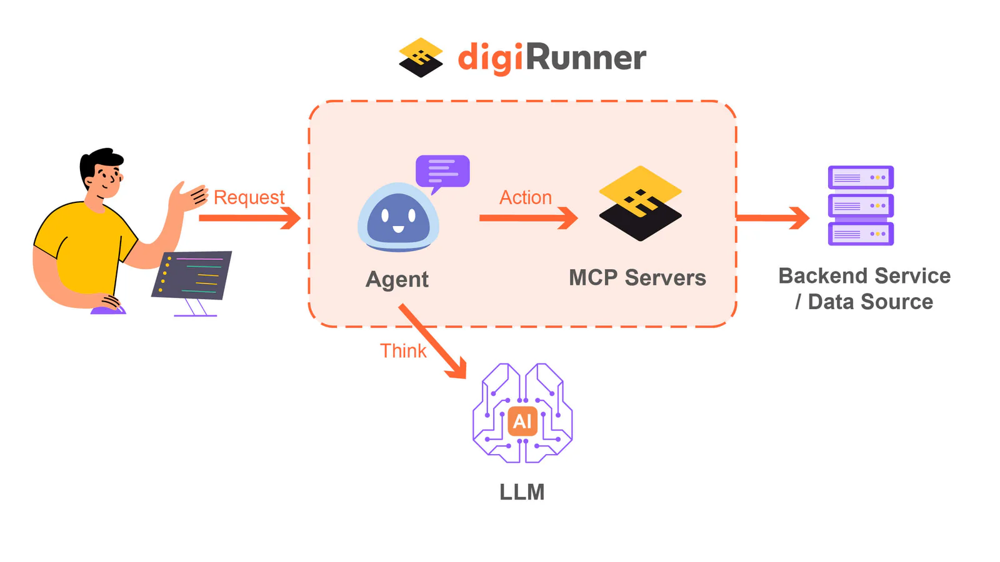

AI 改變企業的運作方式的今天，從客服自動化到智慧決策，越來越多企業希望將 AI 能力融入現有系統。但要讓 AI 模型與企業的資料、API、業務流程無縫協作，安全與整合始終是一大挑戰。

這正是 [**digiRunner**](/products/digirunner) 作為企業級 API 管理平台 (APIM) 的要解決的關鍵挑戰。隨著 MCP（Model Context Protocol）與 AI Gateway 的導入，digiRunner 正引領企業從「API 管理」邁向「AI 驅動整合」。

## MCP 讓 API 與 AI 說同一種語言

MCP 是新一代的開放協定，讓 AI 模型能以結構化、安全的方式與外部系統溝通。

digiRunner 將 MCP 深度整合進 API 管理架構中，使企業能：

-   將 AI 模型視為「可管理的 API 服務」

-   統一控管模型的驗證、流量與版本

-   以標準化格式安全地傳遞任務與上下文

換句話說，**企業不再需要在 AI 與 API 之間架橋，digiRunner 已經讓它們說同一種語言。**

### **應用情境一**：

使用者可直接在 digiRunner 以自然語言檢索、調用 API 資料，不必用人工的方式點開層層報表找資料。舉例來說，使用者直接輸入以下指令：

>  *「請給我今天新增的API清單。」*
>
>  *「今天用量前10名的API與請求次數。」*
>
>  *「今天有登入失敗的紀錄嗎？」*

MCP將擔任「翻譯」的角色，讓LLM能把指令轉譯成系統能理解的程式語言，向後台伺服器送出請求，指派 AI Agent 撈取相關資料，再回傳給使用者。

### **應用情境二**：

以「病患預約掛號」為例，使用者可用對話的方式提出需求，讓 AI Agent 完成後續流程。

> 使用者輸入：*「我這星期三上午有空，請幫我預約掛號耳鼻喉科診所的林醫師，並將掛號結果寄到我的email信箱。」*

整合 MCP 後，預約掛號流程可全自動化。AI agent 會先要求病患提供個人必要資訊，再自動呼叫相關 API，執行下一步任務如：查詢醫師班表、掛號，最後寄送通知到該使用者的email。

## AI Gateway：智慧分流，精準決策

而在這個架構中，AI Gateway 是 MCP 的智慧核心。 當企業的應用或使用者發出請求時，AI Gateway 會自動做到：

-   身份驗證與權限控管

-   任務語意分析

-   智慧分派給最合適的模型或服務 (依任務、效能、版本等)

-   統一監控回應與記錄

讓企業能同時運行多個 AI 模型服務，並在安全與效能之間達到最佳平衡。

### 為企業帶來的關鍵價值

-   **強化治理**：AI 模型、API 與內部資料流，皆受同一平台安全控管。

-   **提升效能**：MCP 與 AI Gateway 讓請求分流更智慧，效能更穩定。

-   **加速創新**：開發團隊能以熟悉的 API 流程，快速接入各類 AI 模型。

-   **跨雲靈活性**：無論模型部署在雲端、本地或第三方服務，都可一站式管理。

隨著 MCP 的崛起，digiRunner 不再只是 API 管理平台，而是企業 **AI 應用的中樞神經系統**。

將所有 API、AI 整合並透過 digiRunner 的管理，可以更快建立 AI Agent 以提高自動化和整合度。
