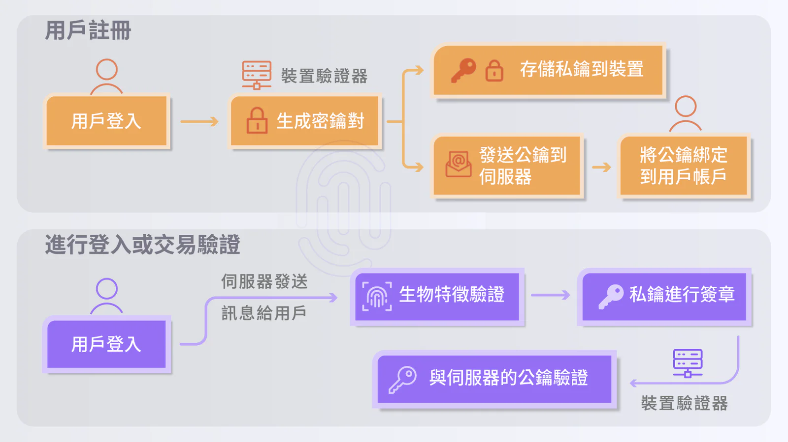

當今數位時代，網路安全威脅日益嚴重，傳統的密碼系統不再足夠應對現代的攻擊。企業和用戶都在尋求更安全、便捷的身份驗證方式，而 FIDO（Fast IDIdentity Online）是一個開放且標準化的身份驗證技術，旨在解決密碼管理的複雜性和安全性問題，這種無密碼認證方式正逐漸取代對傳統密碼的依賴。

## 什麼是 FIDO？

FIDO 是由 [FIDO 聯盟](https://fidoalliance.org/)（Fast IDdentity Online Alliance）制定的身份驗證標準，旨在取代傳統密碼，提供更安全、便捷的身份驗證方式。透過指紋、臉部辨識等生物特徵，FIDO將用戶的獨特生理特徵與裝置綁定，實現無密碼登入。Google、Microsoft、Apple、Amazon 等科技巨頭都是 FIDO 聯盟的成員，且致力推動無密碼身分驗證。

### FIDO 如何運作?

FIDO認證主要透過**生物特徵**（如指紋、面部）和安全金鑰來驗證身份。不同於傳統密碼，**FIDO使用公鑰和私鑰來保護資料**。伺服器僅儲存公鑰，私鑰則由用戶的生物特徵保管，兩者相符才能通過驗證，**且伺服器不會保存用戶的私密資料，避免數據被盜**。

FIDO 認證主要分為三個部分：

    1.驗證伺服器(FIDO Server)：負責管理用戶的公鑰並處理驗證請求。負責管理用戶的身份數據及驗證請求。

    2.用戶端(Client)：用戶的設備，能夠生成和儲存私鑰。

    3.驗證器：位於用戶端設備中，負責進行密鑰的操作和身份驗證。

### FIDO 認證的種類

FIDO 聯盟根據不同的安全需求，推出了三大類型的認證方案：

-   **FIDO UAF (Universal Authentication Framework)：** 以用戶的生物特徵作為密碼的認證方式，只需透過生物辨識（如指紋或面部識別）就能完成身份驗證，適合需要高度安全的應用環境。

-   **FIDO U2F (Universal 2nd Factor)：** 作為雙因素驗證的一部分，FIDO U2F 要求用戶在輸入密碼後，再透過硬體裝置（如 USB 安全金鑰）進行第二步驗證，大幅提升安全性。

-   **FIDO2 (WebAuthn 和 CTAP)：** FIDO2 是 FIDO 聯盟最新的認證標準，透過 WebAuthn 和 CTAP，可以利用生物識別技術或硬體密鑰，在多種裝置和瀏覽器中實現無密碼登入，並確保身份驗證過程的安全性。

### FIDO 的應用場景

FIDO 認證已被廣泛應用於多種領域，為不同產業帶來顯著的安全提升：

-   **金融業**：許多銀行和金融機構已採用 FIDO 技術，用於保護用戶的數位金融服務登入和交易，防止帳戶被網絡攻擊者盜用。台灣金管會已針對金融業制定 [金融FIDO安控指引](https://www.fsc.gov.tw/ch/home.jsp?id=1076&parentpath=0,7,478)。

-   **一般企業內部系統：** 企業內部系統經常成為攻擊目標，FIDO 認證可以大幅降低員工帳號被盜的風險，確保內部數據的安全。

-   **電子商務和線上平台**：許多電子商務網站和線上服務平台已開始採用 FIDO 認證，讓用戶能夠在不需要輸入密碼的情況下安全登入，改善用戶體驗。

### 為什麼FIDO是無密碼時代的必備利器？

這種無需記住複雜密碼的驗證方式，既提高了安全性，又簡化了使用流程。

-   **提升系統安全性：** 透過移除傳統密碼，FIDO 大幅降低了密碼洩漏和重複使用導致的安全風險，保護企業的關鍵數據。

-   **改善用戶體驗：** FIDO 允許用戶通過指紋、面部識別或安全金鑰進行快速登錄，用戶可以在不同的環境中無縫使用。

-   **降低營運支援成本：** 由於集中統一管理，未來不再需要處理大量的密碼重設請求，企業的客服與 IT 部門可以將資源轉向其他更有價值的工作。

-   **滿足合規要求：** FIDO 認證符合現代數據隱私保護的國際標準，幫助企業更輕鬆達到資安合規需求。

FIDO 不僅對於企業提升營運效益，對於使用者而言，自己就是密碼，完全省去記憶多組密碼又被駭的困擾。

### FIDO 對未來的影響

隨著數位化進程的加速，越來越多的企業將會採用無密碼身份驗證技術。FIDO 作為一種具有高度安全性和便捷性的解決方案，將在未來扮演更重要的角色。對於那些正在進行數位轉型的企業來說，採用 FIDO 認證技術不僅能保障企業數據安全，也能提升客戶對品牌的信任度和忠誠度。

FIDO 認證為我們提供了一種更安全、更便捷的身份驗證方式，gadoDIDO 是企業和用戶在面對日益嚴重的網路安全威脅時，能打造高安全性、流暢無斷點的無密碼身分驗證。
