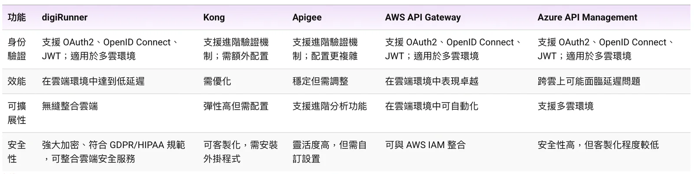

*隨著企業逐步上雲， API 管理平台愈顯重要。全球 API 管理（API Management，簡稱 APIM）市場在 2024 年至 2032 年間的年均複合成長率（CAGR）預計將達 25.9%，足見其增長之迅速。雲端解決方案具備彈性部署特性，符合企業追求的成本效益，如今 AWS、Microsoft Azure、Google Cloud 等雲端服務供應商提供多元化的服務，也讓企業擁有更多選擇，並能從中挑選符合自身需求的 API 管理平台。*

## API 管理平台那麼多，該怎麼選擇？

企業在選用 API 管理平台時應考量以下幾點：

1.  **可擴展性**：確保 API 在高流量下仍可高效運行

2.  **安全性**：利用身份驗證、加密與 API 權限控管等功能，保護數據並達成合規目標

3.  **整合靈活性**：API 管理平台能否與 AWS、Azure、Google Cloud 等雲端環境整合

4.  **易用性**：操作簡易的介面與紀錄完善的技術文件能幫助團隊快速上手

5.  **成本效益**：確保企業在優化效能的同時能掌控成本

目前市面上有各式 API 管理平台，如：Kong、Apigee、AWS API Gateway 的 digiRunner 及 Azure API Management 等，每個平台都各有優勢，無論是 Kong 具高度靈活性的微服務架構，抑或是能在雲端環境中完美整合的 digiRunner，唯有了解自身需求與基礎設施才能找到合適的 API 管理平台。

## 比較一覽表：核心功能、運作效能、可擴展性、安全性

各家 API 管理平台在流量管理、身份驗證、效能、可擴展性與安全性方面都各

有優點，以下將進一步說明。

**流量管理能力**

Kong、Apigee、AWS API Gateway 和 Azure API Management 在導流（Routing）、限流（Throttling）與速率限制（Rate Limiting）方面都表現不俗，但其效能在不同環境下會有所差異。比方，儘管 Kong 和 Apigee 的靈活性較高，但在混合雲或多雲環境中可能需要特定配置；AWS API Gateway 與 Azure API Management 在自家平台上暢行無阻，不過在其他環境中就可能遇到阻礙。

**身份驗證**

上述平台均支援 OAuth2、OpenID Connect（OIDC）和 JWT 等多種身份驗證標準。其中，digiRunner 可整合雲端身份存取管理服務（Identity and Access Management，IAM），提供全面身份存取權限管理；Kong 和 Apigee 雖支援進階驗證機制，但配置上相對複雜。

**效能**

至於效能方面，digiRunner 可 確保低延遲，而 Kong 和 Apigee 在未經優化的情況下可能難以發揮最佳效能。AWS API Gateway 在雲端環境中表現優異，而 Azure API Management 適用於多雲環境，不過就跨雲效能來看，兩者都不甚理想。

**安全性**

digiRunner 提供強大的加密、Token管理功能，並且符合 GDPR 和 HIPAA 等規範，無縫整合雲端安全服務。Kong 和 Apigee 雖提供可客製化的安全功能，但通常需要額外配置。AWS API Gateway 和 Azure API Management 在各自的環境中提供全方位安全保障，但客製化程度與靈活性不如前述幾個 API 管理平台。

## 2025 企業首選 API 管理平台 digiRunner 快速了解

管理雲端 API 相當複雜，找到一個兼具可擴展性與安全性，且能無縫整合的解決方案至關重要。digiRunner 在 雲端環境中，不僅高效控管流量、確保系統運行不間斷且安全無虞，更具備卓越的可擴展性，無論是龐大的負載，抑或是因應組織業務成長，這些需求 digiRunner 都能一一滿足。digiRunner 雲原生容器化佈署架構提供各場景高可用、安全可靠的數位服務，全面強化 API 管理，確保關鍵系統運行，賦能企業保有競爭優勢。

### 立即前往 [digiRunner on Cloud](/products/digirunner-cloud) 以了解企業可如何佈局 API 策略藍圖。
