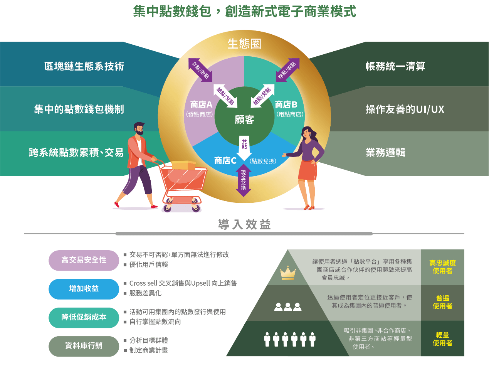
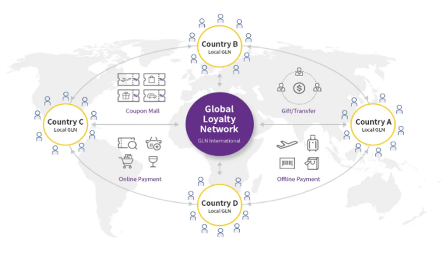

一言以蔽之, 現今市場上的客戶忠誠系統與新點數經濟之於我們的日常生活, 可說是已然結合到了密不可分的程度. 許許多多的相關市場調查報告指出, 目前最夯最熱門的話題, 莫過於新型態點數經濟如何潛移默化影響了消費者的消費行為. 為了應對發展日趨成熟, 多元化的回饋點數經濟與其延伸, 各種使用場景與應用的界線也漸漸模糊. 舉凡數個成功的跨品牌、跨平台，甚至跨境的點數商務模式, 各個志欲搶得市場先機, 拔得頭籌. 也都曾不免俗的走過一段從閉門造車到大破大立的經歷. 彷彿為此百家齊鳴的市場揭開了新一波圈地之戰。

對金融產業來說，2020年有幾個象徵性議題: [Fintech](/#FT), [Open Banking](/industries/finance), 與純網銀的崛起. 除了要滿足種種市場需求上的挑戰，又因Covid-19的疫情肆虐. 更大幅推動了零接觸經濟興起. 傳統金融業以高於其他產業的速度投入數位轉型。身為主管機關的金管會加碼提出的整合電子票券及電子支付的電子支付機構條例草案(1 <em>)(註釋1)</em>，計畫將開放電支機構辦理點數整合平台業務。多數銀行業者也嗅出點數新商機，陸續招攬異業結盟並向金管會爭取開放銀行發行信用卡紅利點數以外的新型紅利點數，進而邁向點數整合平台業務。

顯而易見的，如果能允許消費者便利的兌換手中來自各個不同大型點數平台之紅利點數。例如Open Points、Line Points、UUPon 和HappyGo等等… 那麼這種的升級版的客戶忠誠系統與新型紅利點數勢必會比以往的點數更受歡迎也更具競爭力。畢竟傳統的紅利點數限制了只能從原消費的電商或商家之通路與渠道來兌換。舉例來說，累積的Open Points只能在7-11的商家進行打折或兌換，而累積的 Line Points 也僅限於交換貼圖或在 Line電商消費。然而若是能夠以單一平台串連這幾套大品牌消費點數方案，讓消費者能夠真正地實踐A處獲點B處兌換的概念。針對真正喜歡且有需求的商家與商品，進行有效率的轉點與消費手上擁有的所有紅利點數。對於平台、企業與網銀合作聯盟來說，經由串聯客戶忠誠系統，整合完整的 CRM，並善用消費者的消費行為資訊可以有效的提升再行銷效率。藉由有效的利用 Open data、大數據分析、人工智能與深度學習等科技，再匯整入行銷科技類產品服務(MarTech)，以打造更優質的用戶體驗及行銷自動化優勢。就算對象曾經是非契合或非主流的消費族群，依舊以高客製化度的行銷方案，或等待準備好了更貼近他們需求的產品後，再執行精準行銷。

過往十年間，客戶忠誠系統與紅利點數已經證實是為有效率的顧客維繫方式，也能夠提升顧客終身價值並鼓勵客戶圈粉，雖然某些舊世代灑大網捕小魚的行銷手法仍對許多傳統產業有一定的回饋效果，但是如何有創意的設計新式的客戶忠誠系統來吸引客群提升黏著度才是真正有價值的存在，對於企業財團來說，首要面對的挑戰是如何有效率的建置， 導入並善用雲端服務、人工智能、大數據分析、Fintech甚至區塊鍊等技術開創業務新局，深植客戶忠誠度? 即便在方針目標確立之後，邁向開放金融新時代的同時，如何能兼顧服務創新、資安議題和法規合規？例如國泰集團就為市場做了優良的示範。早在2018就預先布局建置區塊鍊，並聯手昕力資訊聯手打造設計點數整合平臺與小樹點之鍊上服務<em>(2)</em>，目的就要打造一個能整併多種點數的單一平臺，甚至要讓使用者直接搭配混用不同類型的點數，來兌換一款想要的商品。

*整合多種點數的平台系統，打造創新商業模式*

或許有些追求效率的用戶會提出存疑, 紅利點數整合平臺有必要上鍊嗎? 若單純以運算與反應速度的角度來說, 其實是非必要的. 傳統的數據庫足以對一個點數平臺提供快捷的服務. 但是若用鉅細靡遺方式來回答這個問題, 哪麼就要考慮到此平台未來的應用需求當中, 是否有包含絕對的資訊安全、無法竄改的賬本與資料流交換以及節點間一致性問題與共識演算法. 上述的種種都讓建置紅利點數整合平臺在區塊鍊上具備了無可替代的優勢。

1.  堅不可駭的高安全性. 在分散式系統中, 只要是資料相關的服務在多集群運作, 就會面對資料的同步問題、主從問題, 而這就是所謂的節點一致性. 任何性質的平台都不例外. 但由於區塊鍊的建置強調了共識演算法與工作量證明, 換句話說, 既使駭客程式在鍊內有心破壞竄改資料, 也必須有50% 以上的節點認同, 又或者破壞一半以上的網路才行, 由於需要龐大的運算與資源成本所以不符合駭客程式的邏輯, 就算是想要從單一節點中的單一資料點進行竄改, 也必須被鍊內所有的節點認同才可以繼續在鍊上作執行..

2.  有利於會計結帳與法務契約, 由於區塊鍊擁有執行智能合約特性, 當中內含了程式碼函式, 能在符合特殊條件下自動與其他合約進行互動、做決策與儲存資料. 應用上非常的適合記帳, 法務或各式合約自動化. 節省了來來去去的實體簽名授權與律師背書這些時間與人事成本.

3.  未來的發展性. 如果在架構上有長期發展的設計考量, 除了採用雲端原生還有微服務建置以外, 還可以建立一套統一共識演算法. 日後若需要與外部公司或與其他聯盟鍊合作整合, 就可以直接在雲端部署對方所需的節點. 然後只要修改底層, 用共識演算法調參數, 就能快速佈置並符合集團不同業務需求.

所以關於點數整合平臺究竟需不需要上鍊這個問題, 只能說端看各企業與投資方的願景與遠見了. 以國泰與昕力的開發案例來說,「相較於單打獨鬥, 區塊鏈更適合跨公司、跨產業一起把餅做大.」 *(3)*

究竟該如何規劃與深耕客戶忠誠系統與點數平台的下一步, 才能夠對未來帶來效應與衝擊呢? 其實可以從兩個面向來部屬.

向上整合: 因為市場的熱度影響, 大小企業都忙著自己在企劃屬於自己的紅利點數平台方案. 於是衍生出來一些市場漣漪效應. 對消費者來說, 究竟那個平台最實用? 究竟那些紅利點數使用兌換起來的性價比最高呢? 目前國內外已經有數個大型的紅利點數回饋聯盟, 所以真正串連起這些個大小平台並訂出一套標準的點數換算機制讓點數可以自由流通才算是提供消費者所渴望的標準答案. 相關的跨國際範例像是台新銀行與韓國韓亞金融集團旗下韓亞信用卡公司合作，宣布開通 GLN (GLOBAL LOYALTY NETWORK全球紅利點數聯盟) (4 )HANA MEMBERS跨境支付. 此平臺讓會員國在跨境支付上, 不僅能透過綁定銀行帳戶、信用卡進行支付, 還能跨境兌換點數. 所以就算是在旅行時的消費或是在使用跨境電商都能累積紅利點數並兌換商品

*【 全球紅利點數聯盟 GLN ( Global Loyalty Network ) 】(4)*

同理可歸納, 當一個具公信力的組織或平台能夠聯合政府機關以及其他大品牌的紅利點數回饋聯盟來整合彼此間的點數. 讓不同種類的點數，能在同一個平臺中合併兌換商品. 又或是透過商業邏輯上的設定, 讓用戶能在特定通路或情境, 來使用特定種類的點數. 再來就是先前提到的紅利點數交換機制. 一旦能夠達成這些個遠程目標, 不只是讓消費者得利, 也勢必連帶的刺激整個市場消費經濟.

向下延伸: 以現今的市場機制來說, 絕大多數的紅利點數兌換都是針對實體商品而設計的. 事實上, 我們也可以考慮上客戶使用紅利點數兌換服務、體驗或者購買優先權. 取經國外 Amazon Prime 的會員機制, 客戶可以善用其累積的點數換取快捷的物流與收貨速度, 又或者是對於限定商品的優先購買權.

創意無限: 對於紅利點數整合平臺之應用, 我們仍然有許多的機會能夠開發與發揮創意.

慈善與社會責任導向. 現今社會上除了紅十字會、慈濟以外, 其他一些較小型的慈善機構比較沒有財力物力去開發好的樂捐平台. 就算有, 大多時候由於不明確的金流也會讓有愛心的民眾望之怯步. 在街上人力倡導樂捐的方式有時候也會讓民眾反感. 對於需要幫助的人與動物來說, 若是紅利點數整合平臺建置在區塊鍊上, 並提供完善開放的金流資訊與合法文件. 方便支付並杜絕詐騙與洗錢的可能性. 那麼相信許許多多的愛心人士都會樂善好施. 讓消費的每一分的紅利點數都更有意義.

娛樂與電競. 電競相關的花費已經是市場上一股無法忽視的消費力量. 對於電競電玩有愛好的玩家們, 想必對知名品牌誠如索尼的PlayStation points、Google play point 以及 微軟的 Rewards points都不陌生. 可惜的是這些個玩家每天都會碰到的紅利點數都缺乏平台間流通的介接. 若是能與大型電競網站如IGN 或 twitch整合讓紅利點數可以互換流通. 想必訂閱、流量與兌換率都會大幅提升.

虛實點數整合. 中小型企業是每個國家年度國內生產總值的重要推手. 然而大多中小型企業與傳統產業並沒有能力與經費去執行數位轉型, 甚至建立數位化的客戶忠誠系統. 只要平臺能提供模組化的數轉服務, 許多公司行號發放的實體紅利點數如餐飲小吃集點、加油站點數、超市會員點數、高鐵會員點數、秀展會議點數和旅館集團會員點數等等. 都是有潛力的平臺合作整合對象.

所謂「隨經濟」(5)是未來經濟與金流發展的大方向. 消費者不單單的只是想消費產品而也會考慮到隨時(anytime)、隨地(anywhere)、隨人(anyone)、隨終端(any device)、隨支付(any payment)、隨通路(any channel)以及紅利點數回饋等體驗與附加價值. 商業模式不能拘泥於一成不變, 過去和現在的商業模式都無法保證未來的成功. 紅利、管理及創新是任何企業的成長動力. 然而在紅利散盡、管理極致後, 不創新便只剩下邊緣化與淘汰一途. 提早改革, 建立平臺整合並優先突顯出整合優勢與差異化因為客群的訴求已經不同以往越來越多元化了. 點數經濟與平臺很有可能就是眾多企業不容錯失的未來商機與下一桶金.

註釋1：至於點數整合平台業務, 金管會初步規劃, 將有三大重點, 包括:

-   第一, 點數必須是無償取得, 例如行銷或消費後贈送的點數.官員表示, 如果用錢買點數, 再拿點數消費, 就像儲值在悠遊卡、再拿悠遊卡購物一樣, 涉及儲值、吸金, 就非單純的點數.

-   第二, 點數整合平台的點數來源, 包括電支機構的點數及銀行的信用卡紅利點數等, 只要是無償, 原則上不會限制, 由合作的業者自訂.

-   第三, 須揭露相關權益, 包括點數到期無效, 轉換點時, 有效期限等資訊充分揭露, 以避免糾紛.

1 Data source: [https://udn.com/news/story/7239/4927789](https://udn.com/news/story/7239/4927789)

2 Data source: [https://www.ithome.com.tw/news/140994](https://www.ithome.com.tw/news/140994)

3 Data source: [https://www.bnext.com.tw/article/59338/cathayholdings-blockchain–alliance](https://www.bnext.com.tw/article/59338/cathayholdings-blockchain%E2%80%93alliance)

4 [Data source](https://medium.com/wishmobile/%E6%8B%89%E9%96%8B%E8%88%87%E5%B0%8D%E6%89%8B%E7%9A%84%E8%B7%9D%E9%9B%A2-%E9%BB%9E%E6%95%B8%E4%BD%BF%E7%94%A8%E5%A0%B4%E6%99%AF%E6%B2%92%E6%9C%89%E6%A5%B5%E9%99%90-%E8%B7%A8%E5%A2%83%E9%BB%9E%E6%95%B8%E9%80%9A%E7%94%A8%E5%B9%B3%E5%8F%B0%E6%87%89%E9%81%8B%E8%80%8C%E7%94%9F-af8267db7d88)

5 Data source: [https://www.facebook.com/happyfans.lu/posts/817369341632766/](https://www.facebook.com/happyfans.lu/posts/817369341632766/)
