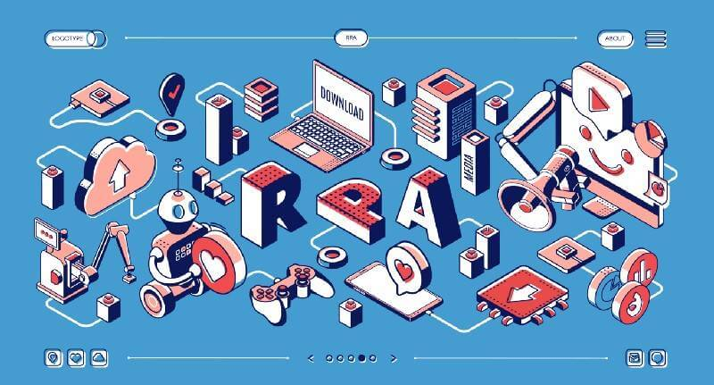

*企業流程不斷變動，既有系統無法自動化執行現有流程，導致作業耗費人力、組織效率低落，要如何提升作業效率，同時又不承擔汰換既有系統的風險呢？本文介紹最容易導入的數位勞動力解決方案：RPA。*

## RPA是什麼？打造企業專屬數位員工 自動執行工作流程

機器人流程自動化(RPA, Robotic Process Automation)受[《富比士》評選2020十大數位變革趨勢第六位](https://www.forbes.com/sites/danielnewman/2019/07/14/top-10-digital-transformation-trends-for-2020/)，是實現數位勞動力的一種解決方案，以軟體模擬辦公室人員操作電腦的動作，依照操作步驟設計規則與邏輯判斷建立自動化作業處理流程，適合用於代替員工執行大量耗時且重複的工作。

*RPA是什麼？(Created by vectorpouch)*

簡單來說，RPA就像是電腦裡的小精靈，可以自動幫員工執行必須的例行工作中最瑣碎、最耗時、生產率最低的事情！讓員工得以用有效率的方式完成原本耗時費力的工作，專注在分析決策、思考創造等更重要的事務上。

《富比士》評選2020十大數位變革趨勢

1.  5G for You and Me

2.  A faster WiFi for a faster world

3.  Analytics are the Competitive Advantage

4.  AI and Machine Learning become force multipliers for data analytics

5.  Blockchain moves beyond Crypto

6.  RPA catches a second wind

7.  Conversational AI becomes a legitimate interface

8.  ACPCs transform the laptop market forever

9.  Connected vehicles, autonomous drones and Smart Cities become our new reality

10.  XaaS, UX/CX, and privacy: How technology-adjacent Digital Transformation trends will take to center stage in 2020

* * *

## 我適合用RPA嗎？先觀察作業流程有沒有這些問題

想知道導入RPA是否能大幅改善效率，可以由觀察辦公室作業流程開始，回想一下辦公室人員工作的情景，符合以下哪幾點呢？

### #1 既有系統未整合完全，需從多個系統匯整資料

製作例行報告時，員工都需跨系統進行資料匯出、處理彙整、格式轉換等工作，才能完成報表製作、填表申請等作業。

### #2 作業涵蓋大量人為重複性操作，耗費過多時間且易出錯

部門員工將大部分的時間花在重複性操作事務，如: 將訂單匯入系統、人資的新人報到手續包含檔案整理、寄送與系統開通等等、財會部門憑證審核與費用報銷、或者電商頻繁操作系統上下架商品。

### #3 企業流程變動，現有系統僅能執行片段作業需求

系統不適用於現有作業流程，輸出的資料不符合使用需求，本應自動化的部分需由人員手動操作執行補足。

### #4 人員異動頻繁，需不斷訓練新人

人員因大量重複性工作內容，工作成就感低易感厭倦而異動，部門需頻繁訓練新人、並承擔新人熟悉操作步驟的錯誤陣痛期。

如果辦公室符合以上狀況，代表RPA可以幫助改善流程！RPA除了有即時快速執行、與低失誤率等優點之外，也可降低人員異動的訓練時間成本，並因應作業量增減隨時擴展人力，有效提升辦公室作業流程效率。

### 流程自動化怎麼選？RPA vs. 建置新系統

除了導入RPA之外，企業若要提升內部作業流程自動化的程度，更直覺的方法是建置新系統。導入RPA相較於建置新系統，哪個更加適合呢？以下從既有系統的相容性、開發時程、導入風險、後續修改彈性來看看兩者差異。

與新建系統相較，RPA可隨時編寫修改自動化的操作設定，在作業流程不斷在改變的情況下，企業不會被綁死在預設的系統功能規格，可依變動隨時編輯調整自動化操作，後續修改彈性高。

從現有系統相容性考量，RPA為基於現有系統操作流程設計自動化作業內容，可配合現有資訊架構，快速融入工作流程，企業也不需承擔更動既有系統的風險，也可以讓員工更有效率地執行工作內容，與無法汰舊的老舊系統共存。

### RPA優勢 #1不影響現有資訊架構、#2彈性高 #3開發時間短、#4導入風險低

### 實現數位勞動力第一步 導入RPA提升組織效率

RPA的優勢使其成為最容易、也最能快速導入的數位勞動力解決方案，且採用後可快速感受到效果差異，因此是近幾年企業積極採用作為降低成本的解決方案。

後續也能將AI解決方案整合進工作流程當中，如整合NLU(自然語言理解技術)、OCR(光學字元辨識)，成為具AI功能的IPA(Intelligence RPA)，進一步加強數位員工的處理能力，更靈活因應企業使用場景。

根據估計，RPA可以幫助企業降低25-50％的成本。
