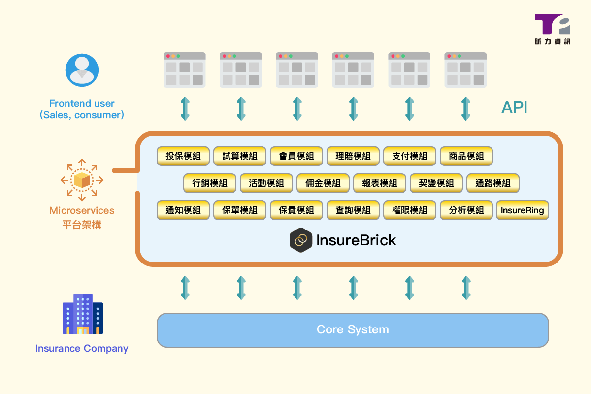

*昕力資訊保險科技暨數位應用處處長鄭宇茜表示，保險商品正朝向與電子商務結合的趨勢，未來在選購網路保險的使用者體驗、操作介面，會變得更友善且輕便。（首圖來源：科技報橘）*

還記得今年 1 月讓民眾漏夜排隊、創下保險業最熱賣紀錄的防疫保單嗎？隨著防疫險及疫苗險都已列入網路投保業務範圍，未來民眾親自至現場搶購且大排長龍的景況，可能有望走入歷史！

<strong>非接觸式經濟快速興起、年輕族群習慣用電商網購，加上主管機關金管會鼓勵數位金融的發展，以上因素都正促使網路投保成為重要科技趨勢。</strong>然而，網路投保的行銷方式，非常不同於傳統透過保險業務員或保險經理人的業務模式，傳統保險公司或銀行兼營保險代理業務該怎麼把握這波數位轉型浪潮，抓住迸發的網投保險商機？

## 用數位行銷手法賣網路保險商品，首重用戶體驗與品牌經營

網路投保自 103 年金管會開放經營，至今已開放十多種壽險/產險商品能透過網路銷售，其中包括今年新增的防疫綜合險。根據金融資訊網站 Money101 的調查，台灣有 3 成民眾有網路投保經驗，而 5 成民眾未來會考慮網路投保；據台灣聯合信用卡處理中心統計，**110 年 1 至 5 月網路投保的信用卡交易筆數達到 59 萬筆，較 109 年同期的 41 萬，大幅成長了 43.9%**。對消費者來說，選擇網路投保最大原因是快速便利及價格較優惠，而個資安全也是消費者重視的因素之一。

提供金融資訊服務起家、已有多年網投系統建置經驗的昕力資訊保險科技暨數位應用處處長鄭宇茜表示，近年純網銀開始上路，預料**純網銀業者也會跨入網路投保業務市場，再者，隨主管機關逐步放寬保險業者辦理電子商務適用範圍，保險商品正加速朝向與電商結合的趨勢發展**。例如在航空公司網站買機票時或預訂飯店民宿時順帶買旅平險、防疫險、跨境電商商品順帶含產物險等，「未來很可能在不經意之間就買保險了，」鄭宇茜說。

不僅如此，**網路投保必須結合數位行銷的手法，並且重視品牌的經營**。鄭宇茜進一步指出，為了抓住疫情帶動的網路投保商機，除了保險公司紛紛改版既有網路投保網站外，許多保險經紀人/代理人公司也加緊建置網投網站，這時消費者便會依照品牌印象來決定到哪個管道購買保險商品，而使用者的操作體驗與操作介面設計（UX/UI）是否夠直覺，能否讓使用者不需等待就能獲得所需資訊等，都會是保險網站吸引消費者下單的關鍵。

鄭宇茜談到，現在網路投保的保險商品也有精簡化的趨勢，例如新車全險不再需要一次花數萬元買一整年的保障，而是可以在長途旅行駕駛時才購買短天數的汽車全險。**在這樣依照需求彈性選購的趨勢中，消費者最期待的即是網站能提供快速便捷的核保、審核機制**。

### 昕力資訊保險科技模組化設計，減少 7 成系統建置時間、高速回應市場

對於可能會存取機敏資料之第三方服務業者 (TSP)，需設有金鑰發放、傳送及保密等控管機制。API 管理平台不會儲放機敏機資料，平台在傳輸資料時，會採用JWT/JWE/JWS等加密機制；因此第三方服務業者若有存取敏感性資料的需要，平台的管控機制能確保金鑰發放、傳送與加密符合金檢規範。

對此，昕力資訊保險科技解決方案與服務具備以下相應特色，為的就是滿足上述使用者對前端操作介面的需求，亦能提供高效能的中台審核服務機制。

首先，系統採模組化的設計，能提供保險業快速建置網路投保平台的 **InsureBrick，共有包含會員、商品、投保、試算及支付在內 19 個模組**，可依客戶需求彈性組合模組，也可串接客戶既有系統或外部系統，如電訪系統、規則引擎、公會等。InsureBrick 各模組可以被理解為一塊塊的「磚」（brick），皆具備獨立性及彈性，方便單一導入客戶的保險系統，或是和其他模組合併運用。

*InsureBrick 涵蓋會員、商品、投保、試算及支付在內 19 個模組，可依客戶需求彈性組合模組，也可串接客戶既有系統或外部系統。（圖片來源：昕力資訊）*

而在實際成效方面，InsureBrick 不僅可以幫助商業邏輯集中，也避免過度分散的邏輯程式，以降低資源重工並提高維護效率，加快商業反應速度，為保險業提升服務效率加值。整體彈性靈活度高的模組化設計，就是在為保險業客戶量身打造服務的同時，減少保險業**高達 70% 的網投平台建置時間，也有助降低建置成本**。

此外，系統採微服務架構規劃設計，能彈性擴充資源，並支援在地或雲端部署，當未來又**有特殊保險商品在線上熱賣時，微服務的架構即可防止瞬間爆量而使系統服務塞車或中斷**。同時在系統安全方面，採網銀標準規劃建置，符合金管會對網路投保的規範。

又以身份認證來說，昕力資訊能幫助客戶快速打造消費者註冊會員時、下單及付款時都需經過的動態密碼（OTP）驗證程序，而在資料安全性，除了基本的在資料傳輸時、儲存時的加密保護外，也採用更嚴謹的區塊鏈技術，將同一筆資料分散式存放，以杜絕資料外洩風險。

展望未來，當網路投保如同電商市場一樣迎向爆發性成長，昕力資訊作為保險業 IT 的後盾，希望能以最快速的提供平台服務，滿足保險業回應市場的需求，持續深耕台灣並打進東南亞市場，同時也成為技術研發的後盾，永遠走在前端解鎖新科技與架構。再者，像是近期保險業界熱議的遠距投保，昕力資訊是最佳整合商，整合集結視訊、人臉辨識、身份證影像辨識等解決方案，在法規正式通過即可因應市場需求提供服務。最後，昕力資訊也盼保險科技能與醫療服務結合，**往後透過異業合作來打造共榮共存的保險醫療生態圈，為台灣在地、國際市場激盪更實用且更有競爭力的服務**。

本文轉載自[科技報橘](https://buzzorange.com/techorange/2021/10/19/tpisoftware-online-insurance-ecommerce-trend/)。
