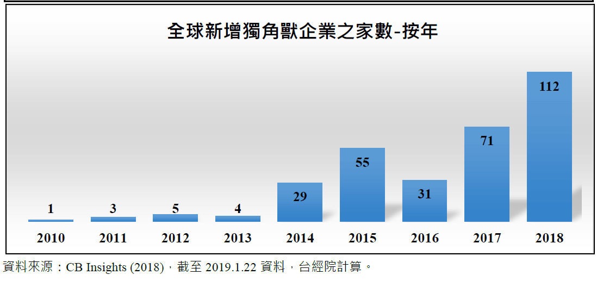

Fintech是這幾年很夯的話題，在日常生活中，隨手可見Fintech的應用。從超商自助結帳、無卡提款、手機號碼轉帳，到對著手機講話即可完成銀行帳戶明細查詢或轉帳，一切切都可以看到Fintech的運用。加上2020年疫情的影響，宅經濟更加蓬勃發展，也連帶帶動了Fintech的發展速度。

近年來大量資金湧進私募市場，因此出現不少獨角獸企業。所謂獨角獸企業，是指估值超過10億美元尚未上市的私人企業。根據CB Insights的統計，2013年新進獨角獸俱樂部的公司僅39家，到了2019年則暴增到151家。此外估值成功超過100億美元的初創公司則被稱作十角獸（decacorn）。

*CB Insights統計2010年至2018年全球新增獨角獸企業之家數*

十角獸企業非常少見，因為估值超過100億美元的企業，幾乎都已經是上市公司。在這些十角獸當中，有一家為Fintech公司，即總部位於矽谷的加密貨幣、股票、選擇權及基金交易平台Robinhood。Robinhood為一家美國券商，於2013年成立，自許為劫富濟貧的羅賓漢，劫華爾街企業的利潤給一般消費大眾，以零手續費、零佣金的方式打入證券市場，成為年輕人最愛的投資工具。從2013年成立迄今，共擁有1300萬用戶數\[1\]，而單單2020年前七個月，便增加300萬用戶。

傳統券商最大的收入來源就是手續費，而Robinhood則打破了這個遊戲規則，逼得華爾街券商也紛紛調降手續費。除了手續費這項創新，Robinhood提供一個Robinhood gold的融資方案，只要每個月5元美金，即可借到帳戶裡現金餘額一倍的額度，但條件是現金餘額須保持在2000美金之上(傳統方式是收取利息)。

Robinhood用戶平均年紀31歲，能夠吸引這群投資市場新手的原因，除了免手續費之外，APP的使用者介面風格清爽簡便，流程簡單，沒有過多的資訊，完全是年輕族群慣用的APP介面，但是對投資老手而言，則是投資資訊遠遠不足。Robinhood同時採用推薦機制，推薦朋友加入會員，不論是推薦人與被推薦人都會有系統隨機贈送的股票（價值2.5美元至200美元），總獎勵無上限，整個產品設計思維完全打破傳統股票下單平台。

但是，Robinhood也備受爭議。今年美股因資金行情，股價節節創新高，投資新手最怕賺錢，賺錢就忘記投資有風險。因此吸引這群投資新手不斷的加大投資槓桿，融資及選擇權通通用上，也因此發生憾事。今年六月一個美國大學生以為自己投資失敗負債730,165美元，因此輕生。實際這個數字僅是選擇權交易過程中系統暫時呈現的數字，實際的負債並沒有這麼高。

此外，雲端系統最重要的就是系統安全性與負載量。今年3月美股大跌又急速反彈以及8月份特斯拉大漲，都造成了成交量異常放大，Robinhood平台上的散戶也趁機大量進場，導致系統癱瘓而發生停機數小時或是系統緩慢的現象。因為這些連續出包狀況，並且消費者投訴無門(無客服人員)，導致大量對Robinhood的申訴書送往主管機關，也引來了美國證管會（SEC）和金融監管局（FINRA）調查。

Robinhood雖然引發一些爭議，但是其設計思維及商業模式確實值得傳統投資平台參考。成立短短七年時間，成為全美最受歡迎的投資平台，種種的創新逼得傳統券商也陸續跟進，因為免交易手續費已經逼得摩根大通 (JP Morgan)、第一理財 (Firstrade) 等證券商也開始不收手續費了。後續還會有哪些創新，又能引起市場哪些效應，據傳Robinhood準備2021年第一季IPO，是否能成功，一切都拭目以待。
