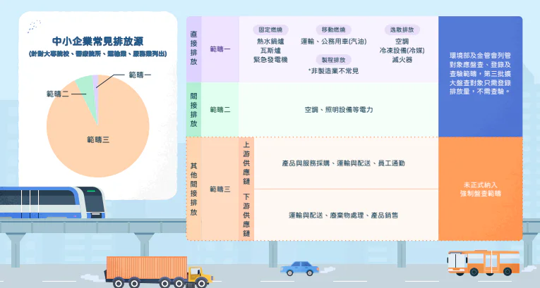

許多中小企業在啟動**碳盤查**時，往往抱著「先做做看」的心態。起初，收集電費單、計算公務車油錢等等（範疇一與範疇二）似乎並不困難。然而，當進展到<strong>範疇三（Scope 3）</strong>時，高達 80% 的企業會因為數據過於龐雜、無法取得供應商資料而感到挫折，甚至導致專案停擺。

根據[國際碳揭露專案（CDP）](https://cdn.cdp.net/cdp-production/cms/reports/documents/000/007/834/original/Scope-3-Upstream-Report.pdf)的數據顯示，對於大多數製造業與零售業而言，範疇三的排放量通常佔據整體碳排放的 70% 至 90%。這意味著，如果你只計算了範疇一與二，這份碳盤查報告實際上只揭露了不到三成的真相。

企業主可能會問說：「為什麼我必須為別人的排放負責？」而這正是範疇三最大的誤解與挑戰所在。它不僅僅是計算數字，更是一場涉及上下游溝通的隱形戰役。

本文將一步一步拆解範疇三的執行關鍵：範疇三到底要算什麼？中小企業又該如何有效搞定它？

## 什麼是範疇一、二、三？一次搞懂差別

為了符合 [**GHG Protocol**](https://ghgprotocol.org/sites/default/files/standards/ghg-protocol-revised.pdf) 與最新 [**IFRS S2**](https://www.ardf.org.tw/tifrssustainable/IFRS%20S2%20Climate-Related%20Disclosures.pdf) 的合規要求，我們必須釐清三大範疇的定義。若您希望在碳盤查中精準揭露資訊，第一步便是清楚界定這三者的邊界。

**範疇一（Scope 1）：直接排放**

-   **定義：** 來自企業「擁有」或「控制」的排放源。

-   **案例：** 工廠內的鍋爐與熔爐燃燒、公司自有公務車的油耗，以及製程中化學設備的逸散排放。

**範疇二（Scope 2）：能源間接排放**

-   **定義：** 企業外購能源（電力、蒸氣、熱能）所產生的排放。

-   **案例：** 台電的電費單（外購電力）。

**範疇三（Scope 3）：其他間接排放**

-   <strong>定義：</strong>除了範疇二以外，發生在企業價值鏈（上下游）中的所有排放。

-   **案例：**  員工通勤、商務出差、原物料採購、產品運輸物流、產品售後使用、廢棄物處理。

## 為什麼範疇三是中小企業最難完成的碳盤查項目？

看完上述分類準則後，你會發現範疇一、二就像算「自家內帳」，數據都在手邊；而範疇三則是算「外部連帶責任」。這也是為什麼在碳盤查的過程中，範疇三最容易卡關，而原因主要集中在以下三點：

**原因一｜排放數據掌握在供應商手中**

要計算原物料的碳排放，需要上游供應商提供數據。然而，許多供應商可能毫無碳盤查的概念，這導致企業必須花費大量人力使用 Email、電話反覆追殺數據。收回來的資料格式往往五花八門：有的是 PDF，有的是手寫紙本，數據單位更是混亂（公斤、箱、棧板）。這種無效的溝通與資料清理過程，往往消耗了專案團隊大半的時間。

**原因二｜計算項目繁多，實務上最容易漏算**

在進入複雜的盤查前，首先要釐清兩大主流標準的差異。ISO 14064-1 是由國際標準化組織發布的「國際標準」，也是臺灣企業目前進行查驗時最常採用的依據；而 GHG Protocol 則是 WRI 與 WBCSD 共同制定的「國際倡議指引」，更是全球供應鏈與 SBTi 填報的共通語言。

下表為您整理兩大標準的分類對照，幫助您在進行碳盤查時，快速對應正確的歸類：

<table><tbody><tr><td colspan="4">
<a href="https://ghgprotocol.org/sites/default/files/standards/Corporate-Value-Chain-Accounting-Reporing-Standard_041613_2.pdf"><strong><u>溫室氣體議定書 (GHG Protocol)</u></strong></a>
</td><td colspan="2">
<a href="https://www.tmts.tw/storage/tmba/1.%E6%BA%AB%E5%AE%A4%E6%B0%A3%E9%AB%94%E6%8E%92%E6%94%BE%E9%87%8F%E7%9B%A4%E6%9F%A5%E8%AA%AA%E6%98%8EISO14064-1.pdf"><strong><u>ISO 14064-1</u></strong></a>
</td></tr><tr><td>
範疇一
</td><td>
直接排放
</td><td colspan="2">
固定燃燒、移動燃燒、逸散排放、製程排放
</td><td>
類別 1
</td><td>
直接溫室氣體排放與移除
</td></tr><tr><td>
範疇二
</td><td>
能源間接排放
</td><td colspan="2">
外購能源
</td><td>
類別 2
</td><td>
由輸入能源產生之間接溫室氣體排放
</td></tr><tr><td rowspan="16">
<strong>範疇三</strong>
</td><td rowspan="16">
其他間接排放
</td><td>
類別 4
</td><td>
上游運輸與配送
</td><td rowspan="4">
類別 3
</td><td rowspan="4">
由運輸產生之間接溫室氣體排放
</td></tr><tr><td>
類別 6
</td><td>
商務差旅
</td></tr><tr><td>
類別 7
</td><td>
員工通勤
</td></tr><tr><td>
類別 9
</td><td>
下游運輸與配送
</td></tr><tr><td>
類別 1
</td><td>
採購之商品與服務
</td><td rowspan="5">
類別 4
</td><td rowspan="5">
由組織使用的產品所產生之間接溫室氣體排放
</td></tr><tr><td>
類別 2
</td><td>
資本財
</td></tr><tr><td>
類別 3
</td><td>
燃料與能源相關活動
</td></tr><tr><td>
類別 5
</td><td>
營運產生之廢棄物
</td></tr><tr><td>
類別 8
</td><td>
上游租賃資產
</td></tr><tr><td>
類別 10
</td><td>
已售產品之加工處理
</td><td rowspan="6">
類別 5
</td><td rowspan="6">
與組織的產品使用相關連之間接溫室氣體排放
</td></tr><tr><td>
類別 11
</td><td>
已售產品之使用階段
</td></tr><tr><td>
類別 12
</td><td>
已售產品生命週期終端處理
</td></tr><tr><td>
類別 13
</td><td>
下游租賃資產
</td></tr><tr><td>
類別 14
</td><td>
加盟體系
</td></tr><tr><td>
類別 15
</td><td>
投資活動
</td></tr><tr><td></td><td></td><td>
類別 6
</td><td>
由其他來源產生的間接溫室氣體排放
</td></tr></tbody></table>

面對以上眾多類別，企業常犯的錯誤是「想一次抓齊」，結果導致數據缺漏或專案難產。然而，項目繁多之餘，數據散落在採購、人事、總務等互不相通的部門裡，常因缺乏跨部門整合工具，導致資料東漏西補。

**原因三｜係數來源混亂，難以通過第三方查證**

即便要到了活動數據，選擇正確的「排放係數」又是另一個難題。市面上的係數資料庫（如 [IPCC](https://www.ipcc.ch/), [Ecoinvent](https://ecoinvent.org/) 或[環境部產品碳足跡資訊網](https://cfp-calculate.tw/cfpc/WebPage/WebSites/CoefficientDB.aspx)）更新頻率不一。若企業誤用舊版係數或錯誤分類（例如將「回收鋁」算成「原生鋁」），在第三方查證時極易被開缺失，甚至被認定有「漂綠」嫌疑。

## 中小企業該如何有效管理範疇三？實務做法解析

既然範疇三如此困難，中小企業該如何著手？對資源有限的中小企業，範疇三的管理核心在於建立一套符合規範的標準化流程。

**步驟一｜辨識與描繪價值鏈：找出所有排放活動**

首先，企業應參考 **ISO 14064-1** 或 **GHG Protocol** 所定義的類別，繪製出公司的「價值鏈圖」。追蹤你的原物料從哪裡來（上游）、產品賣給誰（下游），辨識出與公司營運攸關的所有範疇三活動及其類別，確保你在碳盤查的初始評估中沒有遺漏。

**步驟二｜建立優先性準則：抓大放小**

面對多個類別，不需要同一時間每一項都一次到位。企業應建立一套「優先性判斷準則」，從攸關活動中識別出必須優先盤查的項目。判斷標準通常以排放量大小（重大性）、對減碳目標的影響力、或客戶要求的緊迫程度作為排序基準。

**步驟三｜量化與資料蒐集：初級資料優先，次級資料補位**

針對優先盤查的類別，需同時鎖定「活動資料」與「排放係數」。

-   **數據策略：** 應優先考慮**初級資料**（蒐集來自供應商、客戶的特定活動資料）。

-   **應變方案：** 若初級資料不完整或無法蒐集，依規範宜採用**次級活動資料**（如產業平均係數）來估算排放量。這種「混合核算法」能確保盤查進度不因數據斷點而卡關。

## 告別手工盤查：數位化碳管理工具能解決什麼問題？

隨著碳管理逐漸成為企業的標配，依賴人工處理範疇三數據已不符效益。導入專業的碳管理工具，能解決以下關鍵痛點：

-   **自動化係數串接：** 系統內建國際認可的係數資料庫，透過智慧匹配減少人為選擇係數的錯誤，確保計算合規。

-   **內外部線上填報機制：** 數位平台允許企業內部人員與外部顧問團隊在雲端上共同編輯各項指標文件，能消除因溝通往返造成「版本不一致」的困擾，確保所有參與者看到的都是最新、最正確的數據。

-   **可追溯、可稽核：** 每一筆數據的來源、修改時間、係數版本都被系統完整記錄。當第三方機構來進行查證時，可以一鍵匯出清冊報告。

-   **接軌政府準則：** 數位化工具能將盤查結果自動轉化為符合準則的報表格式，大幅縮短碳盤查報告的編製週期。

如果您正面臨範疇三數據收集的混亂，**GreenSwift 智慧碳管理平台**專為解決供應鏈碳數據難題而生。我們協助企業串接係數資料庫，並提供直覺的雲端協作介面，將繁瑣的範疇三碳盤查化繁為簡。不需要懂複雜的公式，也能產出合規、精準的碳帳本，大幅提高碳盤查完成率。

[**了解 GreenSwift 碳管理平台，預約演示**](/products/greenswift)
