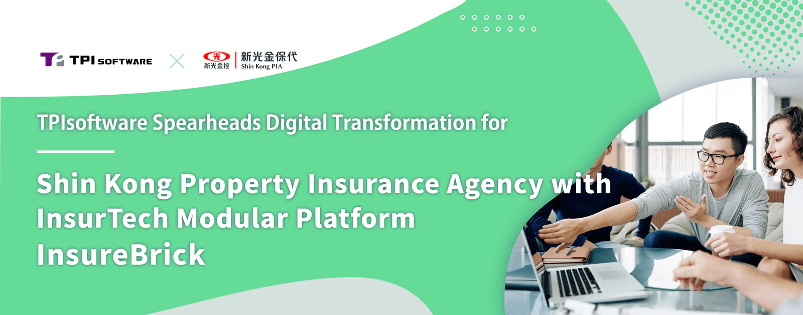

In a groundbreaking move, TPIsoftware, the market leader in digital transformation software technology, is set to build a new generation core system for Shin Kong Property Insurance Agency (SKPIA) within the coming year. This collaboration marks a pivotal moment in Taiwan's insurance sector, as SKPIA becomes the first agency to invest in core system transformation, underscoring the company’s dedication to fintech and digital advancement. Implementing TPIsoftware’s microservices framework “[InsureBrick: InsurTech Modular Platform](/en/products/insurebrick)” tailored for the insurance industry, the new core system will integrate diverse business operations within SKPIA, including receipt modules, deposit processes, commission structures, performance analytics, policy management, product management, customer relations, channel management, etc. The new system is designed to boost operational efficiency and flexibility for SKPIA, revolutionizing its insurance services.

The microservices platform “InsureBrick” built by TPIsoftware empowers insurance providers to act swiftly to the dynamic market demands in today’s rapidly changing digital landscape. "InsureBrick" encompasses 28 modules, ranging from customer, product and insurance policy management to underwriting, premium calculation, payment and more. These modules can be flexibly combined, allowing insurance agents to customize services based on roles and requirements. By leveraging microservices, the system enables packages of smaller and independent services, which optimizes resource utilization and system performance while reducing product development time with faster go-to-market to further deliver seamless customer experience. The new generation core system is expected to streamline the application process across channels and enhance administrative efficiency. Moreover, with split frontend and backend architecture and responsive web design (RWD), the system allows insurance agents to respond to customer needs anytime, anywhere simply through mobile devices.

David Huang, Chairman and President at SKPIA, said, “We really look forward to the development of the new core system. As the benchmark in the insurance agency sector, we have been serious about selecting a reliable partner to work with, and TPIsoftware’s extensive experience in building core systems for the BFSI sector is what we are looking for.”

“We aim not only to enhance the digital capabilities of SKPIA but also to better serve our customers,” added David Huang, “and we are confident that we can achieve unprecedented business milestones with the new system.”

“As the leading digital transformation enterprise software provider in Taiwan, TPIsoftware exemplifies unparalleled expertise in Insurtech,” stated Ben Yao, CEO of TPIsoftware, “In planning the core system, we take the flexibility of cloud migration into account by adopting the microservice middle platform InsureBrick. We believe this collaboration will help SKPIA catalyze the industry’s digital transformation journey, and ultimately deliver greater value to customers.”

**[About TPIsoftware](/en)**

TPIsoftware is the No. 1 digital transformation software company in Taiwan providing proprietary iPaaS middle platform [DigiFusion](/en/products/digilism) and conversational AI product [SysTalk.ai](/en/products#systalkai) domestically and overseas. TPIsoftware also offers comprehensive [software solutions](/en) and [cloud services](https://www.tpisoftware.com/en/gcp) with extensive cross-national project experiences. Globally recognized, it is trusted by customers across industries such as BFSI, government, retail, e-commerce, manufacturing, healthcare and more.

**[Media Contact](/en)**

Peggy Tsai

+886-2-2658-0508 #1606

peggy.tsai@tpisoftware.com
