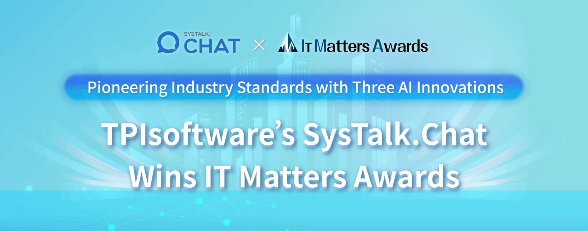

Winning industry-wide acclaims such as Taiwan Excellence Awards, the Oscars of Taiwan industries, TPIsoftware has been acknowledged as a top performer again with the latest recognition from IT Matters Awards for driving digital transformation with its proprietary software product [SysTalk.Chat: Conversational AI for Customer Service](/en/products/systalk-chat). Featuring the three AI innovations "Dual-Brain & Single-Process," "an AI Brain Integrated with ChatGPT" and "Visual Chatbot", SysTalk.Chat meets various industries' needs for personalized AI customer services and earns the highest accolade in the IT Matters Product/Project category among over 200 entries from top-notch enterprises.

The first edition of the IT Matters Awards, organized by Taiwan’s Administration for Digital Industries, Ministry of Digital Affairs, and Information Management Association (IMA), recognizes companies devoted to innovative IT technologies and fostering IT-friendly environments. TPIsoftware has passed the rigor of the six-month judging process from a panel of over 50 industry and academia experts and stood out from the rest.

## Serving Millions in Taiwan with Robust AI Capabilities

SysTalk.Chat's success story is not just about awards but about creating a transformative impact for businesses. Innovating customer services for industries such as BFSI, transportation, healthcare, government, manufacturing, and e-commerce and more, SysTalk.Chat has served millions of people annually with its robust AI capabilities. TPIsoftware’s SysTalk.ai, an AI-powered product portfolio, further builds an AI digital workforce blueprint seamlessly integrated into individuals' lives. It has reduced 40% of labor cost with its AI Document Processing Solution and AI Insurance Claims Processing Solution. “We strive to make AI an integral part of people’s daily lives” states Jeff Lin, VP of Innovation & AI Product Division at TPIsoftware, “SysTalk.Chat has served over 14,000,000 people annually with a market share of over 36% in Taiwan’s life insurance industry, making it the market leader.”

## TPIsoftware: Establishing Leadership Through Innovation

To complete the conversational service blueprint and maximize the digital workforce capacity requires API-led connectivity between services, and a middle platform featuring API management is the key to facilitating service communication and collaboration. With integration of TPIsoftware’s iPaaS Middle Platform DigiFusion, SysTalk.Chat can connect core IT applications and develop innovative digital services. The ISO 27001 certified DigiFusion acts as a bridge between existing services, which can help enterprises build interconnected service ecosystems and expand their core offerings. By providing integration, agility, scalability, security and more, DigiFusion allows collaboration with external partners and service providers and drives innovation for businesses.

TPIsoftware is experiencing an unprecedented growth in recent years. Following major accomplishments such as being selected by Financial Times as a top 500 Asia-Pacific High-Growth Company of 2022 and 2023 in a row, honored with Taiwan Excellence Awards, and featured in reports of leading research firms like IDC, TPIsoftware has demonstrated “Best in Taiwan” globally for its strong product competence and expert insights.

SysTalk.Chat has also driven green transformation for businesses by facilitating human-machine cooperation. “By providing the most efficient AI training to optimize customer services, SysTalk.Chat helps businesses make strides towards sustainability” said Ben Yao, CEO of TPIsoftware, “This recognition highlights the innovative work and dedication of our company, showcasing our product to a wider audience and establishing us as a leader in the field of enterprise software technology.”

**[About TPIsoftware](/en)**

TPIsoftware is the No. 1 digital transformation software company in Taiwan providing proprietary iPaaS middle platform [DigiFusion](/en/products/digilism) and conversational AI product [SysTalk.ai](/en/products#systalkai) domestically and overseas. TPIsoftware also offers comprehensive [software solutions](/en) and [cloud services](https://www.tpisoftware.com/en/gcp) with extensive cross-national project experiences. Globally recognized, it is trusted by customers across industries such as BFSI, government, retail, e-commerce, manufacturing, healthcare and more.

**[Media Contact](/en)**

Peggy Tsai

+886-2-2658-0508 #1606

peggy.tsai@tpisoftware.com
