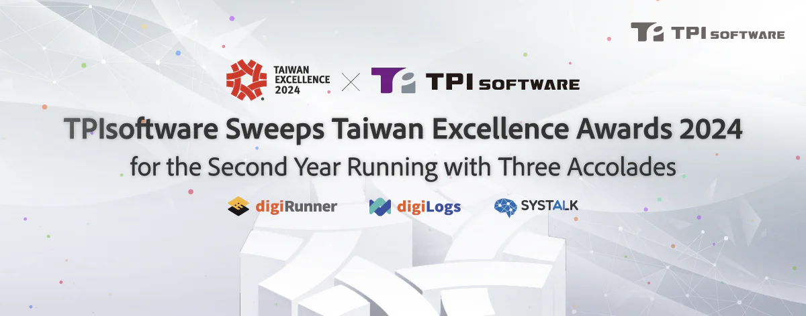

TPIsoftware, a pioneer in the software industry, proudly announces its consecutive victory at the prestigious 32nd Taiwan Excellence Awards. The company has clinched three distinguished accolades for its state-of-the-art proprietary software products and solution: the "[Enterprise API Management Platform digiRunner](/en/products/digirunner)," the "[One-Stop Log Management Platform digiLogs](/en/products/digilogs)," and the "[SysTalk.ai AI-powered Insurance Claims Processing Solution](/en/solutions/smartclaim).” This remarkable achievement underscores TPIsoftware's leading position in Taiwan's software sector and reaffirms its dedication to software innovation.

Known as the Oscars of Taiwan’s Industries, the Taiwan Excellence Awards celebrate the best products in Taiwan representing innovation and excellence. Winners have been selected by an independent jury composed of professionals across industries, with 182 submissions from 320 enterprises recognized for their outstanding product performance.

“Our consecutive accolades at the Taiwan Excellence Awards is a testament to our strong commitment to developing globally competitive software. Currently, we are intensifying our global presence by forging strategic alliances in key markets across the Asia-Pacific region and Europe. Moreover, we have been actively engaged in international promotion activities sponsored by Taiwan Excellence Awards to showcase Taiwan’ robust software expertise.” said Yilan Yeh, CEO of TPIsoftware.

Acclaimed for the second straight year, TPIsoftware's digiRunner stands out as the only proprietary API management platform in Taiwan compliant with Open Banking and Open Government standards. Suitable for industries seeking efficient management of massive APIs such as finance, healthcare and government, It helps enterprises build connected and innovative service ecosystems, and ensures uninterrupted service delivery with its unique function designs and patented technology. For example, the sandbox for API mock test enables parallel development between backend and frontend for fast service rollout. The four built-in mechanisms “API Adaptive Cache”, “Gateway Load Balance”, “Non-blocking API” and “Containerization” provide 100% zero downtime to enhance operational efficiency.

digiLogs, another consecutive award-winning product from TPIsoftware, exemplifies its robust capabilities by enhancing IT operational efficiency with powerful log management features. The features such as Endpoint Detection and Response (EDR) provide visual topology for endpoint monitoring to facilitate issue identification, with Root Cause Analysis (RCA) further giving total visibility over systems for real-time troubleshooting, thereby significantly optimizing enterprise IT governance. ISO 27001 certified, digiLogs fulfills enterprises’ audit and regulatory requirements.

TPIsoftware's foray into AI-enabled solutions has been marked by SysTalk.ai. Catered to the insurance industry, the AI-powered Insurance Claims Processing Solution harnesses AI text analysis and NLU to extract valuable insights from complex documents and streamline the claims process. It further features SysTalk.ICR to provide AI-powered OCR technology for automated document processing of all kinds of document formats such as identifying ICD 9/10-CM codes on medical certificates. Moreover, the exclusive "Adaptive AI Model” allows enterprises to enhance the model's reliability independently without a specialized AI team.

TPIsoftware has once again shone a spotlight on its sophisticated technology and forward-thinking mindset, making it the top-ranked software company in Taiwan.

**[About TPIsoftware](/en)**

TPIsoftware is the No. 1 digital transformation software company in Taiwan providing proprietary iPaaS middle platform [DigiFusion](/en/products/digilism) and conversational AI product [SysTalk.ai](/en/products#systalkai) domestically and overseas. TPIsoftware also offers comprehensive [software solutions](/en) and [cloud services](https://www.tpisoftware.com/en/gcp) with extensive cross-national project experiences. Globally recognized, it is trusted by customers across industries such as BFSI, government, retail, e-commerce, manufacturing, healthcare and more.

**[Media Contact](/en)**

Peggy Tsai

+886-2-2658-0508 #1606

peggy.tsai@tpisoftware.com
