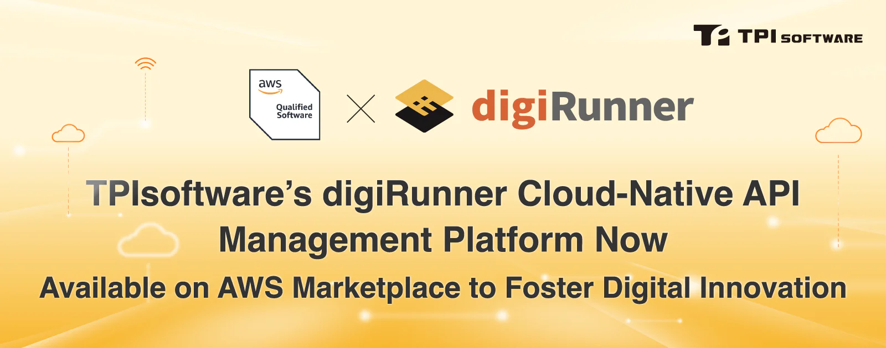

In a significant stride forward in cloud-native software solutions,[TPIsoftware](/en/products/digirunner), proudly announces the official listing of its Enterprise-grade API Management Platform digiRunner on the AWS Marketplace. This milestone follows a rigorous technical review by Amazon Web Services (AWS), the global leader in cloud services, affirming digiRunner's cutting-edge architecture and security design.

As a testament to its innovation and robust capabilities, digiRunner boasts seven invention patents and ISO 27001 information security certification with back-to-back wins of Taiwan Excellence Awards 2023 and 2024. This AWS accreditation, encompassing meticulous checks on security, architecture, deployment, and operational management, positions digiRunner as a facilitator of rapid, efficient, and scalable application deployment in the AWS cloud environment to accelerate digital innovation for businesses. Developed in-house by TPIsoftware's dedicated Taiwan team, digiRunner has become an AWS Independent Software Vendor (ISV) Partner by passing the AWS Foundational Technical Review (FTR). Its presence on the AWS Marketplace now extends its reach to millions of users across 32 global AWS regions.

The global market landscape has witnessed a paradigm shift in recent years, with prompt market response as the key to staying ahead of the curve. Cloud-based innovation marks a new chapter for businesses’ digital strategy. The API management platform digiRunner aims to help enterprises manage massive APIs efficiently, and serves as a middle platform to innovate digital services. Leveraging containers deployed on AWS, digiRunner offers minimal resource utilization and lightweight deployment while ensuring consistent operation across various environments, which is a critical feature in multi-cloud scenarios. This also empowers development teams with accelerated cycles for development, testing and deployment, thus shortening time-to-market and securing a competitive edge.

"In light of recent regulatory relaxations, our assistance to BFSI industry clients in cloud migration has been noteworthy. More and more businesses are shifting their applications and resources to the cloud, despite the inherent technical complexities and operational risks. Our alliance with AWS is a strategic move to provide our clients with a robust cloud infrastructure and comprehensive tools to simplify management and maintenance, allowing them to focus on core business activities." said Yilan Yeh, CEO of TPIsoftware. "Our product strategy is centered around delivering cloud-native software solutions. We excel at containerization and microservices to help our clients modernize IT architectures and reduce the timeline for service rollout. We have accumulated many success stories in digital innovation, and we are poised to capitalize on AWS's international stature to expand our market reach globally."

"Yvonne Chien, General Manager of TPIsoftware Singapore, also comments, "Our recent collaboration with AWS Vietnam signifies our global alliance with AWS, paving the way for new avenues in our international market expansion. By leveraging AWS's extensive global network and our pioneering cloud-native solutions, we believe we can make an impact on a global scale."
