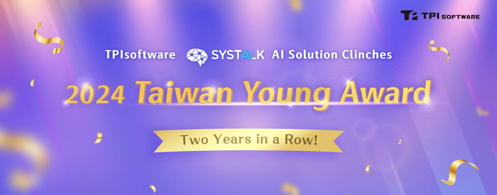

Following its major victory last year, TPIsoftware has once again shone at the 2024 Taiwan Young Award in the Smart Application category with [SysTalk.ai](/en/solutions/smartclaim), the company’s proprietary AI insurance claims processing solution. Organized by the Information Service Industry Association (CISA), the Taiwan Young Award is one of the most prestigious national awards that encourage technological innovation in the nation. Earning an honorable mention at this year’s event, the AI solution specializes in process automation addressing deep-rooted pain points in the insurance industry with an adaptive AI model. SysTalk.ai’s capability to dynamically adjust to various formats throughout the insurance claims process liberates human workers from repetitive tasks, elevating the workforce to new heights of success.

## Adaptive AI-Led Transformation of Insurance Claims Process

TPIsoftware has pioneered Intelligent Character Recognition (ICR)—a refinement of conventional Optical Character Recognition (OCR)—with the AI textual analysis and Natural Language Processing (NLP) in combination with AI algorithms as the core technologies for semantic analysis and text recognition while in compliance with ICD-9/10 and Taiwan’s Surgical Procedure of Primary Code System. With ensemble learning and an AI retraining mechanism, the exclusively-developed tool ensures accurate and efficient data entry, significantly reducing human errors. In addition, Robotic Process Automation (RPA) is incorporated into the model to facilitate seamless cross-platform integration by automatically connecting the claim engine, optimizing the process of claims review and adjudication. An adaptive AI platform SysTalk.PUZZLE is introduced to enable autonomous maintenance and model training with small datasets to keep up with the growing operational needs without additional costs.

## Streamlined Insurance Claims Processing Application

Entering its tenth year, the Taiwan Young Award has been a technology benchmark in the country that inspires outstanding industrial innovation and transformation. TPIsoftware has seen consecutive achievements following its big win last year with its AI chatbot SysTalk.Chat and enterprise middle platform DigiFusion. This year, SysTalk.ai has garnered recognition for its capability to provide greater efficiency and accuracy in terms of a streamlined insurance claims process.

“Just like a human, SysTalk.ai is capable of processing data and has proven to be exceptional in what it does. Workflow has been streamlined through the automation of insurance claims processes. After adopting the solution, the exclusive AI retraining mechanism enables customers to autonomously maintain and continuously optimize the system with minimal human effort, which is a crucial aspect many financial and insurance companies take into account when navigating digital transformation,” commented Jeff Lin, Executive Vice President of TPIsoftware’s Innovation and AI Product Division.
