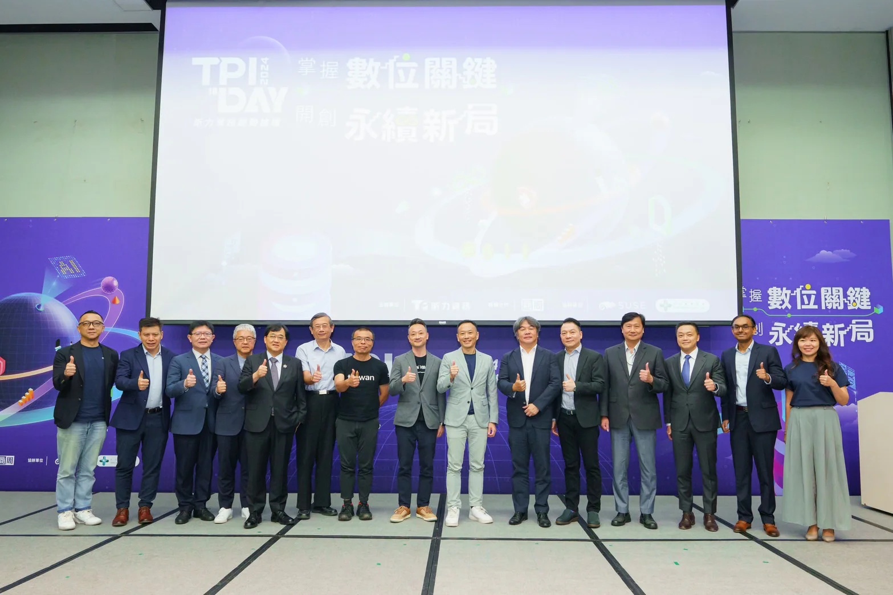

TPIsoftware hosts its annual forum TPI Day in collaboration with Taipei Medical Alliance and multinational open-source software company SUSE to foster insightful dialogues on industry trends: Sustainability, Open Source and Artificial Intelligence (AI). Held under the theme of “Mastering Digital Key Strategies for Sustainable Future,” 2024 TPI Day gathers top experts from the financial and healthcare sectors to exchange actionable insights on incorporating AI into sustainability initiatives and navigating the transition to Net Zero through digital transformation.

Specializing in fintech, TPIsoftware is a trusted service and solution provider that garners broad industry recognition. Its proprietary products, enterprise API management platform digiRunner and centralized log management platform digiLogs, have proven their capabilities to deliver mission-critical operations, ensuring streamlined processes and improved core system efficiency. Both conforming to ISO 27001, the two products feature heightened security and regulatory compliance, with standards meeting the high bar of stringent regulatory requirements and confidentiality in financial services. TPIsoftware is also stepping into healthcare services, with successful integration of its self-developed AI chatbot into medical care systems, showing the company’s pioneership in smart healthcare innovation.

## Official Member of FIDO Alliance

Joining FIDO Alliance’s endeavor to work towards more secure, faster and easy-to-use authentication, TPIsoftware rolls out gadoFIDO, a zero-trust authentication solution, that supports biometric and multi-factor authentication based on FIDO specifications (FIDO2 and UAF). In alignment with passwordless strategies, gadoFIDO ensures stronger security, privacy and a better user experience, making sign-ins across multiple devices and sites resistant to phishing attacks and breaches.

## Launch of AI Assistant SysTalk.VIKI

TPIsoftware’s conversational AI for customer services SysTalk.Chat leverages advanced algorithms to simulate human-like dialogues with greater relevance and precision through Natural Language Processing (NLP). Characterized by a dual-brain and single-process module, SysTalk.Chat is capable of conversing in multi-turn dialogues, classifying user intent, optimizing customer interactions and engagement. A newly-launched generative AI assistant SysTalk.VIKI provides feedback and responses to frequently-asked questions related to internal training, human resources and Management Information Systems (MIS), with a guardrail in place to prevent malicious responses and sensitive information leaks, making internal knowledge more accessible on an as-needed basis, enhancing overall productivity and knowledge management efficiency.

## Power Green Transformation for Sustainable Future

GreenSwift, a carbon management platform exclusively developed by the company, helps enterprises achieve data-driven decarbonization by verifying and measuring carbon footprint, managing carbon inventories as well as giving an overview of enterprise ESG performance with analysis and reporting requisite for public disclosure and carbon emission trading. ElectriSwift, an AI-based energy saving system for smart buildings, maximizes energy efficiency during corporate operations by automatically moderating energy consumption, realizing organizational sustainability initiatives and making corporate ESG efforts and successes visible.

“Entering the third year of TPI Day, we continue to empower enterprises with transformative technologies in Open Source, sustainability and AI,” says Yilan Yeh, General Manager of TPIsoftware. “Our mission is not just to support businesses in achieving their goals, but to lead them through the complex challenges of digitalization and modernization. By pioneering solutions that drive real-world impact, we are shaping a future where technology and sustainability go hand in hand, ensuring lasting success in an evolving global landscape.”
