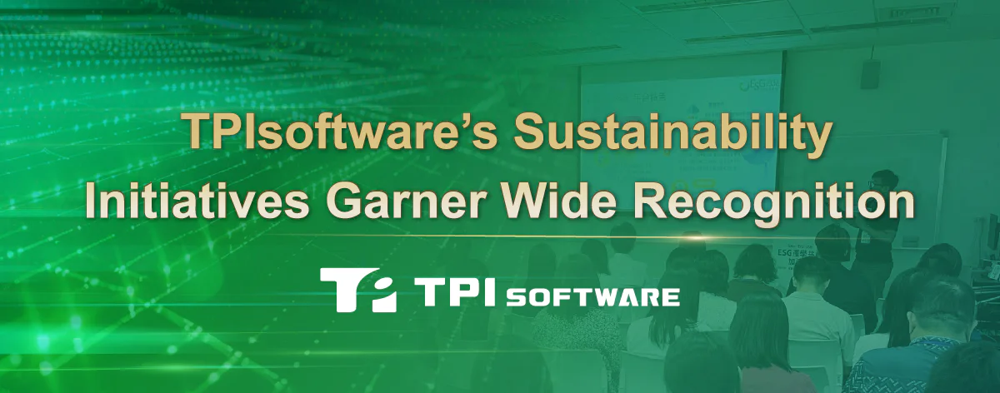

TPIsoftware has been honored with the Taiwan Corporate Sustainability Award (TCSA) from the Taiwan Institute for Sustainable Energy (TAISE), in recognition of its enduring dedication to Environmental, Social and Governance (ESG) principles and the United Nations’ Sustainable Development Goals (SDGs).

As a Taiwan-based B2B software developer, TPIsoftware actively promotes a sustainable future through its social responsibility initiatives. One of its standout efforts is the establishment of TPI University, an online platform for exchanging valuable insights and technical expertise. By fostering inclusive and equitable access to education, TPI University supports SDG 4 (Quality Education), offering online workshops and learning opportunities led by expert teams. This initiative, aimed at reducing the education gap and fostering healthy competition, earned TPIsoftware a TCSA Bronze Award under the SDG 4 category.

In addition, TPIsoftware’s industry-academia collaborations and its involvement in the Global Views ESG Alliance showcase its leadership in tech-driven sustainability strategies. Through its GreenSwift carbon management platform, TPIsoftware enables enterprises to accelerate their decarbonization efforts using data-driven insights, ensuring that ESG initiatives are not only measurable but also positively impactful. Recently, the company shared actionable insights as an invited speaker for the Taipei Computer Association, demonstrating how its AI-powered energy-saving system, ElectriSwift, helps smart buildings maximize energy efficiency while reducing consumption.

“With a presence in 15 regions worldwide, we are committed to leading the way toward a greener future through our innovative software solutions, empowering enterprises to achieve their sustainability goals,” said Yilan Yeh, General Manager of TPIsoftware, highlighting the company’s recognition in multiple sustainability initiatives, including winning first place in Custos’ Earth Day Challenge, where TPIsoftware achieved a remarkable 176.5kg carbon handprint. The company also ranked third out of 190 firms in Northern Taiwan’s technology parks for its participation in the government’s ESG program My Carbon Reduction Passbook, cutting CO2 emissions by 10,546.7kg in Q2 of 2024.
