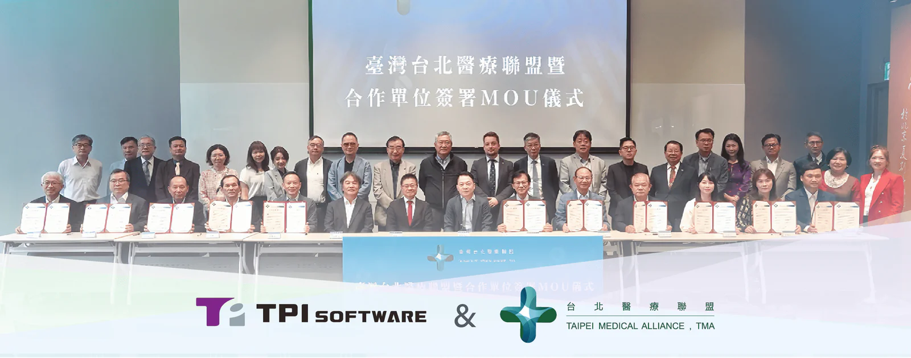

TPIsoftware (7781) and Taipei Medical Alliance signed a Memorandum of Understanding on October 30 in a collaborative effort to advance healthcare technology and medical academia. The collaboration aims to facilitate digital transformation and AI innovation in healthcare and clinical services through efficient resource sharing. Regular seminars, training sessions and academic events are to be expected in order to deepen medical expertise and accelerate digitalization within the healthcare sector.

Prominent attendees include incumbent Deputy Minister of Health and Welfare Jen-Der Lue, former Deputy Minister Pi-Sheng Wang and former legislator Shih-Ying Tsai, along with representatives from leading medical institutions and organizations, such as The National Federation of Long-Term Care, Taiwan Medical Association, Taiwan Society of Aesthetic Plastic Surgery and the College of Medicine at National Chung Hsing University.

“This initiative brings together experts across diverse fields to pool resources and complement one another’s strengths, which is targeted to ultimately improve the quality of healthcare services in Taiwan,” commented Chung-Chieh Chao, Chairman of Taipei Medical Alliance, highlighting TPIsoftware’s specialties in successful digital transformation. “The implementation of AI-powered chatbots, modernization of hospital information systems and cloud transformation, along with Fast Healthcare Interoperability Resources (FHIR) launched by the Ministry of Health and Welfare that fosters seamless healthcare information exchange rely on a tech partner with extensive experience in digitalization to build integrated healthcare management.”

Chairman of TPIsoftware Ben Yao stated, “Teaming up with Taipei Medical Alliance shows our commitment to improving medical management and healthcare services. With over 15 years of experience transforming and modernizing digital financial services, we have solidified our foothold in Taiwan and overseas markets. We have been emerging into the healthcare sector by helping large-scale organizations implement digital strategies. We pride ourselves in helping clients deliver pain-free, seamless system upgrades without having to go through the hassle and disruptions. The use of AI chatbots ranges from booking an appointment online to making health-related queries and reviewing prescription guidelines. An integrated healthcare service platform enables access to patients’ medical history for accurate diagnoses, with a health management platform that monitors pre- and post-treatment data for better understanding of patient conditions. Through the alliance, we make a concerted effort towards strengthening the physician-patient relationship, improving digital health initiatives and data sharing with innovative technology.
