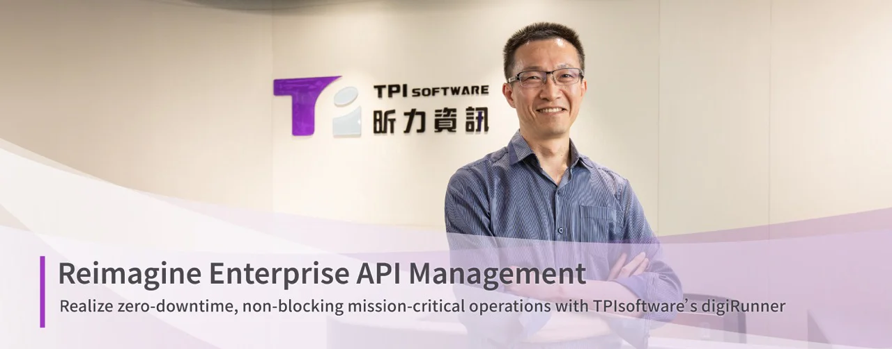
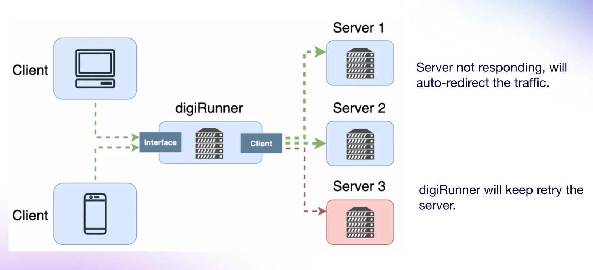

*Pierre Hsia, Executive Vice President of Enterprise Application Product Development Division at TPIsoftware*

Digital services are taking shape in almost every aspect of our daily lives, with seamless service delivery relying on comprehensive API management to foster a thriving ecosystem. By making APIs publicly available to developers, enterprises are in a position to drive innovation and integration across applications.

APIs may seem to be the perfect recipe for business success, but they come with challenges—particularly in managing large volumes of data. And that’s where a robust API management strategy should be in place to efficiently monitor APIs while ensuring secure, compliant and stable data transmission.

digiRunner 4.0, TPIsoftware’s proprietary enterprise APIM platform, has shifted from a virtual machine (VM)-based architecture to a container-based architecture with an API-first approach to enhance deployment flexibility. With patented capabilities that enable auto-scaling and zero downtime, digiRunner stands out as a reliable solution for mission-critical systems, distinguishing itself from other APIM platforms.

**digiRunner Garners International Recognition**

At its initial stage, digiRunner was positioned as a product focused solely on API management, similar to other service providers, which did not make it stand out among competitors, stated Pierre Hsia, Executive Vice President of the Enterprise Application Product Development Division at TPIsoftware. He added that TPIsoftware has since repositioned digiRunner as an APIM platform specifically designed for mission-critical systems, emphasizing its unique differentiation and value proposition.

TPIsoftware earned global recognition—with digiRunner—as one of the Financial Times 500 High-Growth Companies in APAC for three consecutive years—the only Taiwanese software company to achieve this. As a cross-industry APIM solution that delivers non-blocking, uninterrupted operations, digiRunner is widely implemented in core banking systems in finance and Hospital Information Systems (HIS) in healthcare. Other industry applications include power, transportation and much more. Here, digiRunner’s value lies in ensuring these critical services run smoothly and without interruption, as any disruption could lead to significant financial losses or safety risks.

digiRunner utilizes a microservices architecture to run on Kubernetes (K8s), with mechanisms that constantly monitor service performance. During high traffic volumes, auto-scaling—an automated feature that adjusts resources dynamically—activates to manage sudden traffic spikes, a capability made possible by digiRunner’s container and K8s architecture.

When asked about how digiRunner safeguards mission-critical systems as an API Gateway, Pierre explained that digiRunner features load balancing that distributes traffic across multiple backend servers to ensure smooth user experience. In the event of a server issue, it can redirect traffic to available servers based on user-defined configurations, maintaining system stability and reliability.

*When one of the backend servers fails, digiRunner automatically directs the traffic to the live server(s) and redirects the traffic when the dead server is back in operation.*

**Moving Towards the Open Source Community**

When it comes to supporting security, scalability and flexibility, digiRunner shows slight differences from other APIM platforms. What distinguishes digiRunner 4.0 is its robust capabilities to achieve high availability, reliability and fault tolerance, which enable rapid disaster recovery and data backup to ensure continuous operations while meeting Service Level Agreement (SLA) requirements.

The latest version of digiRunner has seen significant advancements in performance, ensuring non-blocking API operations. One of the core technologies behind this is Smart Caching, which optimizes system performance by algorithmically managing data storage and retrieval based on the state of backend systems. The other is In-Memory Gateway, where data operations are available directly on the data memory and the master node manages, coordinates and controls the slave nodes for data consistency.

digiRunner is also characterized by its API Composer, an easy-to-use tool that accelerates the development of value-added services. It not only supports quick API composition and data format transformation but also embodies an API-First approach. Users can create API flows and transform data with predefined API formats based on their needs through a simple drag-and-drop interface, all without modifying the existing systems, facilitating seamless communication between external systems.

*digiRunner’s API design for API composition and data format transformation*

digiRunner marked a milestone earlier this year with its completion of the Amazon Web Services (AWS) Foundational Technical Review (FTR). Now listed on the AWS Marketplace, digiRunner enables cloud deployment for containerized and Kubernetes (K8s) environments, offering four solution options: **Lite Standalone, Lite High Availability, Enterprise Standalone and Enterprise High Availability, where High Availability versions incorporate Auto Scaling and OpenSearch.** Users get a 30-day free trial, with flexible billing options available for either hourly charges or an annual subscription.

TPIsoftware has laid out a strategic roadmap for digiRunner with a strong focus on open-source initiatives. To support this, it has established a dedicated open-source department to manage regulations, licensing and documentation requirements. By maximizing the use of open-source resources and channels, TPIsoftware aims to pave the way for digiRunner’s penetration into the open-source market. The company envisions a bottom-up approach where grassroots communities, including engineers, technical staff and general end-users, play a more influential role in APIM-related decisions that are typically led by top-level executives.

TPIsoftware is strategically expanding into the open-source market—both horizontally and vertically.

Horizontally, it engages the developer community in collaboration and co-creation, which drives innovation and accelerates product iterations. By adopting an open-source approach, the company seeks to make its offering customizable and applicable, meeting enterprise needs and realizing the value of the API management platform.

Vertically, TPIsoftware has deepened its collaboration with leading AI transformation solutions provider SUSE by integrating digiRunner into Rancher, a popular open-source Kubernetes (K8s) management platform, providing a user-friendly, modern microservices architecture, with plans to integrate other open-source tools like Business Process Management (BPM) and Business Intelligence (BI) to foster a vibrant, innovative developer community.

digiRunner has proven its effectiveness in real-world applications. In Taiwan, it assisted the Taipei City Government in establishing an APIM platform to streamline data integration across agencies. This platform, built on a K8s environment and equipped with an API Developer Portal, enhances accessibility by coordinating open data and public services. An international success story includes digiRunner’s deployment for Pharmacity, Vietnam’s largest pharmacy chain, where the API management platform enables real-time inventory updates across hundreds of local branches, optimizing procurement, customer data entry and order management.

TPIsoftware is actively seeking collaboration with clients to deploy digiRunner as an AI Gateway, which helps manage Large Language Models (LLMs), tokens, security and privacy and data exchanges, and even acting as a bridge between LLMs and Retrieval-Augmented Generation (RAG) databases, enabling enterprises to retrieve AI-generated results in a more secure and accurate manner.

**[Download digiRunner](https://aws.amazon.com/marketplace/seller-profile?id=seller-jnqhhvmszbeua)**
