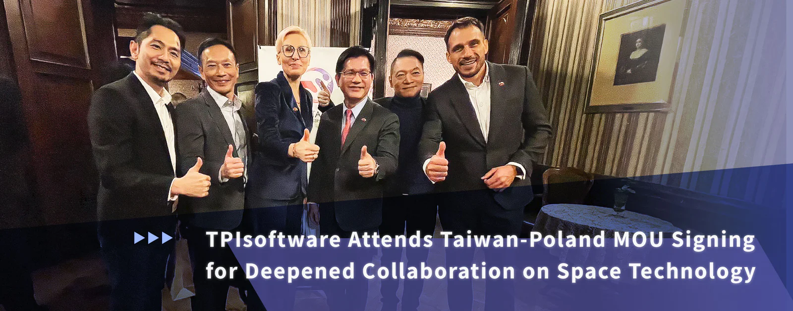

TAIPO Taiwan-Poland Chamber of Commerce and the Polish IoT & AI cluster SINOTAIC have signed a Memorandum of Understanding (MOU) to strengthen collaboration in satellite applications and space technology between the two countries. The signing took place at the Taiwan International Assembly of Space Science, Technology, and Industry (TASTI2024) hosted by the Taiwan Space Agency (TASA) on December 2. Deputy Minister of Taiwan’s Foreign Affairs, Wu Chih-chung, witnessed the event, where TPIsoftware, represented by Chairman Ben Yao, was invited to attend alongside a Taiwan delegation of tech leaders and commercial entities.

Earlier on November 22, a group of enterprises led by Taiwan’s Ministry of Foreign Affairs Lin Chia-lung participated in the Polish-Taiwanese Economic Cooperation Forum held in Łódź to forge commercial ties. Mayor of Łódź Hanna Zdanowska witnessed the MOU signing between President of the Polish-Taiwanese Chamber of Industry and Commerce Agnieszka Sygitowicz and TAIPO President Chung-Chieh Chao, marking a major step in expanding collaboration between Taiwan and Poland in high-tech industries.

TPIsoftware, known for its robust API management solutions across key sectors such as finance, healthcare, manufacturing and government services, is now poised to utilize its expertise in the aerospace sector. The company is to leverage its proprietary API management platform digiRunner to support the growing need for satellite constellations in low Earth orbit (LEO), medium Earth orbit (MEO) and geosynchronous orbit (GEO). By enabling dynamic data distribution and enhancing satellite performance, digiRunner is set to play a crucial role in facilitating ground-air-space communications, which is critical for advancing technologies such as smart cities, self-driving cars, the Internet of Things (IoT), and remote clinical services.

“We are excited to be part of this cross-national endeavor and to contribute our expertise to the Taiwan-Poland satellite network program,” commented Ben Yao, highlighting the significance of the collaboration as TPIsoftware ventures into the space industry and continues its effort in the global digital transformation. “Our API management platform digiRunner is positioned to bolster the advancement of satellite communications, and we look forward to expanding our global reach and driving innovation within the aerospace sector.”
