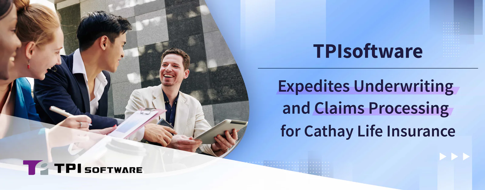

As a leading expert in Fintech and Insurtech, TPIsoftware has once showcased its digital expertise in delivering tech-driven solutions for Cathay Life Insurance. With Cathay utilizing TPIsoftware’s Business Process Management (BPM) platform digiFlexis and digiMars, a big data management platform designed to elevate MongoDB community edition for commercial use, the insurer’s underwriting and claims processing have seen an 86-fold increase in operational performance.

TPIsoftware developed an image processing platform to address the data inconsistencies within Cathay’s existing system, improving the data entry and document scanning to streamline the underwriting and handling of insurance claims. In resolving challenges related to scaling infrastructure for large-volume data management, digiFlexis and digiMars have been integrated to enable wide-scale monitoring of over 60 servers. TPIsoftware also employed advanced compression techniques to free up 40% of storage space for greater scalability and cost-efficiency.

Recognizing the importance of organizational culture, employee adaptability and workflow integration, TPIsoftware takes a comprehensive approach to digital transformation, which goes beyond merely upgrading hardware or phasing in new software. This ensures a seamless transition to modern operations while fostering continued growth and innovation. TPIsoftware provides end-to-end consulting services and software solutions, guiding enterprises through every step of the transformation journey. The incorporation of digiFlexis has empowered Cathay Life Insurance to modernize its processes, while digiMars delivers robust MongoDB management capabilities, including monitoring, alerting, backups and disaster recovery. These features work in tandem to complement existing systems by addressing gaps in provider-side capabilities, ensuring more effective and long-term business operations.

“For enterprises—especially financial institutions and insurance companies—seeking a trusted tech partner to assist them along the digital transformation journey, professional expertise and deep industry knowledge are key to successful implementation,” said Yilan Yeh, General Manager of TPIsoftware. “With TPIsoftware providing full consulting support from the planning stage to platform go-live, we are committed to helping our clients navigate the digital landscape and achieve lasting success.”
