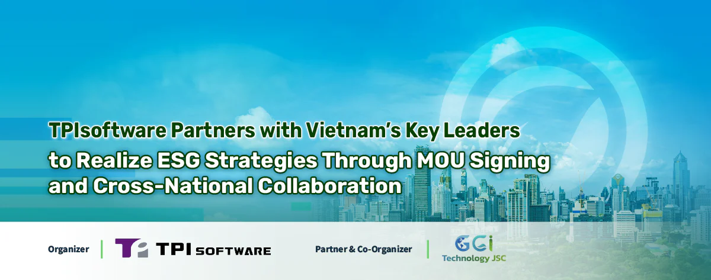

Taiwan’s software company TPIsoftware (TWSE: 7781) and its partners are to sign a multilateral Memorandum of Understanding (MOU) to formalize the cross-border collaboration on facilitating greenhouse gases (GHGs) inventory with tech-driven solutions. The MOU signing will take place on December 26 in Hanoi, Vietnam, along with the product launch of GreenSwift—an AI-driven carbon management platform by TPIsoftware.

Earlier, TPIsoftware and Nam Cau Kien Eco-Industrial Park in Vietnam announced a pilot project to implement GreenSwift in the park. The project aims to strengthen the ESG initiative across the area by optimizing the efficiency of carbon management. Details of the project will be unveiled during the GreenSwift launch event.

*TPIsoftware Vietnam’s General Manager Do Vuong Phong (left) visited Nam Cau Kien Eco-Industrial Park with Nam Cau Kien Eco-Industrial Park’s Chairman Pham Hong Diep, ESG Expert Dr. Nguyen Kim Anh, and Coastal Design and Investment’s Chairman Dr. Mai Van Sy.*

The MOU sets forth a framework to strengthen the parties’ Environmental, Social and Governance (ESG) commitment with enhanced regulatory compliance and transparency, enabling enterprise carbon disclosure for a decarbonized, sustainable future. Led by TPIsoftware and Global Green Innovation Technology (GGI., Technology), the MOU signing brings together government officials, the private sector and ESG experts in Vietnam and will be witnessed by Dr. Nguyen Kim Anh, ESG Advisory Expert and Senior Scientist at Institute of Geography, Vietnam Academy of Science and Technology, Tony Kuo, Founder and CEO of Katina Capital Partners, Mai Hoai An, Chairman of ITD Group, Phan Quoc Dzung, Vice Chairman cum General Director of Bao Long Insurance, and Thomas Cheng, General Manager of ThinkTron Ltd.

Following the MOU signing, the GreenSwift product launch focuses on a comprehensive, practical approach to achieving net zero through carbon management and inventory enabled by advanced AI technology. Keynote speakers feature representatives from Vietnam’s Ministry of Transportation and Ministry of Science and Technology, who will delve into the opportunities and ongoing challenges of climate action and environmental sustainability in the country. Additionally, Dr. Nguyen Kim Anh will share an in-depth analysis of how ESG standards can be effectively implemented across industries in Vietnam. The event will be followed by a product demonstration presented by Do Vuong Phong, General Manager of TPIsoftware Vietnam, to showcase GreenSwift’s key features. The carbon management platform adopts Generative AI to enable efficient GHG inventory, streamline reporting and ensure compliance with international standards.

Yilan Yeh, General Manager of TPIsoftware, said, “GreenSwift is a SaaS-based carbon management platform designed to measure carbon reduction and maximize ESG efforts for enterprises. Together with ElectriSwift, TPIsoftware’s AI Building Energy Conservation System, enterprises are able to reinforce their ESG strategies through streamlining GHG accounting and energy saving, making their sustainability initiatives visible and impactful. We look to build a long-lasting cooperation with the local government, private sector and residents to realize their commitment to ESG goals.”
