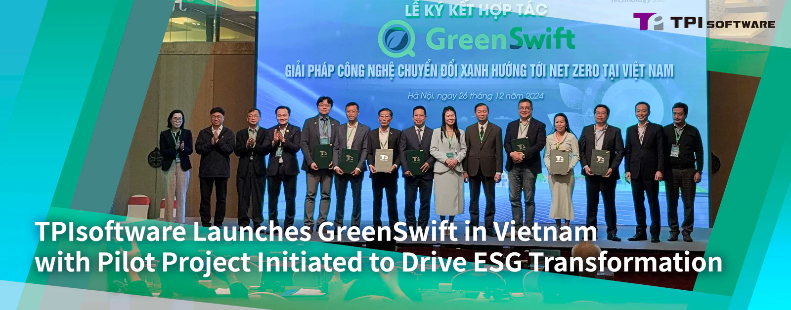

TPIsoftware (TWSE: 7781) and Vietnam’s key partners have signed an MOU to deepen collaboration in promoting a more sustainable, decarbonized future. The signing took place in Hanoi, Vietnam, on December 26, along with the product launch of GreenSwift, an AI-driven carbon management platform by TPIsoftware.

Led by TPIsoftware and Global Green Innovation Technology (GGI., Technology), a leading environmental consultancy offering specialized advice for GHG and ESG projects, the event convened government officials, the private sector and ESG experts in Vietnam, with Dr. Nguyen Kim Anh, Katina Capital Partners, ITD Group, Bao Long Insurance and ThinkTron Ltd signing the MOU.

The event culminated with a live demonstration of GreenSwift during which participants were presented with the platform’s key features such as automated carbon data collection that tracks seven GHG emissions covering Scope 1, 2 and 3 through a centralized platform, and linking multiple indicators using a cloud-based approach that improves carbon auditing efficiency.

GreenSwift is a SaaS-based carbon management platform with professional ESG consulting service and local support that equip enterprises for carbon disclosure and it is ideal for small and midsize businesses (SMBs) who seek to prioritize ESG initiatives. The platform features GHG reporting that complies with global frameworks (ISO 14064-1:2018 and IPCC) and meets regulatory compliance. GreenSwift enables eco-conscious enterprises to work towards net zero by aligning themselves with ESG values and best practices, elevating their brand image through long-term sustainability investment and strategic ESG initiatives.

Do Vuong Phong, TPIsoftware Vietnam’s General Manager, said: “We have been dedicated to helping enterprises navigate the challenges in their green transformation journey. With the Vietnamese government promoting ESG standards and sustainable business practices, launching GreenSwift not only enables enterprises in Vietnam to manage and measure their environmental impact, but also reaffirms our commitment to working with ESG-focused partners to build a greener future for Vietnam.”

The MOU signing followed TPIsoftware’s recent announcement of a pilot project to implement GreenSwift and ElectriSwift (AI Building Energy Conservation System) at Nam Cau Kien Eco-Industrial Park. Pham Hong Diep, Chairman of the industrial park, commented: “Building a partnership with TPIsoftware signifies our commitment to collaboratively develop and advance sustainability initiatives in climate action through tech-based approaches and solutions. This joint endeavor shows the shared vision of both parties towards leveraging cutting-edge technology to enhance energy efficiency and promote eco-friendly industrial practices in Vietnam.”
