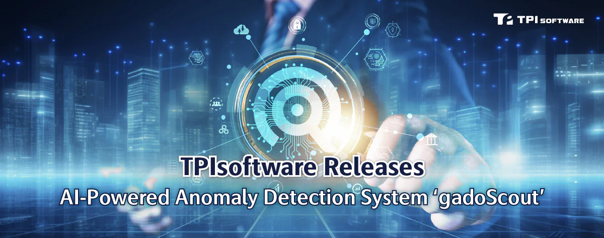

TPIsoftware (TWSE: 7781), Taiwan’s leading software company specializing in digital transformation, has rolled out its latest AI-powered Endpoint Anomaly Detection System ***gadoScout***. The system leverages advanced AI technology to analyze potential threats and automate alerting, effectively reducing IT workload and improving operational efficiency through preemptive protection measures.

***gadoScout*** utilizes machine learning to detect anomalies by identifying patterns, behaviors and events that deviate from expected circumstances in a proactive manner. Unlike rule-based methods, which depend on predefined parameters to flag deviations based on predictive models, <em>**gadoScout**</em> recognizes threat patterns in real-time with improved accuracy and effective false alert prevention. This enables the Site Reliability Engineering (SRE) team to conduct early diagnoses and prompt responses to address system issues.

With flexible architecture and continuous learning mechanism, ***gadoScout*** is designed to meet enterprise needs for monitoring and alerting across diverse application scenarios. ***gadoScout*** enhances system reliability through preemptive anomaly detection, allowing the SRE team to focus on resolving the real problems that could jeopardize corporate operations instead of coping with falsely-flagged issues. This would significantly shorten the time of detection and resolution, minimizing downtime risks and financial losses while enhancing operational security. In addition, ***gadoScout*** features a unified platform that provides integrated contextual insights for seamless collaboration on handling intrusion and efficient cross-team communication.

General Manager of TPIsoftware Yilan Yeh said: “Our ability to deliver success for enterprises stems from our extensive experience and a deep understanding of our customers’ needs. Following the rollout of ***gadoScout*** and the product launch of ***GreenSwift*** (an AI-driven carbon management platform) in Hanoi, Vietnam, TPIsoftware has completed its product portfolios, including iPaaS middle platform ***DigiFusion***, conversational AI series ***SysTalk.ai***, sustainability management platform ***ESGswift***, and enterprise security platform ***GadoSecurity***. This shows our ambition to expand the global presence of Taiwan-made software solutions through strategic partnerships with industry leaders remains unwavering.”
