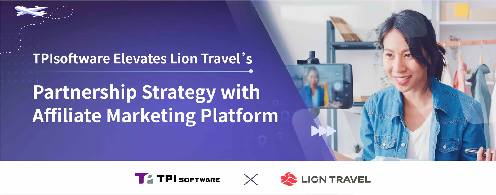

TPIsoftware has enhanced Lion Travel’s partnership strategy by developing a new affiliate marketing platform that connects influencers and content creators. This platform allows the leading travel agency to expand its reach by leveraging the trusted relationships affiliates have with their audiences, enabling the agency to effectively target niche demographics and amplify the impact of its marketing efforts.

The platform provides each affiliate partner with a unique marketing link, which they can share on their websites, social media channels and other platforms to promote services to their followers while tracking orders and commission payments in one place. The entire process—from placing an order to completing a transaction—is tracked with minimal human effort. This allows the travel agency to attribute sales to specific influencers and compensate them accurately. The platform also features visual reporting tools that provide insights into campaign performance, including content views across platforms, order details and sales commissions. Commission rates are customizable and automatically calculated based on selected marketing channels and tour types, streamlining the review and approval of affiliates’ withdrawals as well as the crediting of payments.

“Digital Marketing Association’s 2024 report found over 40% of consumers are more likely to purchase a product or service if an influencer recommends it. Potential buyers tend to refer to online content from influencers before making a purchase decision,” said Ben Chang, Lion Travel’s Chief Marketing Officer, adding that “Introducing an affiliate marketing platform fosters mutually beneficial partnerships with influencers and content creators. Travel bloggers and vloggers can use the platform to share their travel experience and provide guides for different types of tours. We believe this creates diverse opportunities for consumers, influencers and travel agencies alike.”

Yilan Yeh, TPIsoftware’s General Manager, highlighted the project’s success, stating “Our team employed the Water-Scrum-Fall project management methodology to help clients turn an innovative idea into a practical solution in record time. The platform was launched 1.5 months ahead of schedule, demonstrating our ability to deliver agile and efficient solutions. The success we achieved with Lion Travel opens up a pathway for how agencies can leverage affiliate partnerships in today’s digital world. It is a testament to how we create value and enable continued growth for our clients.”
