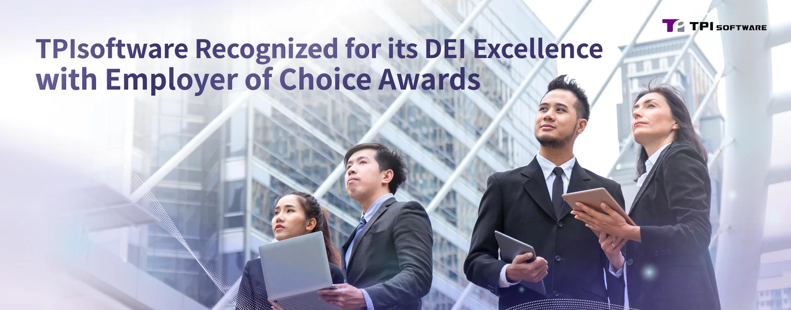

TPIsoftware has been commended with Best Employer Brand Awards by digital talent recruitment site ***Yourator*** in recognition of its commitment to Diversity, Equity and Inclusion (DEI) in the workplace. The award names 20 Taiwanese enterprises out of hundreds who excel in promoting fair treatment, equitable opportunities and workplace inclusiveness. TPIsoftware’s initiatives to foster gender equality, diversity and inclusion at work acknowledges its effective approaches to challenges of complex needs of talents, making it the most popular employer among candidates and employees.

The accolade follows the company’s last year recognition of ***104 Best Employer Awards*** in the Employer of Choice by 104 Job Bank—Taiwan’s largest job search platform that connects millions of talents with employers across a broad range of industries. TPIsoftware’s unwavering focus on talent employment has earned recognition not only by prominent career platforms, but also ***the Taiwan Corporate Sustainability Award (TCSA)*** by the Taiwan Institute for Sustainable Energy—a prestigious award that validates a company’s effort to implement the Sustainable Development Goals.

Executive Vice President of TPIsoftware Mina Yieh said, “We commit ourselves to shaping an inclusive environment where everyone feels valued, respected and supported. Benefits and perks such as flexible working hours, remote working options, paid leave, mental health therapies and health check-ups are offered as we prioritize our employees’ well-being and development, both personally and professionally. We also support working parents by offering parental leave, childcare subsidies and accessibility to nursery rooms, showcasing our approaches to fulfilling parental responsibilities and family needs. At TPIsoftware, celebrating diversity and inclusion is not just a mantra or statement we make, it is reflected through well-rounded policies and programs.”

General Manager of TPIsoftware Yilan Yeh said, ”Being a TCSA honoree reaffirms our endeavor in cultivating a gender-friendly, supportive workplace for all. A notable 3:2 male-to-female staff ratio is achieved, with a gender balance on managerial level. This makes TPIsoftware exceptional in the tech industry, where male dominance is the norm. Every member at our company can expect to reach their full potential and thrive regardless of their sociodemographic backgrounds. Not only do we invest in the workforce to lead in the digital world, but also inspire those around us to propel toward success and professional growth as we believe diverse talents fuel and sustain our journey of innovation and transformation.”
