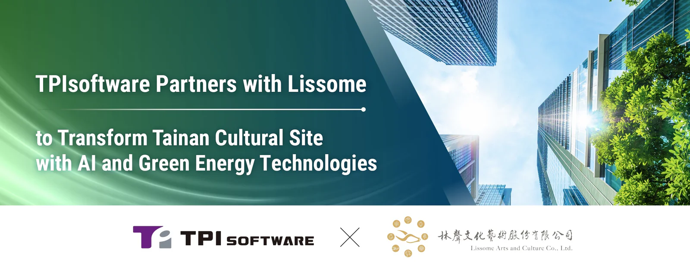

TPIsoftware (TWSE: 7781) and Lissome Arts and Culture Co., Ltd. have announced a collaboration to rejuvenate a historic cultural site in Tainan’s North District, a designated area near the established cultural park 321 Art Alley Settlement. As part of the initiative, TPIsoftware will help develop Taiwan’s first cultural site integrating AI and green energy technologies as well as providing a series of software solutions for the site’s digitalization. The contract—signed by Lissome and TPIsoftware—amounts to NT$500 million, marking a collective effort to harness AI technologies to enhance visitor experiences in culture and art.

With extensive expertise in AI, big data analytics and energy management, TPIsoftware is introducing an automated sustainability management platform to monitor and reduce greenhouse gas (GHG) emissions for optimized energy efficiency across the site. By leveraging data-driven carbon reduction strategies, the project aims to achieve net zero emissions and demonstrate the effective implementation of ESG initiatives through tech-driven solutions.

“With a total investment of NT$7.5 billion, we are transforming the 2.25-hectare site into an oriental cultural hub for Tainan City, featuring over 2,500 pieces of artwork. A permanent exhibition will showcase a collection of paintings by the renowned artist Xia Jing-Shan,” stated Chairman of Lissome Arts and Culture Chao Chung-Chieh at the signing ceremony. “The first phase of construction is expected to be completed within four years, with an exhibition center measuring 10,000 square meters serving as a recreation space for citizens. Lissome also aims to support local artists by exhibiting their work, further enriching Tainan’s urban vibrancy.”

Chairman of TPIsoftware Ben Yao said, “Our collaboration with Lissome to redevelop and revitalize the historic cultural site showcases our expertise in digital transformation across industries, including art and culture. We will introduce key digital solutions such as a middle platform, mobile payment system, energy savings platform and carbon management tools to ensure efficient, eco-friendly and seamless operations. This initiative represents the future of how advanced technologies and art intertwine. Together with Lissome, we are fostering a sustainable future where cultural heritage and innovation connect.”
