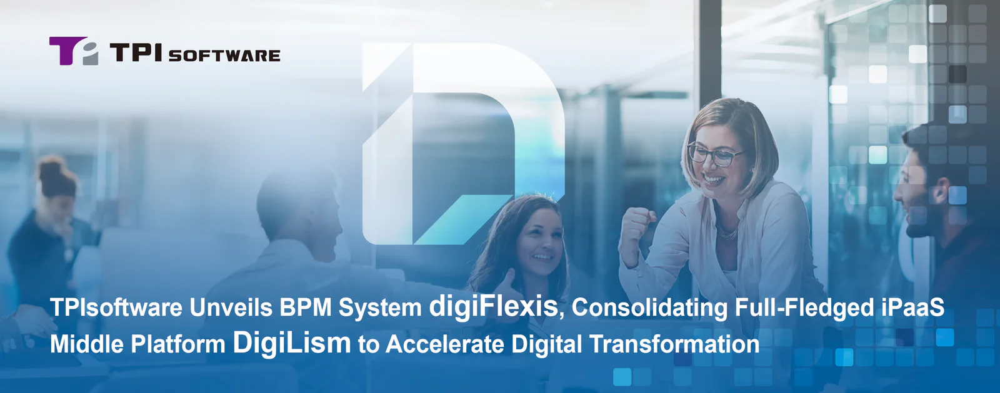

TPIsoftware (TWSE: 7781) has launched digiFlexis, a Business Process Management (BPM) System designed to streamline enterprise workflows and drive operational efficiency. The platform enables rapid development and improvement through a no-code design, with key features like analytic reporting, form builders and API integration capabilities incorporated to cultivate a dynamic, agile workplace in the digital era.

**digiFlexis: Redefine Business Process Management Across Industries**

digiFlexis redefines business process management with its capabilities to integrate existing systems like enterprise resource planning (ERP) and customer relationship management (CRM). Designed as a versatile platform suitable for businesses of any size, key features of digiFlexis include an intuitive, widget-based homepage that allows users to customize their workspace through a drag-and-drop interface, with an administrative dashboard offering visualized, real-time insights into business operations.

digiFlexis streamlines workflows by incorporating role assignment throughout the review and approval process, fostering smooth collaboration and information sharing across departments. A form and workflow builder provide flexibility to customize internal processes and notification settings. Being fully compatible with AWS, GCP and Azure, digiFlexis facilitates digital transformation, empowering enterprises to stay agile, secure and competitive in today's digital landscape.

**DigiLism: Elevated Middle Platform for Digital Transformation**

Following the digiFlexis release, TPIsoftware has announced a major rebrand of its core product line iPaaS middle platform—formerly known as DigiFusion—now as DigiLism, a blend of the word "Digital" and "Realism," which reflects the facilitation of realizing enterprises' digital transformation goals.

The rebrand represents the convergence of the company's established solutions, including API management platform digiRunner, log management platform digiLogs and big data management platform digiMars together with the newly-released digiFlexis.

In tandem with the rebrand, TPIsoftware has introduced a new visual identity featuring interlaced geometric patterns and a typography of the stylized "D" and "L." The vibrant orange used in the redesigned logo symbolizes energy and creativity, while dark gray conveys stability and professionalism. The rotated speech bubble reflects the essence of DigiLism—an intermediary bridging information to facilitate communication between systems, emphasizing its role in connecting client success with digital solutions.

TPIsoftware General Manager Yilan Yeh commented, "Rolling out digiFlexis showcases our vision and commitment to delivering a seamless, unified digital experience for enterprises. digiFlexis is not just a new BPM solution that addresses data silos and cross-departmental issues; it represents TPIsoftware's years of experience in helping clients navigate the complex challenges they face in the ever-evolving landscape with our offerings as we aim to empower partners to innovate and stay ahead."
