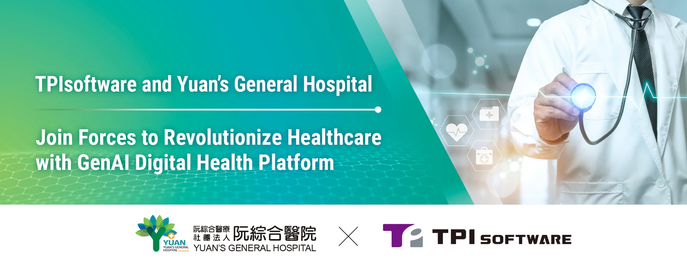

[TPIsofware](/en) (TWSE: 7781) and Yuan’s General Hospital, a leading medical institution in Southern Taiwan, have collaborated to launch a digital health platform that leverages generative AI technology to facilitate data transformation and streamline data exchange within hospital information systems (HIS), enhancing operational efficiency with automated medical processes. The platform release takes place at the upcoming 2025 Kaohsiung Smart City Summit and Expo, co-hosted by Kaohsiung city government, Taiwan Smart City Solutions Alliance and Taipei Computer Association, from March 20 to 22 at the Kaohsiung Exhibition Center.

The digital health platform, built on TPIsoftware’s proprietary API management platform [digiRunner](/en/products/digirunner), is designed to optimize clinical workflows by streamlining data extraction, document processing and medical decision support. One of the features is its smart search, which allows efficient medical record retrieval from hospital information systems and enables quick patient summary using GenAI. Another key capability is the platform’s ability to auto-convert data formats to align with the Fast Healthcare Interoperability Resources (FHIR) standard and TWPAS IG (Taiwan NHI Cancer Prior Authorization Support Implementation Guide), ensuring compliance and facilitating seamless data exchange across healthcare institutions. By automating administrative tasks such as data querying and reconciliation, the newly-launched platform reduces processing time, enhances data accuracy and consistency, and improves workflow efficiency, enabling healthcare professionals to focus more on delivering high-quality patient care.

“With digital transformation posing challenges to healthcare institutions, TPIsoftware continuously strives to provide cutting-edge solutions that help navigate the ever-evolving tech landscape. digiRunner’s robust capabilities and flexibility enable seamless data exchange across heterogeneous systems while maintaining compliance with the FHIR standard—all without requiring modifications to existing systems. This helps standardize data formats and improve interoperability of critical data across systems,” said TPIsoftware General Manager Yilan Yeh. ”Our collaboration with Yuan’s General Hospital is redefining smart healthtech with innovative solutions. As our motto ‘Tech for Change’ suggests, we believe technology has the power to transform the world, fostering smarter and better healthcare.”
