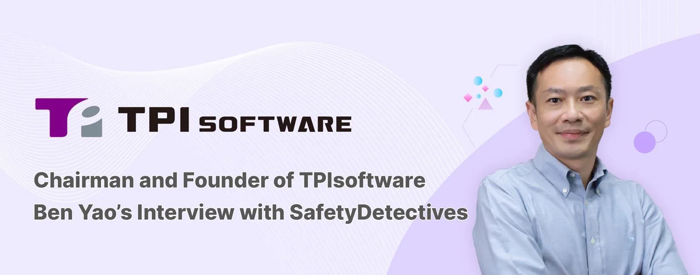

Ben Yao, Chairman and Founder of TPIsoftware, had the opportunity to speak with Shauli Zacks from SafetyDetectives about the company’s journey and its innovative software solutions.

Read on to discover how TPIsoftware is enhancing business operations across industries with its enterprise security platform **GadoSecurity** (**gadoDIDO** & **gadoScout**) and API management platform **digiRunner**.

**Q: Can you introduce yourself and tell us a little about TPIsoftware?**

**Ben**: Majoring in civil engineering, I have always been an enthusiast for computer science. Driven by this passion, I became a self-taught software engineer and kicked off my tech career at a commercial bank. In April 2005, I founded ThinkPower, starting small with a five-member team. Rebranded as TPIsoftware in 2020, we have grown into a large company of 600, trusted by partners across finance, insurance, healthcare, government, transportation, manufacturing and retail industries, with established partnerships and subsidiaries in Vietnam, Thailand, Indonesia, Cambodia, Singapore, Japan, Europe and the US.

We pride ourselves on our fully Taiwan-made software solutions that empower our clients to succeed in their digital transformation journey. A recent milestone was TPIsoftware’s listing on Taiwan’s Emerging Stock Board (ESB) in 2024. TPIsoftware was selected by the Financial Times as one of the **[top 500 Asia-Pacific High-Growth Companies](https://www.ft.com/high-growth-asia-pacific-ranking-2024)** for three consecutive years (2022-2024) and received global recognition with [the **Best Open Banking APIs Southern Asia 2024 award**](https://www.globalbankingandfinance.com/global-banking-finance-awards-2024-award-winners) from the Global Banking and Finance Awards®.

**Q: Could you provide a brief overview of the GadoSecurity product family, particularly gadoDIDO and gadoScout? How do these solutions stand out in the enterprise security landscape?**

**Ben<strong>:</strong>** GadoSecurity is one of our core product lines, along with iPaaS middle platform[DigiLism](/en/products/digilism) (formerly known as DigiFusion), conversational AI series SysTalk.ai and sustainability management platform ESGswift. The GadoSecurity product family, an enterprise security platform, consists of two solutions: gadoDIDO (FIDO-certified passwordless authentication) and gadoScout (AI-powered anomaly detection system).

**[gadoDIDO](/en/products/gadodido)** , built on the FIDO2 standard, leverages public-key cryptography and biometric authentication to ensure secure, seamless and phishing-resistant login experiences. By reducing the reliance on passwords, **gadoDIDO** streamlines sign-ins across multiple devices through zero-trust security for enhanced user experience and account protection, reducing password reset and maintenance costs.

**gadoScout** utilizes machine learning to enable anomaly detection and identify pattern deviation, allowing proactivity in recognizing potential threats and abnormal traffic in a real-time manner rather than depending on predefined rules. Specifically designed to meet enterprise needs for monitoring and alerting across diverse applications, **gadoScout** ensures system reliability through preemptive anomaly detection and effective false alert prevention.

**GadoSecurity—gadoDIDO** and **gadoScout**— stands out as a comprehensive security solution for enterprises to ensure robust cybersecurity, seamless authentication and proactive threat detection, helping organizations fortify their digital infrastructure, leading to efficient, compliant and secure operations.

**Q: How does gadoDIDO implement FIDO-certified passwordless authentication, and what are the primary advantages for enterprises adopting this technology?**

**Ben:** **gadoDIDO** uses public-key cryptography to authenticate sign-ins by generating a unique key pair (public and private keys) without using passwords. Once a user registers with a FIDO-enabled service, the public key is stored on the service’s server, while the private key remains securely on the user’s registered device and is protected by biometrics (e.g., fingerprints, facial recognition). Sign-in is completed via a challenge-response from the user device and the server; the server does not see or ever store the private key. During sign-in, the server sends a challenge to the user’s device. The user must prove the possession of the private key by signing the challenge for the sign-in to be verified and completed.

The passwordless authentication reduces password-related vulnerabilities and streamlines digital access, providing the following advantages:• **Enhanced protection** against password leaks, interception, credential theft and phishing attacks.• **Frictionless login experience** through a simplified verification process without using passwords.• **Cost reduction** of password reset and maintenance.• **Regulatory Compliance** with global standards like GDPR, NIST and CISA to ensure cybersecurity.

**Q: In what ways does gadoScout utilize AI to detect anomalies within enterprise systems? Can you share a specific example of how it has enhanced security for a client?**

**Ben:** **gadoScout** utilizes AI and machine learning to analyze network traffic, user behavior and system logs, identifying abnormal activities through:1. **User Behavior Analytics (UBA)** to detect deviation in behaviors like unusual login patterns, access from unexpected locations and abnormal API requests.2. **Endpoint/Extended Detection and Response (EDR/XDR)** to accelerate the process of finding and responding to suspicious system activity.

In a real-world scenario, a financial institution who implements **gadoScout** has visibility across different layers of its security stack, which translates into the ability to monitor internal access and detect anomalies, such as an unusual surge in customer data access during non-business hours. The alerting mechanism, one of the gadoScout’s key features, will be triggered when an unusual activity is identified. The SRE team will be notified of the incident and receive a summarized report for them to take prompt action to mitigate the risk, effectively shortening the incident response time.

**Q: What are the standout features of the digiRunner API management platform, and how does its cloud-native design facilitate deployment across various environments?**

**Ben:** **[digiRunner](/en/products/digirunner)** , grouped under the **DigiLism** product family, is a cloud-native API management platform designed to help enterprises develop, secure and govern APIs for mission critical success. Its key features include:

1\. **Multi-cloud deployment** supporting public cloud services (AWS, Azure and GCP), private and hybrid cloud.2. **Dual-centered, in-memory gateway** ensures zero downtime during database failures, service disruptions, system upgrades or blue-green deployments.3. **Full lifecycle API management** from creation to retirement of an API, including registration, version control, authentication, rate limiting and monitoring.4. **Enhanced API security** using OAuth and JWT authentication, with an in-memory password vault for credential management.5. **Auto-scaling** to dynamically adjust resources based on actual traffic for optimized performance and improved stability.

**digiRunner**’s cloud-native design enables seamless deployment across various environments using Kubernetes-based architecture and containerization for portability and scalability. It supports multi-cloud (AWS, Azure, GCP) and hybrid cloud setups, allowing businesses to avoid vendor lock-in and deploy APIs flexibly. With dynamic traffic distribution and load balancing, digiRunner ensures high availability, low latency and optimized performance across multiple regions.\\

**Q: How do the GadoSecurity solutions integrate with digiRunner to provide a comprehensive security framework for enterprises?**

<strong>Ben:</strong>                                                                                                   <strong>Integrating gadoDIDO with digiRunner provides:</strong>1\. **Enhanced security** by enabling API access controls, real-time anomaly detection and token encryption while securing authentication based on FIDO2 specifications.2. **Scalability and optimized performance** with **digiRunner**’s capabilities of traffic management, auto-scaling and caching, ensuring high-availability and optimal performance while facilitating authentication with **gadoDIDO**.3. **Comprehensive monitoring and auditing** through a visualized dashboard that shows real-time insights into detailed access logs, providing visibility and ensuring compliance.

<strong>Integrate gadoScout with digiRunner provides:</strong>1\. **AI-powered API monitoring** by detecting anomalous traffic and blocks malicious API requests.2. **Zero-trust security** with API firewalls and behavioral analytics to implement the Principle of Least Privilege (PoLP) for regulatory compliance and data privacy.

**Q: Which industries have benefited most from implementing digiRunner and GadoSecurity solutions?**

**Ben:** TPIsoftware specializes in B2B software solutions for midsize and large enterprises across industries. Implementing digiRunner and GadoSecurity solutions in different industries bring forth the following benefits and results:**•** **Banking, Financial Services and Insurance**1\. **Improved API Security:** Supporting The Revised Payment Services Directive (PSD2) and ensuring secure sign-ins with FIDO authentication.2. **Fraud Prevention and Risk Management:** Real-time API monitoring for preemptive anomaly detection and early diagnosis.3. **Seamless Digital Banking:** Smooth integration with payment gateways, core banking systems and mobile banking.

**• E-Commerce and Retail**1\. **Secure Payments and Transactions:** Management of API-based payment gateways.2. **Fraud Detection:** Fortified security and real-time monitoring of abnormal traffic.

**• Manufacturing and IoT**1\. **API Integration:** Seamless communication between operational and business systems.2. **Enhanced Security:** Real-time detection of unauthorized access and cyberthreats.

**• Healthcare and HealthTech**1\. **Interoperability and Data Exchange:** Seamless API integration for electronic medical records in alignment with FHIR.2. **Compliance with HIPAA and ISO 27001:** Enhanced protection of sensitive health information.

Interviewed and published by **[SafetyDetectives](https://www.safetydetectives.com/blog/ben-yao-tpisoftware/)**
