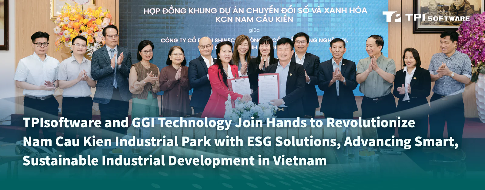
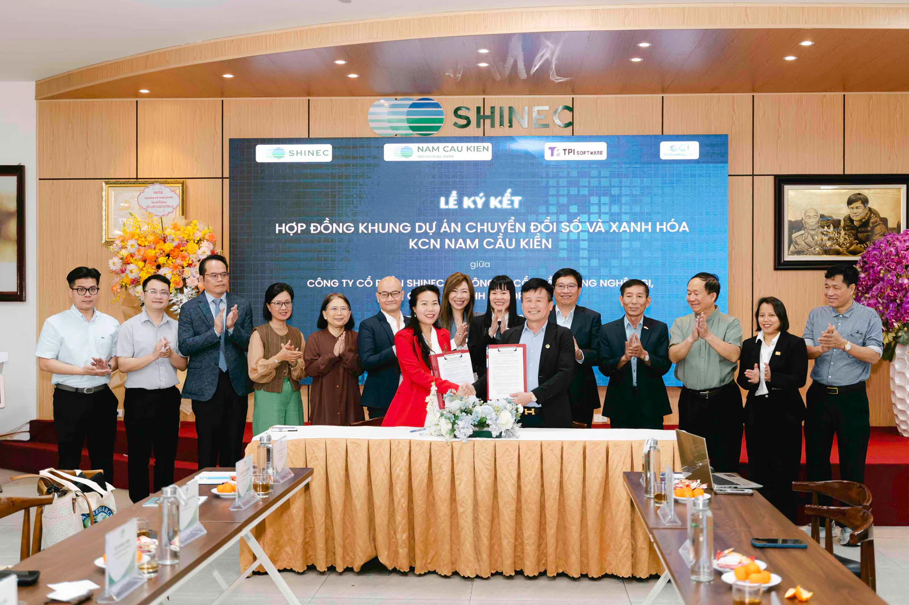

TPIsoftware (TWSE: 7781) and its Vietnam’s partner GGI technology have collaborated in a flagship project to implement AI-powered ESG solutions in Nam Cau Kien Industrial Park to reinforce the country’s commitment to sustainable development in the industrial sector. Following the signing between the key partners, the cross-national project aims to transform Vietnam’s first eco-industrial park, established in 2008, by deploying AI technologies to enhance environmental, social, and governance (ESG) practices, while supporting Vietnam’s goal to achieve net zero emissions by 2050.

***Nguyen Thuy Anh** (CEO, GGI Technology) and **Pham Hong Diep** (Chairman, Shinec) sealed the partnership agreement with a handshake after signing the contract, witnessed by **Yvonne Chien** (Executive Vice President of TPIsoftware), **Do Vuong Phong** (General Manager of TPIsoftware Vietnam), **Dr. Nguyen Kim Anh** (ESG expert), with the attendance of key leaders.*

Located in Hai Phong, Vietnam, Nam Cau Kien has attracted domestic and foreign investors due to its strategic location in the Northern coastal region and long-term sustainability initiatives. The park has partnered with GGI Technology, a leading environmental consultancy offering advice for GHG and ESG projects, to effectively implement ESG strategies. GreenSwift and ElectriSwift—sustainability solutions by TPIsoftware—have been incorporated into the park’s system for seamless greenhouse gas emissions management and improved energy efficiency.

As a key component of the sustainable development model, GreenSwift, an integrated carbon management platform, is utilized to automate carbon data collection, analysis, and reporting, ensuring carbon auditing efficiency and compliance with international frameworks such as ISO 14064 and the Intergovernmental Panel on Climate Change (IPCC). Complementing the initiative is ElectriSwift, an AI-powered energy management system, which provides real-time insights into energy consumption, identifies inefficiencies through anomaly detection based on acquired power usage patterns, improving overall ESG performance while reducing energy costs.

Ms. Nguyen Thuy Anh, CEO of GGI Technology, stated: "GGI’s mission is to accompany businesses on their journey toward sustainable green transformation, positioning ESG as a strategic foundation for growth. Nam Cau Kien is an ideal partner—bringing together vision, commitment, and determination to lead the green transition of Vietnam’s industrial sector."

"Nam Cau Kien is committed to building the industrial park model of the future—where economic growth goes hand in hand with environmental and social responsibility," affirmed Mr. Pham Hong Diep, Chairman of the Board of Directors at Shinec Joint Stock Company, the investor behind Nam Cau Kien Industrial Park. "We are joining hands to create a true ecological industrial park at Nam Cau Kien, spreading the spirit from Hai Phong to investors across the country, and inspiring a mindset of sustainable investment, investment for the future, where economic development is closely tied to environmental protection. This, in turn, helps build a symbiotic ecosystem that brings happiness to the community," he emphasized.

Dr. Nguyen Kim Anh, ESG advisor and environmental remote sensing expert at the Vietnam Academy of Science and Technology, emphasized: "A truly green industrial park not only applies ESG principles but also requires a centralized management system that connects environmental, energy, and ecological security data on a single digital platform. The application of AIoT, artificial intelligence, remote sensing, and integrated one-stop technologies enables real-time monitoring, operational optimization, and ensures truly sustainable development."

“ElectriSwift’s implementation in Vietnam's industrial park marks its global launch, with an upcoming plan to conduct a PoC (Proof of Concept) at the Tainan City Hall in southern Taiwan. This signifies ElectriSwift’s potential to be deployed across public and commercial infrastructure for enhanced utilization and optimization of renewable energy,” said Yilan Yeh, General Manager at TPIsoftware. “Our collaboration with Nam Cau Kien shows how we, as a B2B software leader, leverage our expertise in digital transformation solutions to help enterprises navigate the challenges of technological advancement, sustainable development and regulatory compliance. That is the spirit behind our ‘Tech for Change’ motto—harnessing the power of technology to drive sustainable transformation. It’s about creating smart, market-proven solutions that help organizations meet their ESG goals while building a more resilient and responsible future for the planet.”
