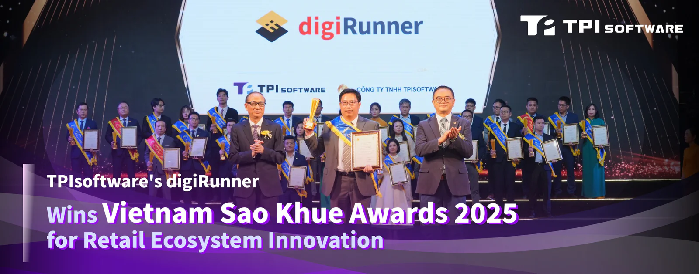
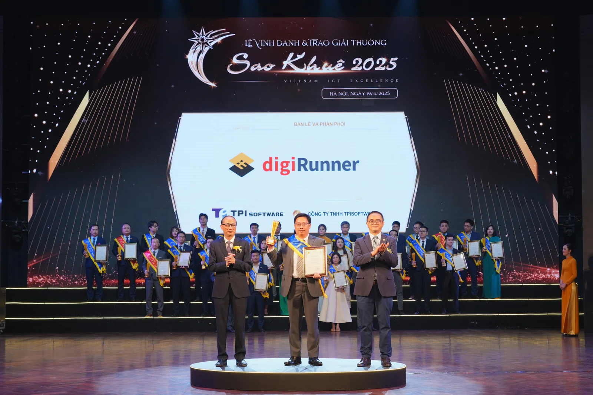

TPIsoftware (TWSE: 7781), Taiwan's leading software company specializing in digital transformation, has been awarded the **Sao Khue Awards 2025** in recognition of its API management platform digiRunner's proven capabilities in heterogeneous integration across retail ecosystems. Being an honoree in the Retail and Distribution category, digiRunner has been accredited for its excellence in enhancing efficiency and scalability through microservices architectures and seamless third-party connectivity, with API standardization improving interoperability across disparate systems and applications to overcome legacy constraints for enriched experience and accelerated iteration.

*Do Vuong Phong, General Manager of TPIsoftware Vietnam, accepted the Sao Khue Awards trophy.*

The Sao Khue Awards, organized by the Vietnam Software and IT Services Association (VINASA) since 2003, are one of the most esteemed awards in Vietnam's software and IT services industry. The awards saw participation from 165 organizations, with over 500 nominations competing in nine categories. The rigorous three-round evaluation process was conducted by a panel of industry experts, chaired by Nguyen Quan, former Minister of Science and Technology. Criteria include market performance, technology and quality, impact and effectiveness, and unique selling proposition. digiRunner stands out as the winner of Best Retail and Distribution Solution, alongside 198 digital products, services and solutions by tech leaders in Vietnam.

Following its recognition for Best Open Banking APIs Southern Asia 2024 from the Global Banking & Finance Awards®, TPIsoftware's win at the awards reflects its deep-rooted experience in technology over the past two decades. The company's proprietary API management platform digiRunner not only meets the unique digital challenges in the retail industry, but also stands as an integrated API solution across sectors such as finance, insurance, healthcare, telecoms, public services, manufacturing and e-commerce. The platform helps organizations meet industry requirements by supporting authentication frameworks such as OAuth 2.0 and OpenID Connect, and ensure compliance with the General Data Protection Regulation. Designed for mission-critical services, digiRunner is built with load balancing and traffic throttling to optimize traffic distribution, ensure system stability and prevent failures.

Yilan Yeh, General Manager of TPIsoftware, says, "The recognition not only affirms digiRunner's robustness to help retailers navigate the complex API landscape with confidence, but also comes as a testament to TPIsoftware's ability to empower enterprises to achieve goals, maximize value and drive innovation. The award gives us the momentum to deliver tech solutions that empower our clients' digital transformation journeys."
