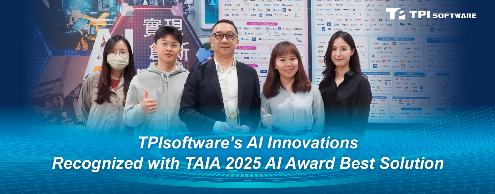

TPIsoftware’s conversational AI product SysTalk.ai was named Best Solution at the 2025 AI Award by Taiwan Artificial Intelligence Association (TAIA). Established in 2023, the TAIA’s 2025 AI Award is a prestigious honor recognizing AI innovation and contributions. Finalists are carefully chosen through a three-round rigorous evaluation process conducted by a panel of experts.

The awards saw record-high submissions this year, and selected 18 tech leaders as well as 11 scholars, healthcare practitioners and professionals whose contributions to AI are impactful and innovative. TPIsofware’s SysTalk.ai ranked Distinction for its proven capabilities to deliver AI-complementing and -enhancing solutions using generative AI and discriminative AI, which classifies and predicts data for improved decision-making. With 120 million active users in Taiwan, SysTalk.ai has been widely adopted and seen effectiveness in AI-enhanced applications across key sectors, especially at a time when the labor market is constrained. Incorporating SysTalk.ai into AI strategy empowers businesses to further utilize AI to improve efficiency and drive iteration.

“In the rapidly-changing AI landscape, businesses confront technical challenges that impede their ability to leverage AI, causing gaps between expectations and real-world experience. Over the past five years, we completed 38 AI-related projects that deliver value and tangible outcomes, empowering businesses to better serve their customers with our one-stop GenAI solutions. We believe that by using the right AI, businesses will be equipped to make the right decision and achieve the best results, further enhancing productivity while capitalizing on AI adoption,” says Jeff Lin, Executive Vice President of TPIsoftware’s Innovation and AI Product Division.

“The industry awards affirm our commitment to addressing businesses’ AI-related challenges in their digital transformation journey. Integrating GenAI into a one-stop solution helps enhance business processes and improve decision-making throughout their critical operations,” comments Yilan Yeh, TPIsoftware’s General Manager. “We see ourselves as a tech leader, rather than a mere B2B software provider, as we always lean into innovative AI applications and industry expertise to strategize on a future-proof, impactful digital experience for our clients.”
