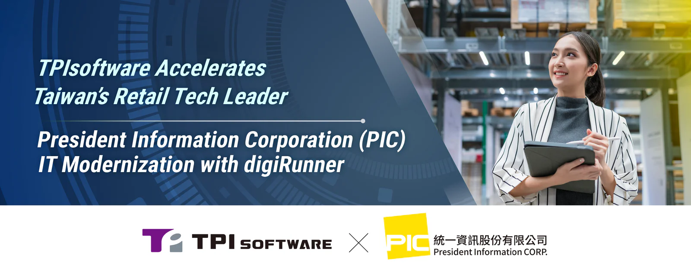

TPIsoftware (TWSE: 7781) and President Information Corporation (PIC), an IT solution provider affiliated with Taiwan's largest retail and convenience store operator Uni-President Group, have joined hands to promote innovative, reliable retail services. Specializing in Digital Transformation as a Service (DXaaS), TPIsoftware provides a diverse array of products and solutions that empower businesses across industries to navigate the ever-evolving digital landscape. The company’s API management platform digiRunner has proven robustness in connecting APIs across systems, applications and third-party services to ensure interconnectivity, operational efficiency and integrated experiences.

digiRunner helps PIC bring new features and updates to users faster by using a scalable, container-based design, allowing iteration and shortened service launch times. Sensitive information is secured against cyberthreats with access controls, data encryption and API keys for enhanced authentication and authorization. These features in digiRunner ensure responsive user experiences, strengthen confidentiality and reduce risks of breaches. The platform enables compliance with standard measures like OAuth 2.0 when connecting third-party services and applications.

In case of burst traffic like the holiday season, websites and apps can slow down or crash because of the heavy load. digiRunner’s ability to dynamically distribute API requests helps prevent interruptions and system overload while reducing latency in service delivery. With digiRunner’s smart caching that stores frequently accessed data, users are guaranteed a faster, smoother experience—especially for online shopping and retail services.

“Retail ecosystems face challenges in real-time data exchange, payment integration, transaction processing and the management of customer data and membership systems,” commented PIC. “Incorporating digiRunner as part of our API strategy allows us to integrate APIs distributed across systems, providing data interoperability in a seamless, meaningful way. Also, security controls are facilitated to effectively secure data against unauthorized access and misuse. TPIsoftware drives our modernization into action, allowing stable, trusted services as well as enriched experiences for our customers.”

“With a solid track record of successful implementations in the financial services sector, we are proud to partner with Taiwan’s retail tech leader PIC to create a fully integrated system solution—especially at a time when labor constraints and operational inefficiencies hinder retailers’ ability to transform,” said Yilan Yeh, TPIsoftware’s General Manager. “By addressing IT bottlenecks with compliant, scalable and market-proven digital solutions like digiRunner, we help clients achieve tangible outcomes and maximize business value, empowering them to advance their digital transformation journey.”
