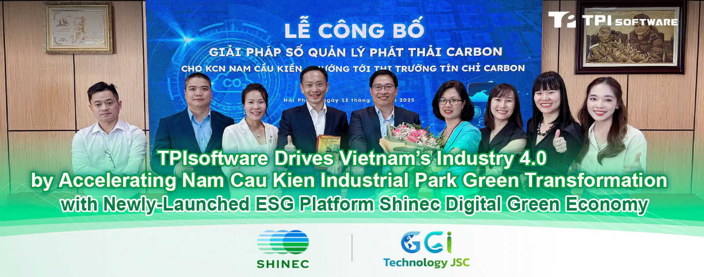

Today, Shinec Joint Stock Company, the developer of Nam Cau Kien Industrial Park (IP), officially launched its ESG application platform, "Shinec Digital Green Economy," marking a significant milestone on its journey toward sustainable development. This event not only represents a major step in the comprehensive digitalization of the IP's operational management but also affirms Nam Cau Kien's pioneering role in creating an eco-industrial park, advancing towards Net-Zero targets, and unlocking the potential for carbon credit generation.

TPIsoftware supports the park sustainability initiative with the "Shinec Digital Green Economy" platform, a comprehensive solution powered by the company’s GreenSwift (smart carbon management platform) and ElectriSwift (smart energy management system), with GGI Technology serving as the ESG consultant. The platform functions as an intelligent IP management system focused on digitalizing environmental management, emissions control, and security. Through this platform, the solution provides a holistic management system, from real-time carbon emissions data collection and analysis of emission and energy consumption hotspots to recommending and monitoring improvement strategies.

*The Shinec Digital Green Economy dashboard, a centralized platform for real-time environmental and operational monitoring at Nam Cau Kien (NCK) Eco-Industrial Park in Hai Phong, Viet Nam. It tracks key performance indicators including GHG emissions, energy consumption (grid vs. solar), and wastewater treatment effectiveness, turning sustainability efforts into measurable data.*

The superiority of "Shinec Digital Green Economy" is demonstrated through its diverse integrated features:

<strong>•</strong> **Greenhouse Gas (GHG) Emissions Management (powered by GreenSwift)**: Streamlines carbon data collection, analysis and reporting, ensuring auditing and inventory efficiency through an integrated platform, aligning the inventory process with international standards such as ISO 14064-1.

<strong>•</strong> **Smart Energy Management (powered by ElectriSwift)**: Monitors and detects energy inefficiencies based on acquired power usage patterns, providing insights into energy consumption with real-time alerting for optimized energy-saving strategies.

<strong>•</strong> **Wastewater Monitoring and Treatment**: Tracks water quality indicators (pH, TSS, COD, BOD, Ammonia) before and after treatment and calculates the corresponding GHG emissions.

<strong>•</strong> **Intelligent Security Monitoring**: Integrates AIoT into the camera system to issue instant security alerts for events such as crowd detection, fence climbing, accidents, and fires.

<strong>•</strong> **Visual Reporting**: Provides an intuitive dashboard on both mobile and web platforms, allowing management to access reports anytime, anywhere, facilitating timely and effective decision-making.

In the face of intense pressure from global climate change, Carbon Management Systems (CMS) are emerging as a new global trend, aligning with international accords such as the Paris Agreement (2015), Net Zero 2050, and COP26/COP28. These frameworks compel businesses to reduce carbon emissions. Regulations like the EU's Carbon Border Adjustment Mechanism (CBAM) impose carbon tariffs on imported goods, forcing exporting enterprises to measure and manage their carbon footprint. Globally, CMS is becoming mandatory for listed companies (under IFRS S2, CSRD), while carbon pricing (taxes, ETS) is being strengthened in developing nations.

Japan and South Korea are leading with carbon pricing policies (carbon tax, ETS), with corporations like Toyota and Samsung already implementing CMS to achieve their Net Zero 2050 goals. Indonesia and Malaysia are focusing on CMS in the oil and gas and agricultural sectors. The Indian government has promoted its Carbon Credit Trading Scheme (CCTS) since 2023. China is at the forefront of implementing robust policies to support its businesses in transitioning towards carbon neutrality by 2060 and is a pioneer in IP carbon management, investing in carbon offset projects across ASEAN and Africa.

Vietnam is committed to achieving net zero by 2050 and will pilot a carbon credit exchange, including mechanisms for trading and offsetting credits, while preparing to officially launch a carbon credit trading floor connected to regional and international markets by 2028. CMS adoption in Vietnam is expected to grow, driven by FDI and export requirements. The government will support SMEs through tax incentives and training. Vietnamese businesses are encouraged to invest in CMS early to mitigate carbon tax risks and enhance global competitiveness.

Investing in this green and digital solution not only helps Nam Cau Kien IP optimize operations and reduce costs through efficient energy and resource use but is also a strategic move to enhance its brand reputation through environmental responsibility. This positions the IP to achieve ISO certifications for energy management (ISO 50001) and carbon neutrality (ISO 14068). Furthermore, the next phase of the project is expected to digitize green spaces—which account for 31% of the entire IP, including trees, shrubs, lawns, and water features—and renewable energy sources. This will create a solid foundation for calculating carbon sequestration and tapping into the future carbon credit market for the developer.

Nam Cau Kien Industrial Park, under Shinec's strategic investment, marks the group’s commitment to creating an eco-industrial park model toward achieving carbon neutrality. The collective efforts of Shinec's pioneering vision, GGI Technology's expert consultancy, and TPIsoftware's strengths in implementing impactful sustainability initiatives are poised for broader deployment across Shinec's eco-industrial parks and other industrial parks in Vietnam.

The launch of "Shinec Digital Green Economy" not only elevates the stature of Shinec and Nam Cau Kien IP within the Vietnamese and regional industrial park landscape but also builds significant credibility for its implementation partners, GGI Technology and TPIsoftware. It affirms their capacity to consult on and deliver advanced green technology solutions, contributing significantly to Vietnam's national sustainable development goals.
