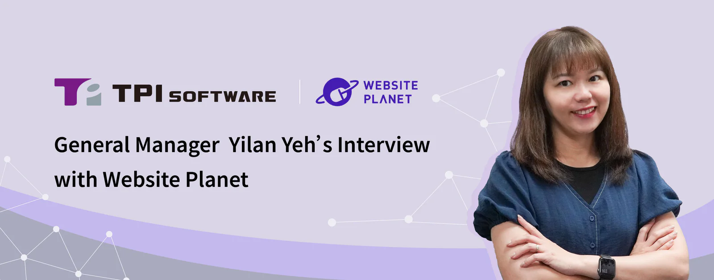

*TPIsoftware General Manager Yilan Yeh spoke with Predrag Vlatkovic from Website Planet to explore how the company is helping enterprises overcome legacy challenges and build scalable, secure and sustainable systems for long-term success. Read this exclusive interview to learn more.*

**1\. How and when was TPIsoftware founded, and what pain points were you trying to solve?**

[TPIsoftware](/en/about-us) was founded in April 2005 by Ben Yao. Starting as a small team of 5, TPIsoftware has grown into a leading tech company trusted by clients and partners across finance, insurance, healthcare, government, transportation, manufacturing and retail industries.

As a DXaaS (Digital Transformation as a Service) company, TPIsoftware specializes in addressing legacy constraints, security risks and operational inefficiencies with a diverse array of solutions across the four product lines below:

•  **[DigiLism:](/en/products/digilism)** Centralized management solutions of APIs, logs and big data help businesses gain visibility and actionable insights into their critical operations through heterogeneous integration, comprehensive monitoring and real-time data exchange.

•  [**SysTalk.ai:**](/en/products#systalkai) Conversational AI chatbots and robotic process automation (RPA) address constrained labor with enhanced efficiency, productivity and experience, ensuring real business outcomes and effectiveness of AI initiatives.

•  **ESGswift:** Greenhouse gas emissions and energy management solutions streamline the complex process of collecting, measuring and analyzing data, helping businesses better align their operations with ESG goals and regulatory compliance.

•  **GadoSecurity:** FIDO-based passwordless authentication and AI-powered anomaly detection system ensure an effective, adaptable and resilient approach to addressing vulnerabilities and preventing attacks in today’s tech landscape where threats keep evolving.

**2\. What is digiRunner, and how does it work?**

[**digiRunner**](/en/products/digirunner) , under the **DigiLism** family, is an enterprise-level API management platform that helps integrate APIs to ensure system stability and zero-downtime operations. Key capabilities include:

1\. **Dual-centered, in-memory gateway:** Ensures zero downtime during database failures, service disruptions, system upgrades or blue-green deployments.

2\. **Auto-scaling:** Dynamically adjusts resources based on actual traffic for optimized performance and improved stability.

3. **Full lifecycle API management:** Oversees an API from its creation to retirement across its full life span, including registration, version control, authentication, rate limiting and monitoring.

4\. **Enhanced API security:** Incorporates OAuth and JWT authentication, along with an in-memory password vault for credential management.

**digiRunner**’s cloud-native design also enables seamless deployment across various environments using Kubernetes-based architecture for greater scalability. It supports multi-cloud (AWS, Azure, GCP) and hybrid cloud setups, allowing businesses to deploy APIs flexibly while avoiding vendor lock-in. With dynamic traffic distribution and load balancing, digiRunner ensures high availability, low latency and optimized performance.

**3\. You have also developed gadoDIDO and gadoScout, the two products under the GadoSecurity family, to further strengthen your clients' security. Can you elaborate on those?**

GadoSecurity focuses on helping enterprises strengthen their security posture by providing FIDO-based passwordless authentication (gadoDIDO) and anomaly detection (gadoScout).

**[gadoDIDO](/en/products/gadodido)**, aligning with the FIDO2 standard, uses public-key cryptography to authenticate sign-ins by generating a unique key pair (public and private keys) with biometrics (e.g., fingerprints, facial recognition), enabling phishing-resistant and seamless login experience.

[**gadoScout**](/en/products/gadoscout) incorporates AI and machine learning to detect deviation in behaviors like unusual login patterns, access from unexpected locations and abnormal API requests, allowing the SRE team to quickly identify, respond and mitigate threats in a more proactive manner.

These two solutions work to help businesses:

• Support security and regulatory compliance with a zero-trust framework

• Build reliable, stable and resilient IT architecture by enabling seamless integration with SSO, MFA, API management, etc.

• Improve user experience:

○ **gadoDIDO** reduces password-related vulnerabilities and reset costs, making sign-ins faster, safer and simpler.

○ **gadoScout** filters false positives from real incidents and addresses wasted labor, enhancing the accuracy and effectiveness of threat detection.

**4\. How does TPIsoftware help businesses realize digital transformation?**

    •  **Strengthening mission-critical operations** with a digital middle platform that ensures reliability, security and operational resilience.

\

    •  **Enhancing AI-enabled services** through intelligent chatbots and virtual assistants, improving user experience, service quality and efficiency.

\

    •  **Advancing sustainable practices** with carbon and energy management solutions that support ESG compliance and transparent disclosure.

**5\. What can we expect from the company going forward? Any upcoming projects we could be looking forward to?**

2025 marks a major milestone for TPIsoftware as we celebrate our 20th anniversary, following our listing on Taiwan’s Emerging Stock Board (ESB) last year. As we reflect on our achievements, we remain steadfast in expanding our global footprint, with a growing network of subsidiaries and strategic partnerships across APAC and beyond—including Vietnam, Thailand, Indonesia, Cambodia, Singapore, Japan, Europe and the United States.

Looking ahead, we are committed to sustained innovation through increased investment in R&D and the acquisition of invention patents. Our goals include unlocking new revenue streams through software and hardware integration across the value chain to drive profitability.

One of our recent cross-border collaborations is [the implementation of GreenSwift and ElectriSwift in Nam Cau Kien](/en/media-center/539), the first and one of the largest ecological industrial parks in Vietnam. The sustainability initiative reinforces the country’s commitment to responsible operations and its progress toward net zero, with further deployments anticipated in other industrial zones.

Building strategic partnership networks like these are central to our growth strategy. They not only open doors to regional markets, but also highlight the global competitiveness and technological capabilities of TPIsoftware. We're excited about the opportunities ahead and confident in our ability to thrive across APAC and beyond.

Interviewed and published by [Website Planet](https://www.websiteplanet.com/blog/interview-tpisoftware/)
