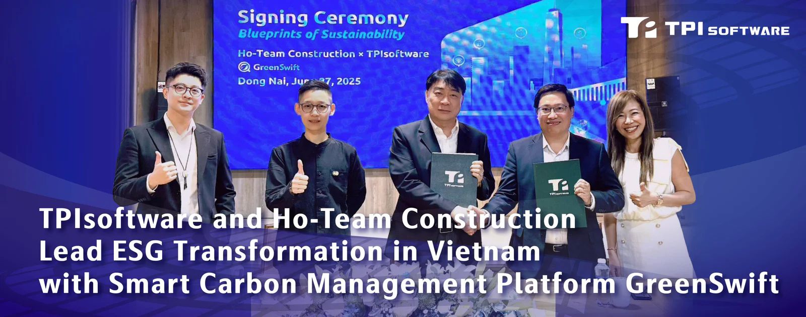
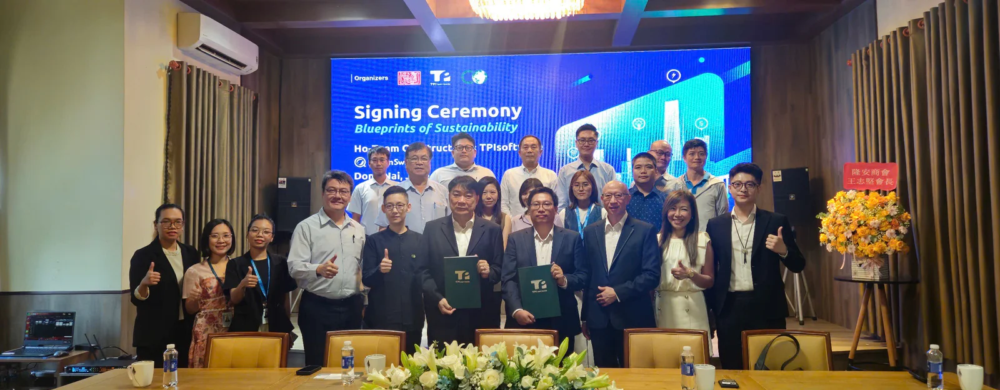

Taiwan’s DXaaS company TPIsoftware (TWSE: 7781) and Ho-Team Construction Co., Ltd., a Taiwanese-owned construction firm operating in Vietnam since 2007, announced a strategic collaboration to support Vietnam’s roadmap toward net zero with GreenSwift, an AI-powered carbon management platform.

*Chien Chih Ming (Ho-Team Construction Chairman) and Do Vuong Phong (TPIsoftware Vietnam General Manager) sealed the partnership with a handshake, witnessed by far left Harry Lu (ESG Service Corporation Association Chief Supervisor), Chien Tzu-Yun (Ho-Team Construction Vice President) and Yvonne Chien (TPIsoftware Executive Vice President) at the signing ceremony held in Đồng Nai, Vietnam.*

Signed on June 27, the partnership highlights Ho-Team Construction’s leadership in sustainability and its proactive preparation for Vietnam’s carbon trading regulations, which are set to take full effect in 2029. The signing ceremony took place at the Ho-Team Construction headquarters located in Đồng Nai, Vietnam, and was graced by representatives from ESG Service Corporation Association, TÜV Rheinland Việt Nam, CSGT Metals Vietnam Joint Stock Company (CSMV), TAYA (Vietnam) Electric Wire & Cable Joint Stock Company, Yung Chi Paint & Varnish MFG (VN), TAISHIBA Electric, Taiwan Fluoro and Pro-Chain International Ltd.

With a well-established presence in Vietnam, Ho-Team Construction has built over 600 industrial facilities and completed more than 240 large-scale industrial and commercial infrastructure projects nationwide while currently working on 13 projects across both the northern and southern regions.

In June this year, Vietnam officially launched the pilot phase of its emissions trading scheme, targeting three major industrial sectors—steel, cement and thermal power—to reduce their carbon dioxide emissions. Under the program, companies in these sectors will be mandated to purchase emissions allowances based on their carbon intensity as outlined in a government decree.

With full implementation of the scheme expected by 2029, Ho-Team Construction is taking the initiative by adopting carbon management solutions to ensure future compliance and maintain a competitive edge. By implementing an integrated platform like GreenSwift, the firm aligns with Vietnam’s emissions trading scheme while advancing its ESG strategy.

The AUP-certified carbon management platform streamlines the process of collecting and analyzing carbon data as well as generating ISO 14064-compliant reports. Built-in support for the latest IPCC emissions factors ensures accuracy and alignment with international standards. From inventory planning and defining organizational boundaries to identifying emission sources, calculating emissions and generating audit reports, GreenSwift provides actionable, data-driven insights into emissions reduction strategies. The platform also supports cloud-based collaboration across teams and locations, helping enterprises simplify reporting and improve consistency, transparency and regulatory readiness.

Chien Chih Ming, Chairman of Ho-Team Construction, said “GHG emissions generated from the construction industry continue to rise as a result of Vietnam’s economic boom, with projected emissions of 148 million tons by 2050. While net-zero targets have been set, progress in high-emissions sectors such as construction has been slow. As a leading builder, we see it as our responsibility to lead by example in driving sustainable development.”

“Achieving carbon neutrality becomes a global imperative as climate change presents drastic impacts to our planet.” stated Chien Tzu-Yun, Vice President of Ho-Team Construction and President of ESG Service Corporation Association. “By partnering with TPIsoftware, we are deepening our commitment to measurable climate action through digital transformation. Their local support and consulting expertise help us navigate complex regulations and position us competitively in Vietnam’s evolving carbon market.”

Yilan Yeh, General Manager of TPIsoftware, shared “This agreement highlights GreenSwift’s adaptability and readiness for Southeast Asia’s climate policies. As Vietnam accelerates its carbon trading initiative, we are proud to help businesses in the country digitize their GHG emissions management, advancing their ESG goals with greater confidence and regional compliance.”
