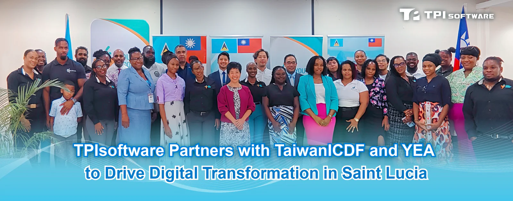

TPIsoftware (TPEx: 7781) has partnered with the International Cooperation and Development Fund (TaiwanICDF) and the Youth Economy Agency (YEA) of Saint Lucia to launch an e-commerce platform to support youth and women entrepreneurship in Saint Lucia by accelerating the country’s digital transformation. The company looks to deepen global partnerships and solidify its market leadership, with AI agent adoption to ensure security and continued business success.

Launching the e-commerce platform marks a significant milestone for TPIsoftware amid its global expansion in recent years. The official ceremony was attended by Ambassador of the Republic of China (Taiwan) to Saint Lucia Nicole Su, YEA CEO Bryan Vidal, YEA Chairman Thomas Leonce, Chief of the Taiwan Technical Mission (TTM) Daniel Lee, and TPIsoftware Vice President Alvin Wu.

In collaboration with the TaiwanICDF’s Assisting the Economic Empowerment of Youth and Women Project, 525 young and female entrepreneurs in Saint Lucia were supported with training schemes essential for starting a business and 640 businesses were provided with consultancy and guidance. The new e-commerce platform helps increase the online presence of micro-, small- and medium-enterprises in the country, fostering competitiveness in the local marketplace.

“As e-commerce shifts consumer behavior, the new platform paves the way for Saint Lucian women and youths to establish their own start-ups and fulfill their entrepreneurial ambitions,” stated Nicole. “Taiwan is more than happy to share our technical expertise and experience to help entrepreneurs thrive in the local, regional or even global market.”

The e-commerce platform, built with AI and digital solutions by TPIsoftware, enables real-time order tracking and inventory management, integrates data analytics and provides market insights to eliminate barriers to entrepreneurship. This empowers young people and women to nurture their intent to set up a business, encourages their ventures and participation in competition.

TPIsoftware General Manager Yilan Yeh emphasized that the platform is built on the company’s core technologies to achieve process automation and intelligent management. Future upgrades will include guest checkout, vendor backend systems, customer reviews and advanced order tracking features. An online payment system will also be incorporated to build a digital business ecosystem with enhanced security and convenience.
