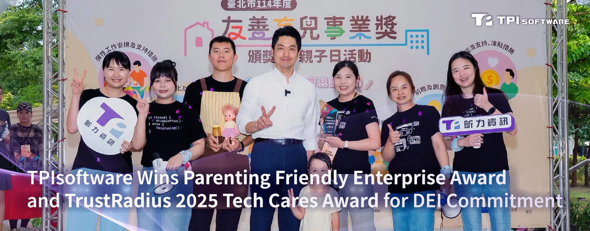

TPIsoftware (TPEx: 7781) was recognized with the Parenting Friendly Enterprise Award from the Department of Labor of Taipei City Government and the TrustRadius 2025 Tech Cares Award for its commitment to environmental sustainability and diversity, equity and inclusion (DEI).

“We take real actions toward building a gender- and family-friendly workplace with well-rounded approaches. These accolades are testimony to what we advocate for,” said TPIsoftware’s General Manager Yilan Yeh, highlighting last year’s wins of the TCSA Gender Equality Leadership Award by the Taiwan Institute for Sustainable Energy (TAISE) and The Best Employer Awards from the two Taiwan’s largest recruitment sites 104 Job Bank and Yourator.

“TPIsoftware embraces corporate social responsibility not only at an organizational level, but also to an extent of all involved stakeholders. We are committed to empowering businesses to strengthen their competitiveness with our AI-driven software products, enabling them to operate more efficiently and sustainably.”

TPIsoftware was among 44 companies honored by the Taipei City Government for fostering a family-friendly workplace. Winners were selected through a three-round evaluation process based on seven criteria. TPIsoftware offers various benefits to support parent employees, including flexible hours, remote work options, 10-day prenatal leave and other stipends. Childcare and daycare support is also provided to help parent workers achieve a work-life balance.

The TrustRadius 2025 Tech Cares Award recognizes B2B tech companies that go beyond corporate social responsibility in supporting their employees, communities and the environment. Being one of the 100 honorees this year, TPIsoftware supports its clients’ ESG goals with its proprietary software products: GreenSwift (carbon management platform) and ElectriSwift (energy management system).

As a way to demonstrate the use of renewable energy into its operations, TPIsoftware has supplied its Kaohsiung office with 10,000 kWh green electricity under the Taipower’s Small-Scale Green Energy Auction 2025-2029 program. Workers at TPIsoftware are entitled to The Employee Assistance Program (EAP) among other benefits such as annual health checkups, free massages, educational subsidies, etc.

“TPIsoftware embraces a flat organizational structure to encourage open communication, fostering engagement and a sense of belonging among our employees,” stated Mina Yieh, TPIsoftware’s Executive Vice President. “We are deeply committed to sustainability, actively participating in initiatives like the Step 30 shoe donation and planting trees in Taitung. We believe true company success is defined by both profitability and positive impacts on the environment and people.”
