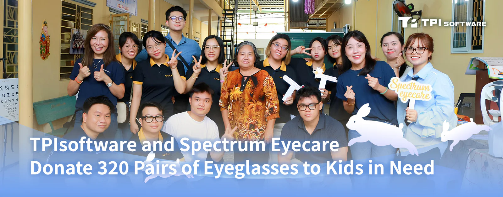

TPIsoftware Vietnam and Spectrum Eyecare today donated hundreds of pairs of prescription eyeglasses to children in need along with school supplies as part of the community outreach program and in celebration of the upcoming Mid-Autumn Festival.

*Children from the charity class at Phước Thiện Pagoda participated in Mid-Autumn Festival activities.*

The charity program, themed “Care for Your Eyes, Shine for Your Future,” was conducted throughout September by TPIsoftware members and professionals at Spectrum Eyecare. The team visited Bình Thọ Centre, Kỳ Quang Pagoda and the Phước Thiện Pagoda Volunteer Class, providing free vision screenings and prescription eyewear to 320 children. Assortments of mooncakes, candies, lanterns and school supplies were given out as Mid-Autumn Festival gifts to celebrate the traditional festivity.

Do Vuong Phong, General Manager of TPIsoftware Vietnam, shared: “At TPIsoftware, we put people at the heart of our initiatives and act in alignment with our ‘Tech for Change’ motto. Not only do we build B2B software systems and solutions for enterprises, we are also committed to giving back to the community. Empowering the young generation to see better and clearer provides them with opportunities to succeed academically and socially.”

A representative from Spectrum Eyecare, Ms. Catherine Tran also stated: “With our motto, ‘See Clear, Give Back,’ we believe that clear vision is a fundamental right and a cornerstone of every child's development. Partnering with a community-minded company like TPIsoftware, which shares our values, has allowed us to extend our mission's reach to even more children. We are overjoyed to have helped bring light and happiness to them this Mid-Autumn Festival.”
