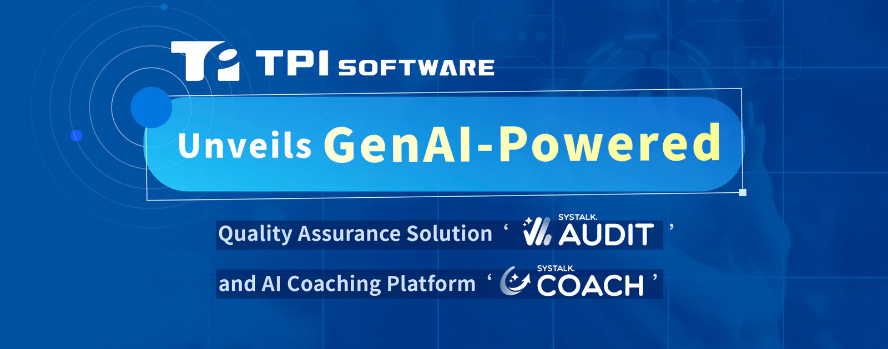

Taiwan’s leading software provider [TPIsoftware](/en) (TPEx: 7781) today launched new generative AI (GenAI) solutions: SysTalk.Audit, a contact center quality assurance solution, and SysTalk.Coach, a 24/7 coaching platform. Together with the company’s SysTalk.ICR and SysTalk.VIKI, these AI-enabled products form a complete suite of patented SysTalk.ai solutions, enabling operational efficiency and advanced automation toward building agentic AI systems.

SysTalk.Audit automates the QA process with multilingual speech recognition in Mandarin, Taiwanese Hokkien, Hakka and English. Unlike traditional QA that relies on predefined rules and phrases to process queries, SysTalk.Audit incorporates natural language understanding to interpret intent, sentiment and context of customer-agent interactions. It automatically analyzes every single inbound interaction, providing full visibility into agent performance and service quality instead of evaluating a small sample through manual review. Customizable criteria weighting, objective QA scores and comprehensive summary reports help enhance service consistency and customer satisfaction.

SysTalk.Coach delivers 24/7 AI coaching that simulates realistic interactions through roleplays. It provides instant feedback and personalized onboarding experience, shortening learning curves of new hires and reducing overall training costs. Learning progress and performance are tracked and analyzed to provide insights, allowing evaluation of teams’ readiness, engagement and skill growth. SysTalk.Coach also uses high-quality performance data collected from users to refine its training model, enabling continuous optimization of the coaching process.

“Most AI initiatives end up in failure because of the misconception that using AI tools for personal productivity is the same as implementing AI strategically at an enterprise level,” said Jeff Lin, Executive Vice President of TPIsoftware’s Innovation and AI Product Division, citing an [MIT report](https://mlq.ai/media/quarterly_decks/v0.1_State_of_AI_in_Business_2025_Report.pdf) showing only 5 percent of organizations saw meaningful outcomes. “The GenAI capabilities are purpose-built to address specific challenges in the contact center quality management and coaching process while reducing manual effort and fostering innovations.”

“AI transformation is a strategic initiative that requires not only technical expertise but also the experience of implementation and domain knowledge.” said Yilan Yeh, TPIsoftware’s General Manager. “With 20 years of experience in the software industry, we have served more than 400 clients across BFSI, healthcare, government, retail, manufacturing and e-commerce industry. With SysTalk.Service (TPIsoftware’s consulting service for optimized AI applications), our mission is to empower clients in sectors with the right AI solution that delivers high-value impacts and drives sustainable growth.”
