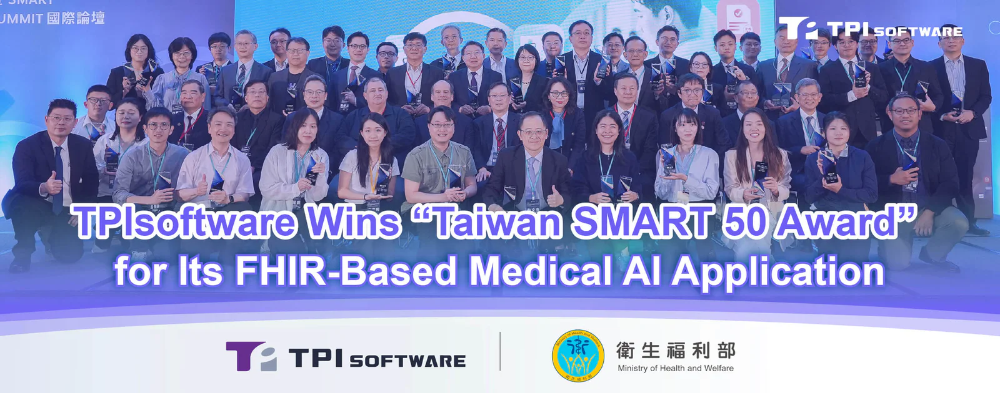
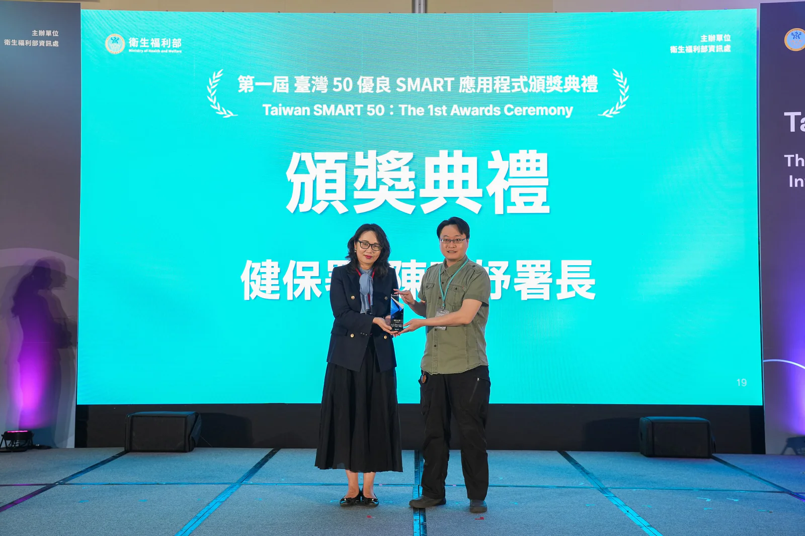

[**TPIsoftware**](/en) (TPEx: 7781) was honored with the first [**Taiwan SMART 50 Award**](https://www.mohw.gov.tw/cp-7398-86093-1.html) for creating a FHIR-based Medical AI Application.

Organized by the Ministry of Health and Welfare, the award encourages the development of smart health apps that align with the SMART on FHIR standard to enable secure and real-time data sharing across different hospitals. 50 apps were selected from 115 submissions through an open call. These apps will be listed on the Taiwan Health App Space (THAS) as part of the country’s initiative to foster data interoperability in healthcare.

*Director General of the National Health Insurance Administration Lian-Yu Chen presented the award to John Chen, representative of TPIsoftware.*

TPIsoftware’s submission of an AI-powered procedural coding tool, which is a module of its healthcare solution digiCare, has been proven to be practically effective and compliant with SMART on FHIR.

The procedural coding app uses Natural Language Processing (NLP) to identify whether a contrast agent is applied or specify anatomical sites in a radiology report. The tool generates suggested codes once clinical details are recognized, which medical professionals can then review and manually revise. The automated workflow improves coding accuracy, reduces denied claims and ensures compliance with ICD-10-PCS and DICOM. The data entry process is streamlined since the tool is compatible with existing systems such as EHR and HIS, freeing up staff to handle complex patient concerns and care journeys.

“Being named one of the SMART 50 Apps demonstrates our R&D capacity in supporting healthcare transformation. The standardized framework enables hospitals and medical centers to provide informed, high-quality care with greater consistency, security and plug-and-play simplicity,” said Pierre Hsia, Executive Vice President of Enterprise Application Development Division at TPIsoftware.

TPIsoftware General Manager Yilan Yeh attributed the accolade to the company’s domain expertise and years of experience in highly-regulated industries. “Partnerships among industry leaders, academic institutions, healthcare providers and government agencies are nurtured to support patient-centered care, clinical decisions and treatment. Following the model of the US All of Us Research Program, we are committed to building Taiwan’s national database aligned with the TW Core Implementation Guide (IG) and FHIR standard, where data are made accessible within an open, standardized ecosystem.”
