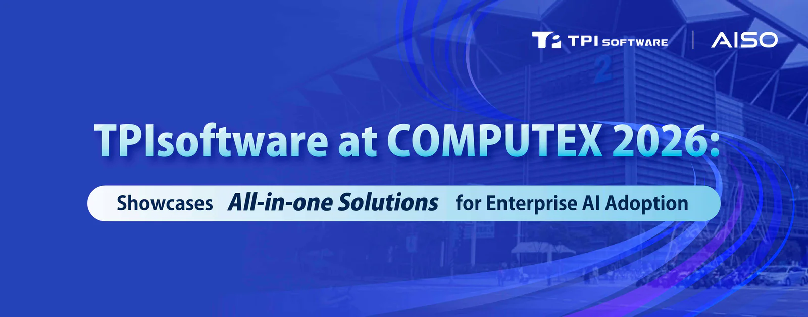

**[TPIsoftware](/en)** (TPEx: 7781) is joining forces with Phison Electronics and Elitegroup Computer Systems (ECS), co-founding members of **[AISO](https://aisoportal.com/)**, to showcase integrated AI solutions at COMPUTEX 2026. With the theme “AI Together,” the company brings together software and hardware partners to support enterprise AI implementation with reduced complexity, streamlined procurement and enhanced compatibility.

This year, the Open Source Team Taiwan pavilion, hosted by the Administration for Digital Industries, made its debut at the COMPUTEX InnoVEX exhibition. TPIsoftware is exhibiting its open-source project **[OpenTPI](https://tpi.dev/)** with a keynote focusing on how the initiative helps promote technological transparency and innovation.

The session also features demonstration of open-source digiRunner use cases completed by the Google Developer Groups on Campus (GDGoc) members. Applications range from fintech, healthcare, legal to education, including an investing tool, credit card rewards recommendations, AI-powered patient communication training, automated patent laws analysis, voice-based campus navigation, a unified info portal, AI-assisted course selection, a scholarship hub and AI tutoring.

“Our commitment to nurturing talent and democratizing AI is at the core of our mission. In an era where computing power and software capabilities mean competitive advantage, making digiRunner publicly accessible enables trusted, governable agentic AI use,” said TPIsoftware General Manager Yilan Yeh. “Moving AI from prototype to production with control over data and models ensures businesses capture value from their AI initiatives.”

TPIsoftware digiRunner has transitioned from an API gateway into an AI gateway that allows users to centrally and efficiently manage Large Language Models (LLMs) and AI agents with enhanced governance and observability. This reposition aligns with business needs to build and adopt AI at scale while securing sensitive data for compliance purposes.

AISO (AI for Sovereignty), founded by TPIsoftware, is a network that provides credible, market-proven software and hardware solutions for AI transformation with plug-and-play simplicity and affordability.

**Event Information**

When: June 2 – June 5, 2026

Where: 4F, Taipei Nangang Exhibition Center Hall 2

Booth: S0524

Registration: [https://www.computexonline.com.tw/?userlang=en](https://www.computexonline.com.tw/?userlang=en)
