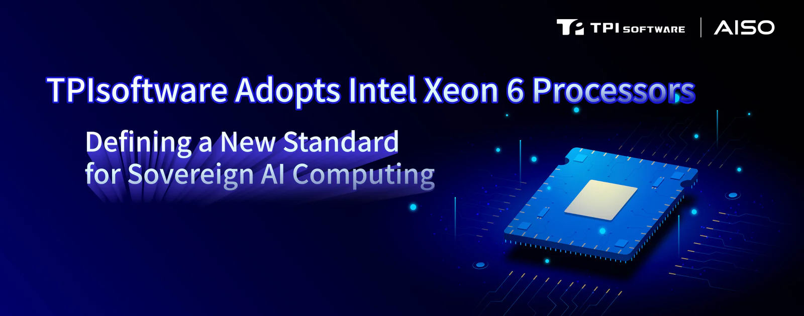

**Pioneering the Use of Intel Xeon 6 and Arc Pro B60 to Accelerate Scalable Enterprise Generative AI Applications**

As corporate demand for data autonomy and on-premises deployment rises, sovereign AI and integrated software-hardware architectures are becoming the next wave of critical competitiveness. Signifying a major technical breakthrough in software-hardware integration, **[TPIsoftware](/en)** (TPEx: 7781) announced today its adoption of Intel Xeon 6 processors with Performance Cores (P-Cores) and Intel Arc Pro B60 GPUs as the core computing foundation for its enterprise-grade AI solutions.

Working with Intel, TPIsoftware – a member of the Intel Partner Alliance – aims to strengthen its technical capabilities in edge computing and Generative AI (GenAI), assisting enterprises in accelerating digital transformation while enhancing the stability and performance of mission-critical applications.

To address the cost and data control challenges enterprises face when adopting GenAI, TPIsoftware’s self-developed SysTalk.VIKI platform leverages the powerful computing cores of Intel Xeon 6 to provide a stable and efficient foundation for complex enterprise AI models. When combined with the Intel Arc Pro GPU, SysTalk.VIKI demonstrated strong inference performance and low latency in preliminary tests, making it well-suited for high-concurrency enterprise application scenarios. Through this integrated architecture, enterprises can achieve a fully on-premises deployment, ensuring that sensitive data is managed locally, underpinned by cybersecurity and compliance.

Ben Yao, Chairman of TPIsoftware, stated: “TPIsoftware has long cultivated deeply regulated industries. We know that maintaining high system stability and performance is the core standard for corporate success. The adoption of Intel Xeon 6 and Intel Arc Pro B60 is not only a demonstration of our deepening technical layout but also a significant milestone in our promotion of the AISO Sovereign AI Software-Hardware Integration Ecosystem. Leveraging Intel’s globally leading technical advantages, we will further integrate our self-developed GenAI platform, API management middleware, and AI Gateway capabilities to create solutions featuring on-premises deployment, data autonomy, and high-performance computing. This ensures that 100% of sensitive corporate data is managed locally, enabling the intelligent transformation across all industries under the premises of safety and compliance.”

“As enterprises across Asia Pacific and Japan race to unlock the value of AI, they are looking for platforms that deliver performance, economics, and strict data control in a single, scalable architecture. By combining Intel Xeon 6 processors with Intel Arc Pro GPUs, solutions like TPIsoftware’s SysTalk.VIKI platform give customers a powerful, on-premises foundation for GenAI that lowers cost, improves responsiveness, and keeps sensitive data under their own sovereignty. This is exactly the kind of sovereign, enterprise-grade AI foundation Intel is building with our partners across the region—so governments and businesses can move faster with AI, without compromising on compliance, security, or trust,” said Santhosh Viswanathan, Vice President and Managing Director – Intel Asia Pacific and Japan.

Simultaneously, through strategic layouts in Singapore, Vietnam and Japan, TPIsoftware will accelerate expansion into the Asia-Pacific market, driving the international development of enterprise AI solutions.

©Intel, the Intel logo and other Intel marks are trademarks of Intel Corporation or its subsidiaries.
