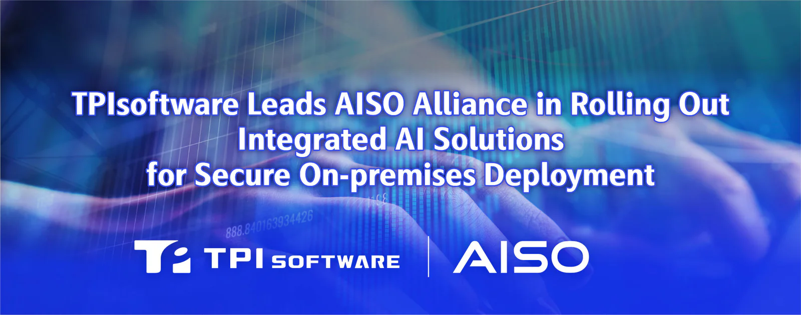

**[TPIsoftware](/en)** (TPEx: 7781) announced the launch of a lineup of integrated AI solutions, including the AISO AI Notebook, which comes pre-configured with **[OrientAI](/en/orient-ai)**, an enterprise agentic AI platform. The out-of-the-box solution delivers high-performance computing and enhances data security by running AI workloads entirely on local devices.

Unlike most hardware focused solely on compute capability without a software platform for AI governance, the AISO all-in-one AI solutions are available with OrientAI for greater visibility into AI usage. Through centralizing large language models and agents in one place, organizations enable a full-scale management framework with granular role-based access control, real-time token tracking and cost optimization.

The AISO Alliance is expanding its portfolio through a software-defined hardware approach, combining software and purpose-built hardware to deliver solutions for vertical industries. In addition to AI Notebooks, the ecosystem includes TPIsoftware’s **digiCare Smart Healthcare All-in-One AI Solution** and KDAN’s Healthcare and Manufacturing Intelligent Document All-in-One AI Solution, extending the alliance’s reach across multiple industries.

The alliance will also launch AISO 1, its first branded on-premises AI agent solution, in mid-October. The desktop system will bring together large Mixture-of-Experts (MoE) models, private knowledge bases and AI agent-powered workflow automation in a compact on-premises platform. OrientAI provides unified AI governance and token cost management across the portfolio, helping organizations optimize computing resources while keeping sensitive data on premises and advancing sovereign AI across industries.

“With new members joining the AISO Alliance, our ecosystem’s integrated offerings now cover more applications in healthcare, manufacturing, finance, security and government,” said Yilan Yeh, General Manager of TPIsoftware, adding that “hardware options include AI Notebook, AI PC, workstations and servers, depending on team size and business demand.”

Customers can now simply opt for their preferred solutions and place orders via the **[AISO Portal](https://aisoportal.com/)** without dealing with procurement frictions and adoption complexity.

TPIsoftware also announced strategic partnerships with global tech leaders as a move to continue expanding its reach across the Asia-Pacific and Southeast Asian markets.

For more details, visit AISO Portal: **[https://aisoportal.com](https://aisoportal.com/)**
