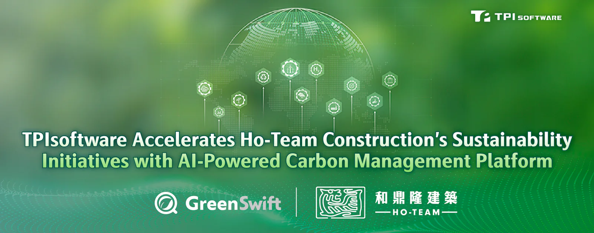

**[TPIsoftware](/en)**’s (TPEx: 7781) supported Ho-Team Construction in its carbon inventory and reporting process with **[GreenSwift](/en/products/greenswift)**, an AI-powered carbon management platform.

Bureau Veritas—a global leader in testing, inspection and certification—verified Ho-Team Construction’s emissions management effort, validating the integrity of the reported data. Conducted and assessed within the defined scope, the inventory report that the construction firm compiled using GreenSwift received third-party assurance, demonstrating its environmental performance with credibility and compliance with ISO 14064-1:2018.

Ho-Team Construction conducted an inventory to collect, measure, analyze and report on greenhouse gas (GHG) emissions with GreenSwift AI-powered features following their partnership with TPIsoftware in 2025. GreenSwift is a SaaS platform that centralizes management of emissions data and provides strategies to improve climate action. GreenSwift AI assistant provides real-time guidance and recommends which emissions factors to use during the data entry process. The emissions inventory reports are generated with AI-enhanced simplicity and are ready to be submitted for third-party audits and certification.

A PwC survey reveals that while 80% of Vietnamese businesses have made ESG commitments, 71% of them remain in the initial stages of understanding or have not started incorporating ESG data. Organizations often struggle to obtain reliable emissions data due to fragmented systems and limited supplier engagement, leading to inaccurate reporting and misguided strategies. Addressing the challenges requires a comprehensive, structured approach that enables real-time access to data and cross-team coordination using a digital solution like GreenSwift to automate the integration, quantification and analysis of emissions data for consistency and efficiency.

“Bureau Veritas verification is a testament to our commitment toward carbon reductions and environmental sustainability,” said Chien Tzu-Yun, Vice President of Ho-Team Construction. “Incorporating GreenSwift into our inventory process enables informed decisions, data-based reporting and best practices aligning with international standards. We are in a stronger position for the opportunities of the carbon market Vietnam plans to fully launch in 2029.”

“TPIsoftware supports organizations’ initiatives to achieve low-carbon and net zero emissions by streamlining data tracking, analysis and reporting,” said Yilan Yeh, General Manager of TPIsoftware. “We are pleased to be part of Ho-Team Construction’s progress to make a meaningful climate impact with our technical capabilities. We continue to drive transparent, measurable sustainability impact with partners in Southeast Asia.”
