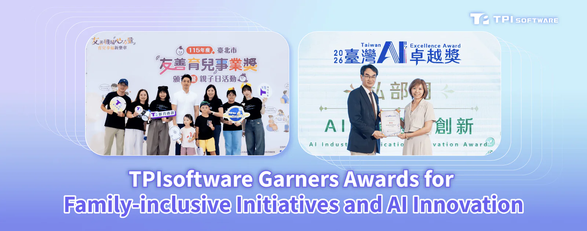

**[TPIsoftware](/en)** (TPEx: 7781) announced its recent recognitions with the Parenting Friendly Enterprise Award for its commitment to promoting diversity, equity and inclusion at workplace and the 2026 Taiwan AI Excellence Award for its integrated AI solution.

Recognized by the Department of Labor of Taipei City Government for the second year in a row, TPIsoftware’s support for parent workers was honored with the **[Parenting Friendly Enterprise Award](https://bola.gov.taipei/cp.aspx?n=E5C5E8BD24E3A36C)**. Benefit programs and measures such as flexible hours, 10-day prenatal leave, remote work options and tuition subsidies are in place to foster a family-inclusive workplace culture. A new sharing platform is built to enable community-based peer support, facilitate toy and book swaps, along with expert-led parenting webinars that provide childcare tips.

TPIsoftware’s AISO Integrated AI Solution was named one of the top-tier solutions at the inaugural <strong>[2026 Taiwan AI Excellence Award](https://aiaward.tissa.tw/winner.html)</strong> by Taiwan Innovative Software and Services Association (TISSA). The proprietary turnkey solution, with an agentic AI governance platform **[OrientAI](/en/orient-ai)** pre-configured, provides unified control over access permissions and token usage while enabling high-performance local AI workloads. It features a hybrid approach that keeps data private and secure while preserving flexibility of cloud services.

Hardware options of different specifications and mission-critical software applications are available on the designated **[AISO Portal](https://aisoportal.com/)**, where customers can directly place an order via the website. This helps reduce complexity and costs of AI adoption, providing cost-efficient solutions for businesses of all sizes.

48 specialized solutions across the public and private sector, including ThinkTron and Gogolook—also AISO alliance members—were named and presented with the Taiwan AI Excellence Award.

“In an era where AI adoption is accelerating, TPIsoftware prioritizes a human-centric approach in technological innovation and sustainable development,” said Yilan Yeh, General Manager of TPIsoftware. “In addition to the mentioned accolades, our capability in establishing healthcare interoperability was verified at the 2026 Taiwan Connectathon, demonstrating compliant, secure data sharing technology aligned with the SMART on FHIR standard.”

“With proven expertise and offerings we provide, our customers can move confidently and drive growth in the digital landscape while embracing an innovative, resilient future driven by human-first technology,” Yeh added.

*Mayor of Taipei City Wan-An Chiang presented the award to TPIsoftware Executive Vice President Mina Yieh.*

*Minister of the Ministry of Digital Affairs Yi-Jing Lin presented the award to TPIsoftware General Manager Yilan Yeh (Photo courtesy of TISSA).*
