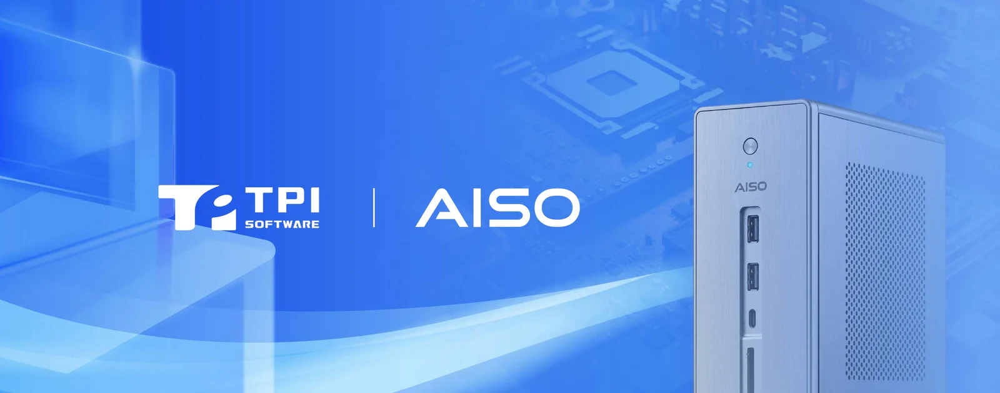

**[TPIsoftware](/en)** (TPEx: 7781) announced the launch of a new series of sovereign AI solutions pre-configured with **[OrientAI](/en/orient-ai)**, an enterprise agentic AI platform. Tailored to specific application scenarios such as legal contract review, human resources operations, talent development, teacher preparation and enterprise AI governance, the software-defined hardware solutions aim to reduce complexity and costs of AI deployment. Solution options pre-configured with Phison aiDAPTIV™ are also available for enhanced on-premises inference speed and fine-tuning efficiency.

The **Contract Review** appliance specifically designed for the legal team helps identify risk levels and provides suggestions in the original document, allowing legal professionals to review each clause before accepting the revisions. Edit history, deadlines and penalty clauses are tracked throughout the process of contract management.

The **HR Compliance** appliance combines labor laws, internal policies, payroll logic and compliance deadlines. It automates calculations for severance pay, wage in lieu of notice and unused annual leave conversion, while scheduling process milestones to ensure operational efficiency and regulatory compliance.

The **Employee Services** appliance converts internal policies into an instant, interactive knowledge base. Employees get accurate, policy-grounded answers to frequently asked questions, such as leave inquiry, reimbursement and the offboarding process, along with instructions on how to proceed, improving information accessibility.

The **AI Talent Nurturing** appliance equips students with practical AI skills through hands-on experience in model evaluation, retrieval-augmented generation (RAG), text chunking and vector embedding within a secure, on-premises environment. Through side-by-side model comparisons and parameter tuning, students gain end-to-end expertise in data structuring, knowledge base architecture and application validation.

The **Teacher Preparation** appliance automates curriculum planning, assessment authoring, teaching materials and administrative workflows. All exam data remains securely on-premises to safeguard test integrity. Historical lesson plans and questions are archived to facilitate onboarding for new and substitute teachers, while AI-assisted drafting for proposals and reimbursement documentation streamlines administrative tasks.

The **Enterprise AI Agent Governance** appliance, powered by OrientAI Enterprise, centrally manages AI agents built by teams on a unified platform. It enforces role-based access control, token usage limits and comprehensive audit logs, giving IT and security teams complete visibility into AI activity across the organization.

The **Enterprise AI Metering** appliance, powered by OrientAI Meter, provides multi-tenant isolation, token usage controls and automated billing, transforming compute resources into measurable, trackable investments. It supports quota distribution across business units and individual users, backed by an API gateway that intercepts requests when limits are exceeded.

“Enterprise AI adoption requires an all-in-one solution that integrates domain-specific software applications—such as legal contract review, HR operations, educational tools and AI governance—with hardware into a unified AI infrastructure stack. Together with our AISO alliance partners, we look forward to expanding vertical application scenarios across industries,” said Yilan Yeh, General Manager of TPIsoftware.

The new series of sovereign AI solutions is now available on the AISO portal, where customers can view product details, place an order or make an inquiry.

To learn more about TPIsoftware’s sovereign AI solutions, visit: [https://www.tpisoftware.com/en/aiso](/en/aiso)
