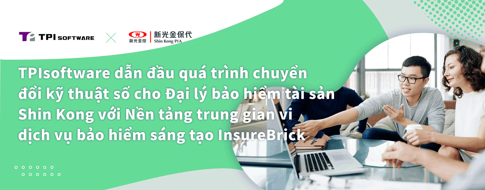

Với một bước đi đột phá của mình, TPIsoftware, công ty dẫn đầu thị trường về công nghệ phần mềm chuyển đổi kỹ thuật số đang chuẩn bị xây dựng hệ thống lõi thế hệ mới cho Cơ quan bảo hiểm tài sản Shin Kong (SKPIA) trong năm sau. Quá trình hợp tác này đánh dấu một thời điểm quan trọng trong lĩnh vực bảo hiểm của Đài Loan khi SKPIA trở thành cơ quan đầu tiên đầu tư vào chuyển đổi hệ thống lõi, nhấn mạnh sự quyết tâm của công ty trong việc đầu tư vào tiến bộ kỹ thuật số và công nghệ tài chính. Triển khai khung vi dịch vụ của TPIsoftware " [InsureBrick: Nền tảng mô-đun InsurTech](https://www.tpisoftware.com/vn/solutions/insurebrick) " được thiết kế riêng cho ngành bảo hiểm, hệ thống lõi mới sẽ tích hợp các hoạt động kinh doanh đa dạng trong SKPIA, bao gồm các mô-đun quản lý tiền gửi, hoa hồng, phân tích hiệu suất, chính sách bảo hiểm, sản phẩm, quan hệ khách hàng, các kênh, v.v. Hệ thống mới giúp nâng cao hiệu quả hoạt động và tính linh hoạt cho SKPIA, giúp họ cách mạng hóa các dịch vụ bảo hiểm của mình.

Nền tảng vi dịch vụ "InsureBrick" do TPIsoftware phát triển cho phép các đơn vị cung cấp bảo hiểm hành động nhanh chóng để đáp ứng nhu cầu thị trường năng động. "InsureBrick" bao gồm 28 mô-đun, từ quản lý khách hàng, sản phẩm và hợp đồng bảo hiểm đến đánh giá rủi ro, tính phí bảo hiểm, thanh toán, v.v. Các mô-đun này có thể kết hợp linh hoạt, cho phép đại lý bảo hiểm tùy chỉnh các dịch vụ dựa trên vai trò và nhu cầu. Bằng cách tận dụng các vi dịch vụ, hệ thống cho phép tạo ra các gói dịch vụ nhỏ hơn và độc lập, giúp tối ưu hóa quá trình sử dụng tài nguyên cũng như hiệu suất hệ thống, đồng thời giảm thời gian phát triển sản phẩm với khả năng tiếp cận thị trường nhanh chóng nhằm mang lại trải nghiệm liền mạch hơn cho khách hàng. Hệ thống lõi thế hệ mới được kỳ vọng sẽ hợp lý hóa quy trình đăng ký trên các kênh và nâng cao hiệu quả quản trị. Ngoài ra, với kiến trúc phân tách đầu trước (frontend) và đầu sau (backend) cũng như thiết kế web đáp ứng (RWD), hệ thống giúp các đại lý bảo hiểm đáp ứng nhu cầu của khách hàng mọi lúc, mọi nơi chỉ với thiết bị di động.

Ông David Huang, Chủ tịch Hội đồng Quản trị kiêm Chủ tịch của SKPIA, cho biết: "Là đơn vị đứng đầu trong lĩnh vực đại lý bảo hiểm, chúng tôi vô cùng chú trọng trong việc lựa chọn một đối tác đáng tin cậy để hợp tác và bề dày kinh nghiệm của TPIsoftware trong việc xây dựng các hệ thống lõi cho lĩnh vực BFSI là điều chúng tôi tìm kiếm".

Ông cũng nói thêm: "Chúng tôi không chỉ mong muốn nâng cao khả năng kỹ thuật số của SKPIA mà còn phục vụ khách hàng tốt hơn, đồng thời tin tưởng rằng chúng tôi có thể đạt được các cột mốc kinh doanh chưa từng có tiền lệ với hệ thống mới".

Ông Ben Yao, Giám đốc điều hành của TPIsoftware, cho biết: "Là nhà cung cấp phần mềm doanh nghiệp chuyển đổi kỹ thuật số hàng đầu tại Đài Loan, TPIsoftware thể hiện chuyên môn vượt trội về lĩnh vực Insurtech. Chúng tôi tin rằng quá trình hợp tác này sẽ giúp SKPIA xúc tiến hành trình chuyển đổi kỹ thuật số của ngành và mang lại giá trị lớn hơn cho khách hàng".

**Giới thiệu về [TPIsoftware](/vi)**

TPIsoftware là công ty phần mềm FinTech số 1 tại Đài Loan cung cấp hai sản phẩm độc quyền – Nền tảng tích hợp doanh nghiệp dưới dạng Dịch vụ [DigiFusion](/vi/products#digifusion) và sản phẩm hỗ trợ AI [SysTalk.ai](/vi/products#systalkai) nhằm thúc đẩy quá trình chuyển đổi kỹ thuật số. Nhận được sự tin tưởng của khách hàng trong ngành, TPIsoftware cũng chuyên về các lĩnh vực như InsurTech, GIS, AIoT, chăm sóc sức khỏe thông minh, UI/UX, v.v.

**Thông tin liên hệ cho tổ chức truyền thông:**

**TPIsoftware**\
Peggy Tsai\
+886-2-2658-0508 #1606\
peggy.tsai@tpisoftware.com\
[Đăng ký nhận bản tin](/vi/subscribe) [|](https://www.facebook.com/TPIsoftware) [Website](/vi) | [Facebook](https://www.facebook.com/TPIsoftwareGlobal) | [LinkedIn](https://www.linkedin.com/company/tpisoftware)
