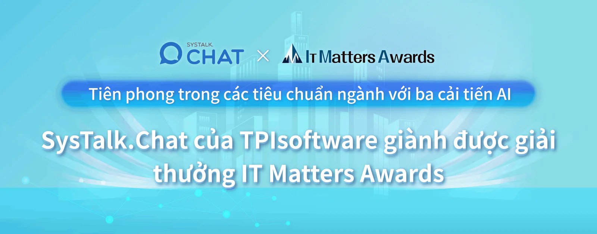

ĐÀI BẮC, 25/10/2023 /PRNewswire/ -- Ngoài những giải thưởng trong toàn ngành như Giải Xuất sắc Đài Loan, còn được coi là giải Oscar của các ngành công nghiệp Đài Loan, TPIsoftware đã vinh dự nhận được một sự công nhận danh giá khác từ Giải thưởng IT Matters Awards cho thành tích thúc đẩy chuyển đổi số với sản phẩm phần mềm độc quyền [SysTalk.Chat: AI đàm thoại dành cho dịch vụ khách hàng](/vi/products/systalk-chat) . Với ba cải tiến AI "Bộ não kép & Quy trình đơn", "Bộ não AI tích hợp ChatGPT" và "Chatbot trực quan", SysTalk.Chat đã vượt qua 200 đối thủ từ các doanh nghiệp uy tín và vinh dự nhận được giải thưởng danh giá hàng đầu trong hạng mục Sản phẩm/Dự án IT Matters.

Lễ trao giải lần đầu tiên của IT Matters Awards, do Cục Công nghiệp Kỹ thuật số và Hiệp hội Quản lý Thông tin (IMA) của Đài Loan tổ chức, vinh danh các công ty cống hiến cho công nghệ IT tiên tiến và môi trường thân thiện với IT.

## Phục vụ hàng triệu người ở Đài Loan với khả năng AI mạnh mẽ

SysTalk.Chat đã tạo ra tác động mang tính chuyển đổi và đổi mới dịch vụ khách hàng cho các ngành như Ngân hàng, Dịch vụ tài chính và Bảo hiểm (BFSI), chăm sóc sức khỏe, vận tải, thương mại điện tử, v.v. SysTalk.ai của TPIsoftware, một danh mục sản phẩm được hỗ trợ bởi AI, tiếp tục xây dựng mô hình về lực lượng lao động kỹ thuật số AI được tích hợp liền mạch vào cuộc sống của mọi người. Jeff Lin, Phó Chủ tịch Bộ phận Đổi mới & Sản phẩm AI tại TPIsoftware cho biết: "Chúng tôi luôn nỗ lực biến AI trở thành một phần quan trọng trong cuộc sống hàng ngày của mọi người. SysTalk.Chat đã phục vụ hơn 14.000.000 người mỗi năm với thị phần hơn 36% trong ngành bảo hiểm nhân thọ của Đài Loan, tiên phong dẫn đầu thị trường".

## TPIsoftware: Thiết lập sự lãnh đạo thông qua đổi mới

Để hoàn thành mô hình dịch vụ đàm thoại và tối đa hóa năng lực lực lượng lao động kỹ thuật số, cần có khả năng kết nối dựa trên API giữa các dịch vụ và nền tảng trung gian có tính năng quản lý API là chìa khóa để hỗ trợ giao tiếp dịch vụ. Với sự tích hợp DigiFusion nền tảng trung gian iPaaS của TPIsoftware, SysTalk.Chat có thể kết nối các ứng dụng CNTT cốt lõi và phát triển các dịch vụ kỹ thuật số tiên tiến. DigiFusion, được chứng nhận ISO 27001, đóng vai trò là cầu nối giữa các dịch vụ, giúp doanh nghiệp xây dựng hệ sinh thái dịch vụ kết nối và mở rộng các dịch vụ cốt lõi. Bằng cách cung cấp tính linh hoạt, khả năng mở rộng, bảo mật và hơn thế nữa, DigiFusion cho phép hợp tác với các đối tác bên ngoài và thúc đẩy sự đổi mới cho doanh nghiệp.

Trong những năm gần đây, TPIsoftware đang chứng kiến sự tăng trưởng chưa từng thấy trước đây. Sau những thành tựu lớn như được Financial Times bình chọn là một trong 500 Công ty tăng trưởng cao hàng đầu Châu Á-Thái Bình Dương năm 2022 và 2023, đồng thời có tên trong các báo cáo của các công ty nghiên cứu hàng đầu như IDC, TPIsoftware đã chứng minh trình độ "Tốt nhất tại Đài Loan" (Best in Taiwan) trên toàn cầu về năng lực sản phẩm vững mạnh của mình.

Ben Yao, Giám đốc điều hành của TPIsoftware cho biết: "SysTalk.Chat cũng đã thúc đẩy quá trình chuyển đổi xanh và phát triển bền vững bằng cách tạo điều kiện cho sự kết hợp giữa con người và máy tính với chương trình đào tạo AI hiệu quả nhất. Sự công nhận này nhấn mạnh các sản phẩm tiên tiến và sự tận tâm của công ty chúng tôi, giúp chúng tôi trở thành đơn vị tiên phong của công nghệ phần mềm doanh nghiệp".

**Giới thiệu về [TPIsoftware](/vi)**

TPIsoftware là công ty phần mềm FinTech số 1 tại Đài Loan cung cấp hai sản phẩm độc quyền – Nền tảng tích hợp doanh nghiệp dưới dạng Dịch vụ [DigiFusion](/vi/products#digifusion) và sản phẩm hỗ trợ AI [SysTalk.ai](/vi/products#systalkai) nhằm thúc đẩy quá trình chuyển đổi kỹ thuật số. Nhận được sự tin tưởng của khách hàng trong ngành, TPIsoftware cũng chuyên về các lĩnh vực như InsurTech, GIS, AIoT, chăm sóc sức khỏe thông minh, UI/UX, v.v.

**Thông tin liên hệ cho tổ chức truyền thông:**

**TPIsoftware**\
Peggy Tsai\
+886-2-2658-0508 #1606\
peggy.tsai@tpisoftware.com\
[Đăng ký nhận bản tin](/vi/subscribe) [|](https://www.facebook.com/TPIsoftware) [Website](/vi) | [Facebook](https://www.facebook.com/TPIsoftwareGlobal) | [LinkedIn](https://www.linkedin.com/company/tpisoftware)
