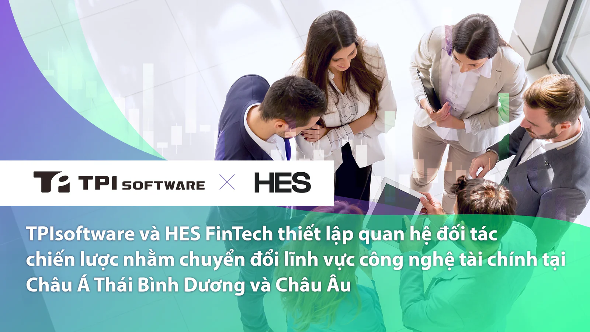

TPIsoftware, công ty phần mềm doanh nghiệp tiên phong dẫn đầu trong lĩnh vực chuyển đổi kỹ thuật số, gần đây đã công bố mối quan hệ đối tác chiến lược với HES FinTech, nhà cung cấp nền tảng cho vay kỹ thuật số hàng đầu, nhằm thúc đẩy sự gián đoạn của ngành công nghệ tài chính (fintech) tại khu vực Châu Á - Thái Bình Dương và Châu u thông qua việc tận dụng kiến thức chuyên môn về công nghệ tài chính và hiểu biết sâu sắc về thị trường hai bên.

Lần hợp tác này là một bước tiến quan trọng trong chiến lược mở rộng hoạt động toàn cầu của TPIsoftware và HES FinTech. Với các chi nhánh tại Singapore, Việt Nam, Nhật Bản và Thái Lan, TPIsoftware cũng đã và đang mở rộng mạng lưới của mình tại Indonesia, Campuchia và xa hơn nữa. TPIsoftware sẵn sàng mở rộng phạm vi tiếp cận toàn cầu sang Châu u, đồng thời HES FinTech có thể thâm nhập thị trường châu Á.

Sức hợp tác này nhằm mục đích mang lại sự đổi mới hệ sinh thái tài chính cho lĩnh vực BFSI với sự tích hợp sẵn của [digiRunner, nền tảng quản lý API doanh nghiệp](https://www.tpisoftware.com/vn/products/digirunner) của TPIsoftware và [nền tảng cho vay dưới dạng dịch vụ Loanbox](https://hesfintech.com/platform/) của HES FinTech. Nền tảng tích hợp sẵn đảm bảo nâng cao quy trình cho vay và trao đổi dữ liệu với hiệu quả, bảo mật, tính linh hoạt và trải nghiệm khách hàng được tối ưu hóa.

LoanBox là một nền tảng cho vay toàn diện với bộ công cụ tài chính và bí quyết ngành hoàn chỉnh. Được thiết kế cho những người cho vay thay thế và ngân hàng mới, các mô-đun của nền tảng bao gồm khởi tạo khoản vay, quản lý, dịch vụ, thu nợ, báo cáo thông tin kinh doanh (BI) và đánh giá AI. digiRunner, nền tảng APIM bản địa đám mây được chứng nhận theo tiêu chuẩn AWS và ISO 27001, đáp ứng các tiêu chuẩn Ngân hàng mở với khả năng tuân thủ quy định và bảo mật mạnh mẽ, điều này rất quan trọng đối với phần mềm cho vay. digiRunner không chỉ đóng vai trò là nền tảng trung gian mà còn là trụ cột giúp tối ưu hóa các dịch vụ của Loanbox, cho phép tích hợp liền mạch với các tổ chức tài chính và văn phòng tín dụng, đồng thời cung cấp các tính năng nâng cao như xác thực và ủy quyền để xử lý dữ liệu tài chính nhạy cảm.

Mối quan hệ hợp tác này bắt đầu sau dự án hợp tác xuyên quốc gia gần đây ở Thái Lan. Tại đây, họ đã phát triển hệ thống quản lý khoản vay dựa trên đám mây cho một công ty tài chính tiêu dùng địa phương nhằm hỗ trợ quá trình hiện đại hóa cốt lõi và đổi mới mô hình kinh doanh, chứng minh khả năng sản phẩm đã được thị trường kiểm chứng của TPIsoftware và HES FinTech.

Ivan Kovalenko, Đồng sáng lập HES FinTech cho biết: "Thông qua sự hợp tác cùng TPIsoftware, chúng tôi có thể tích hợp liền mạch LoanBox và các hệ thống quan trọng khác vào môi trường CNTT của các khách hàng lớn nhất của mình. Quan hệ hợp tác này mở đường cho việc thử nghiệm sản phẩm cho vay nhanh chóng, thu thập phản hồi của người dùng ngay lập tức và giao tiếp dữ liệu hiệu quả giữa các hệ thống".

Ben Yao, Giám đốc điều hành của TPIsoftware, cho biết thêm: "Chúng tôi rất vui mừng được đồng hành cùng các doanh nghiệp cho vay để duy trì tính cạnh tranh, tuân thủ và đáp ứng nhu cầu thị trường với HES FinTech, chuyên gia fintech hàng đầu khu vực. Cùng nhau, chúng tôi sẽ mang lại giá trị vô song cho lĩnh vực fintech".

**Giới thiệu về [TPIsoftware](/vi)**

TPIsoftware là công ty phần mềm FinTech số 1 tại Đài Loan cung cấp hai sản phẩm độc quyền – Nền tảng tích hợp doanh nghiệp dưới dạng Dịch vụ [DigiFusion](/vi/products#digifusion) và sản phẩm hỗ trợ AI [SysTalk.ai](/vi/products#systalkai) nhằm thúc đẩy quá trình chuyển đổi kỹ thuật số. Nhận được sự tin tưởng của khách hàng trong ngành, TPIsoftware cũng chuyên về các lĩnh vực như InsurTech, GIS, AIoT, chăm sóc sức khỏe thông minh, UI/UX, v.v.

**Thông tin liên hệ cho tổ chức truyền thông:**

**TPIsoftware**\
Peggy Tsai\
+886-2-2658-0508 #1606\
peggy.tsai@tpisoftware.com\
[Đăng ký nhận bản tin](/vi/subscribe) [|](https://www.facebook.com/TPIsoftware) [Website](/vi) | [Facebook](https://www.facebook.com/TPIsoftwareGlobal) | [LinkedIn](https://www.linkedin.com/company/tpisoftware)
