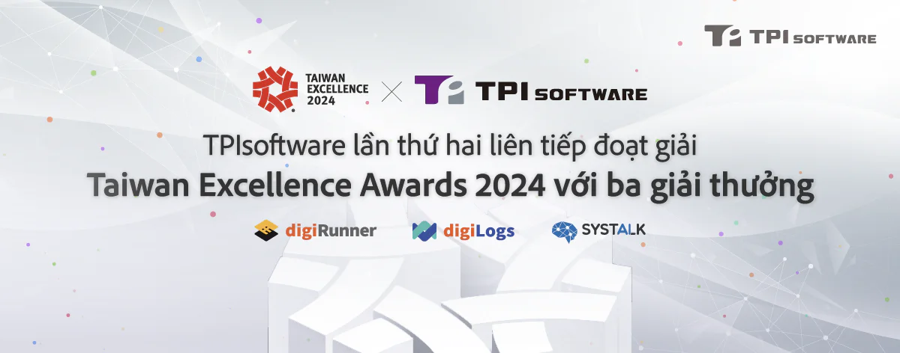

TPIsoftware, công ty tiên phong trong ngành phần mềm, tự hào tuyên bố giành chiến thắng liên tiếp tại lễ trao giải thưởng danh giá Taiwan Excellence Awards lần thứ 32. Công ty đã giành được ba giải thưởng cao quý cho các sản phẩm và giải pháp phần mềm độc quyền tiên tiến nhất của họ: "Nền tảng quản lý API doanh nghiệp digiRunner", "Nền tảng quản lý nhật ký toàn diện digiLogs" và "Giải pháp xử lý đơn yêu cầu bảo hiểm sử dụng Trí tuệ Nhân tạo SysTalk.ai". Thành tích đáng chú ý này giúp khẳng định vị thế dẫn đầu của TPIsoftware trong lĩnh vực phần mềm của Đài Loan và một lần nữa khẳng định sự cống hiến của TPIsoftware cho hoạt động đổi mới phần mềm. Được biết đến là giải Oscar của các ngành công nghiệp Đài Loan, Giải Taiwan Excellence Awards vinh danh những sản phẩm tốt nhất ở Đài Loan, cho thấy được sự đổi mới, với 182 bài dự thi từ 320 doanh nghiệp được vinh danh vì thành tích xuất sắc của họ trong năm nay.

Yilan Yeh, Giám đốc điều hành của TPIsoftware cho biết: "Các giải thưởng liên tiếp của chúng tôi tại Taiwan Excellence Awards là minh chứng cho cam kết vững chắc của chúng tôi trong hoạt động phát triển phần mềm có khả năng cạnh tranh toàn cầu. Hiện tại, chúng tôi đang mở rộng sự hiện diện toàn cầu bằng cách xây dựng các liên minh chiến lược tại các thị trường trọng điểm trên khắp khu vực Châu Á - Thái Bình Dương và Châu Âu".

Được đánh giá cao trong hai năm liền, digiRunner của TPIsoftware nổi bật với vai trò là nền tảng quản lý API độc quyền duy nhất tại Đài Loan tuân thủ các tiêu chuẩn Ngân hàng mở và Chính quyền mở. Phù hợp cho các ngành muốn quản lý hiệu quả các API lớn như tài chính, chăm sóc sức khỏe và chính quyền, digiRunner hỗ trợ doanh nghiệp xây dựng các hệ sinh thái dịch vụ kết nối và đổi mới, đồng thời đảm bảo việc cung cấp dịch vụ liên tục thông qua thiết kế chức năng độc đáo và công nghệ đã được cấp bằng sáng chế. Ví dụ, sandbox dành cho thử nghiệm mô phỏng API giúp phát triển song song giữa phía máy chủ và phía giao diện người dùng để triển khai dịch vụ nhanh chóng; bốn cơ chế tích hợp "Bộ nhớ đệm điều chỉnh API", "Cân bằng tải cổng giao tiếp", "API không chặn" và "Container hóa" đảm bảo 100% không bị gián đoạn để nâng cao hiệu suất hoạt động.

digiLogs, một sản phẩm liên tiếp đoạt giải thưởng khác của TPIsoftware, có khả năng mạnh ở công năng tăng cường quản trị CNTT doanh nghiệp với các tính năng quản lý nhật ký ưu việt. Các tính năng như Phát hiện và Phản ứng tại Thiết bị Đầu cuối (EDR) cung cấp cấu trúc liên kết trực quan để giám sát thiết bị đầu cuối nhằm hỗ trợ xác định vấn đề, với Phân tích nguyên nhân gốc (RCA) tiếp tục mang lại khả năng quan sát toàn diện hệ thống để giải quyết sự cố ngay lập tức. Với chứng nhận ISO 27001, digiLogs đáp ứng các yêu cầu quản lý và kiểm toán của doanh nghiệp.

TPIsoftware đã đánh dấu sự bước chân vào lĩnh vực giải pháp hỗ trợ sử dụng trí tuệ nhân tạo thông qua SysTalk.ai. Giải pháp xử lý đơn yêu cầu bảo hiểm do AI cung cấp khai thác phân tích văn bản AI và NLU để hợp lý hóa quy trình yêu cầu bồi thường cho ngành bảo hiểm. Ngoài ra còn có thêm tính năng SysTalk.ICR cung cấp công nghệ OCR được hỗ trợ bởi AI để xử lý tài liệu tự động.

TPIsoftware một lần nữa gây chú ý nhờ công nghệ phức tạp và tư duy cầu tiến, đưa TPIsoftware trở thành công ty phần mềm hàng đầu tại Đài Loan.

**Giới thiệu về [TPIsoftware](/vi)**

TPIsoftware là công ty phần mềm FinTech số 1 tại Đài Loan cung cấp hai sản phẩm độc quyền – Nền tảng tích hợp doanh nghiệp dưới dạng Dịch vụ [DigiFusion](/vi/products#digifusion) và sản phẩm hỗ trợ AI [SysTalk.ai](/vi/products#systalkai) nhằm thúc đẩy quá trình chuyển đổi kỹ thuật số. Nhận được sự tin tưởng của khách hàng trong ngành, TPIsoftware cũng chuyên về các lĩnh vực như InsurTech, GIS, AIoT, chăm sóc sức khỏe thông minh, UI/UX, v.v.

**Thông tin liên hệ cho tổ chức truyền thông:**

**TPIsoftware**\
Peggy Tsai\
+886-2-2658-0508 #1606\
peggy.tsai@tpisoftware.com\
[Đăng ký nhận bản tin](/vi/subscribe) [|](https://www.facebook.com/TPIsoftware) [Website](/vi) | [Facebook](https://www.facebook.com/TPIsoftwareGlobal) | [LinkedIn](https://www.linkedin.com/company/tpisoftware)
